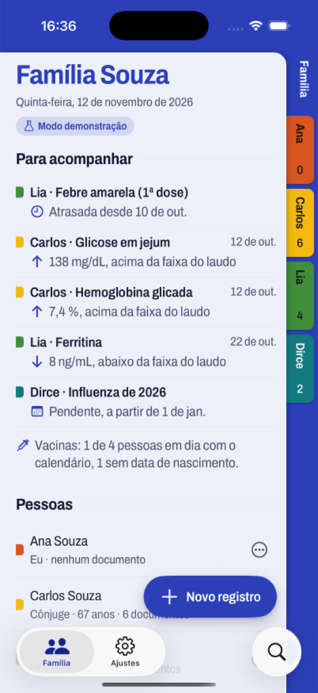
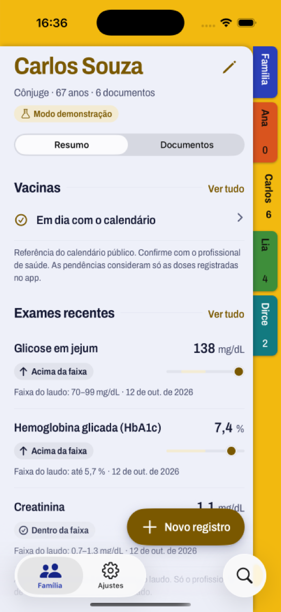
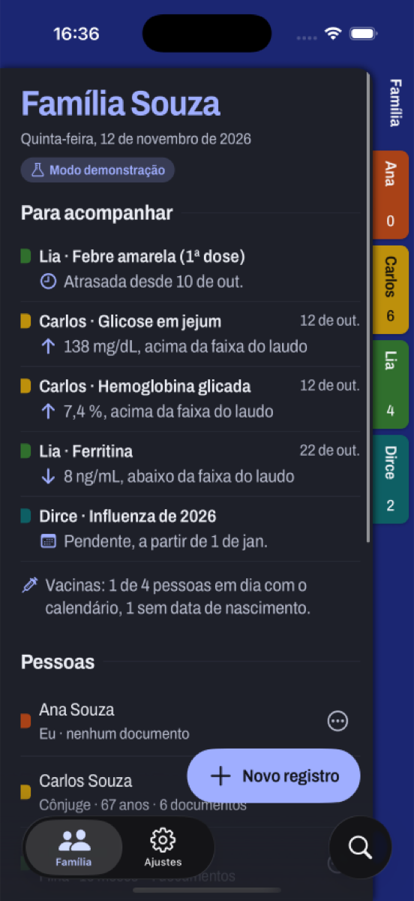

# Prontuário da Família

Um prontuário de saúde particular para a família inteira, no celular. Exames, receitas, laudos e carteiras de vacina costumam ficar espalhados entre clínicas, laboratórios e consultórios; aqui a própria família guarda tudo num lugar só e acompanha a saúde de cada pessoa e de todos juntos.

<p align="center">
  
  
  
</p>

> [!IMPORTANT]
> O app organiza informações; ele **não faz diagnóstico nem substitui a orientação de um profissional de saúde**. Estados como "acima da faixa" comparam o valor com a faixa impressa no próprio laudo.

## O que ele faz

- **Pasta com divisórias.** Cada pessoa da família tem uma divisória de cor própria. Tocar numa aba troca de pessoa na mesma tela.
- **Leitura de documentos no aparelho.** Fotografe ou anexe um laudo: o app sugere tipo, data, laboratório, profissional (com CRM) e os exames com valor e faixa de referência. A leitura usa Apple Vision no iOS e ML Kit no Android, sem enviar o documento para fora do celular, e nada é salvo sem a revisão da pessoa ([ADR 0001](docs/adr/0001-ocr-no-aparelho.md)).
- **Saúde individual.** Exames com gráfico de tendência, vacinas pelo calendário do PNI conforme a idade, medicamentos em uso e sinais vitais.
- **Saúde da família.** O painel "Para acompanhar" reúne o que pede atenção, como exames fora da faixa e vacinas pendentes, e mostra quantas pessoas estão em dia com o calendário vacinal.
- **Modo demonstração.** Sem backend configurado, os dados ficam só no aparelho e dá para carregar uma família de exemplo.

## Como rodar

Pré-requisitos: Node 22, Xcode (para iOS) ou Android Studio (para Android).

```bash
npm ci
npx expo run:ios       # ou: npx expo run:android
```

O app tem um módulo nativo próprio (leitura de documentos em `modules/document-text`), por isso roda em **development build**, não no Expo Go. As pastas `ios/` e `android/` são geradas pelo Expo (CNG) e não ficam no repositório.

Sem `.env`, o app abre no modo demonstração. Para usar o backend, copie `.env.example` para `.env` e siga o [guia do backend](docs/BACKEND.md) (Supabase com RLS por família).

### Verificações

```bash
npm run check   # typecheck + lint + testes (o mesmo que a CI roda)
```

## Stack

Expo SDK 58 · React Native 0.88 · Expo Router · TypeScript estrito · TanStack Query · Supabase (Postgres com RLS e testes pgTAP). A organização segue Clean Architecture com Feature-Sliced Design, e as fronteiras entre camadas são checadas pelo lint ([arquitetura](docs/ARCHITECTURE.md)).

## Documentação

| Documento | Conteúdo |
|---|---|
| [PRODUCT.md](docs/PRODUCT.md) | Para quem é o produto e o que ele promete |
| [DESIGN.md](DESIGN.md) e [DESIGN_SYSTEM.md](docs/DESIGN_SYSTEM.md) | O visual "Pasta com divisórias" e os componentes |
| [ARCHITECTURE.md](docs/ARCHITECTURE.md) | Camadas, decisões e convenções |
| [ROADMAP.md](docs/ROADMAP.md) | O que já existe e o que vem depois |
| [docs/features](docs/features) | Especificações das funcionalidades |

## Contribuindo

Contribuições são bem-vindas. Leia o [guia de contribuição](CONTRIBUTING.md) e o [código de conduta](CODE_OF_CONDUCT.md). Para começar, procure issues com a etiqueta `good first issue`. Falhas de segurança seguem a [política de segurança](SECURITY.md), nunca uma issue pública.

## Licença

Código sob a [Licença Apache 2.0](LICENSE). A fonte Archivo, embutida em `assets/fonts`, é distribuída sob a [SIL Open Font License 1.1](assets/fonts/Archivo-OFL.txt).
