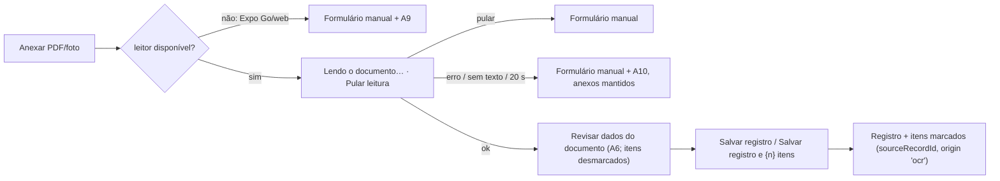

# Leitura de documentos no aparelho (OCR + parser) — desenho técnico

> Versão 0.2 · 11/11/2026 · dono: Arquitetura mobile (OCR e parser) · status: **proposta para implementação**; nada disto está em `src/` ainda.
> 0.2 (11/11/2026, revisão de consistência da Fase A): alinhado à spec da Head de Produto (seleção, limites, copy, vocabulário da faixa, códigos de vacina, entity `vaccine`). Ver "Alinhamento com a spec". Plano de implementação: [v0.2-plano-implementacao.md](v0.2-plano-implementacao.md).
> Decisões de origem (Douglas, 11/11/2026, não reabrir): OCR **no aparelho** (Apple Vision/PDFKit no iOS, ML Kit no Android, módulo Expo local em `modules/`); Expo Go/web caem no preenchimento manual; modo demo usa texto simulado; acompanhamento de exames, vacinas, medicamentos e sinais vitais nesta rodada.
> Decisão registrada em [ADR 0001](../adr/0001-ocr-no-aparelho.md). Tabelas e LGPD do backend: [dados-saude-backend.md](dados-saude-backend.md).

## Resumo

| Peça | Onde mora | O que faz |
|---|---|---|
| Módulo nativo `DocumentText` | `modules/document-text/` (fora de `src/`, autolinking do Expo) | `extractText(uri, mimeType, options)` → texto por página. iOS: PDFKit (camada de texto) e Vision (`VNRecognizeTextRequest`, `pt-BR`). Android: `PdfRenderer` (texto no Android 15+, senão rasteriza) e ML Kit Text Recognition v2 (modelo latino embutido). |
| Porta `DocumentTextExtractor` | `src/features/read-document/domain/document-text.ts` | Contrato puro: `extract(file) → ExtractedText \| null`. |
| Adaptadores | `src/features/read-document/data/` | nativo (com cancelamento e timeout), indisponível (Expo Go/web → `null`), demo (texto fictício pelo nome do arquivo). |
| Parser | `src/features/read-document/domain/parse-health-document.ts` | `parseHealthDocument(text, { today, sex })` → sugestões com confiança (tipo, título, data, local, profissional, exames, vacinas, medicamentos). TypeScript puro. |
| Catálogo de analitos | `src/entities/measurement/domain/analyte-catalog.ts` | 36 analitos + 4 sinais vitais, aliases normalizados, unidade canônica, conversões triviais, faixa plausível. |
| Caso de uso e hook | `read-document/domain/read-document.ts`, `read-document/model/hooks.ts` | Lê os anexos em sequência, junta o texto, gera sugestões; cancela ao sair da tela. |
| Revisão e gravação | widget `document-review` + `features/add-record` estendido | O usuário confirma; só o que ele confirma é salvo (registro + medições/vacinas/medicamentos com `sourceRecordId`). |

**Princípios clínicos** (vêm da persona Head de Produto clínico e valem como critério de aceite):
1. O app **nunca diagnostica**. "Acima/abaixo da faixa do laudo" compara o valor com a faixa **impressa no próprio laudo**; sem faixa única e clara → `flag: 'none'` ("Sem faixa no laudo").
2. Nada é salvo sem confirmação. **Todo item encontrado começa desmarcado**, qualquer que seja a confiança (S4 e F1.4 da spec).
3. Na dúvida, o parser **não sugere** (valor implausível, unidade estranha, faixa ambígua, sexo não informado) e explica com um aviso. Preferimos campo vazio a dado errado.
4. O texto extraído não sai do aparelho, não vai para log e não é persistido (§g).

**Verificado nesta fase** (fora de `src/`, em rascunho): o parser de referência e os 9 textos de exemplo rodaram no Node 22 e passaram em `tsc --strict --noUncheckedIndexedAccess`. As saídas esperadas do §e foram geradas por essa execução, não digitadas, e os dois blocos de teste do §e foram executados a partir deste documento (com um shim mínimo de `expect`). Também rodaram 37 asserções de casos de borda. Os adaptadores, a porta e o caso de uso passaram no `tsc` contra os tipos reais do projeto. O ESLint do projeto não acusou violação de fronteira FSD; o único erro foi "módulo não encontrado", porque os arquivos ainda não existem. O Swift (motor completo e o módulo contra um stub da DSL) passou em `swiftc -typecheck` com o SDK do iOS 26.5, alvo iOS 16.4. O **Kotlin não foi compilado** (não há `kotlinc`/Gradle fora de um build): foi revisado contra o código-fonte do `expo-modules-core` 58.1.0 instalado.

### Alinhamento com a spec da Head de Produto (revisão de consistência, 11/11/2026)

A spec `docs/features/v0.2-saude-da-familia.md` prevalece sobre este documento em comportamento, copy e limites. A revisão cruzada da Fase A trocou o que divergia. **O código de referência dos apêndices foi verificado antes desses ajustes.** Ao mover para `src/`, aplique a lista abaixo e rode de novo os testes do §e:

| # | O que muda | Antes | Agora (fonte) |
|---|---|---|---|
| 1 | Seleção dos itens na revisão | `high`/`medium` marcados | **todos desmarcados** (S4, F1.4) |
| 2 | Limites da leitura | 10 páginas por arquivo, 5 arquivos, 60 s por arquivo | **5 páginas no total da leitura e 20 s no total** (F1.1, F1.2). O teto nativo de 20 páginas continua como proteção. Estourou os 20 s: para, mantém os anexos e abre o formulário manual com A10 |
| 3 | Início da leitura | botão "Preencher com o documento" | **começa sozinha ao anexar**, com "Pular leitura" (fluxo da F1) |
| 4 | Vocabulário da faixa | `'low' \| 'normal' \| 'high' \| 'unknown'` | **`'low' \| 'in' \| 'high' \| 'none'`**, os mesmos literais de `ReferenceState` do `shared/ui` (DESIGN.md). "normal" é palavra vetada (§3.2) e não deve existir nem como valor interno exibível |
| 5 | Linha sem unidade ou sem valor legível | `unit-missing` sugeria o valor na unidade canônica; `value-unreadable`/`value-implausible`/`value-censored` só viravam aviso | **a linha aparece na revisão com "Confira" e sem valor preenchido** (F1.8). `LabResultSuggestion.value` e `.unit` passam a ser `number \| null` e `string \| null`; avisos com `label` viram linhas desse tipo |
| 6 | Nome divergente (A11) | o parser não lia o paciente | `HealthDocumentSuggestions.patientName: Suggestion<string> \| null` (linha "Paciente:"/"Nome:"). Só em memória, nunca salvo (P4). A comparação com o primeiro nome da pessoa (sem acento e sem caixa) fica em `readDocument` |
| 7 | Data antes do nascimento (F1.6) | não tratada | `readDocument` recebe `birthDate` e descarta a data sugerida anterior a ele, como faz com a futura ("Confira a data") |
| 8 | Códigos de vacina | `vip`, `pneumococcal_conjugate`, `meningococcal_c`, `meningococcal_acwy`, `hpv` | `ipv`, `pcv10`/`pcv20`, `menc`, `menacwy`, `hpv4`, + `rsv` (calendário PNI §2). Entity `vaccine`, não `vaccination` |
| 9 | `medicationEndOn` (R6) | no parser | em `entities/medication/domain` (regra de domínio usada também pelo formulário manual da F4). O parser só lê a duração (`readDuration`) |
| 10 | "Ver texto lido" na revisão | sanfona com o texto completo | **removido**: fora da spec e expõe o texto inteiro na tela. A evidência é o trecho lido de cada linha (F1, passo 2). `ReadDocumentResult` não devolve `text` |
| 11 | Leitor no modo demo | — | igual ao §b.4 (dev build em demo usa o nativo). A spec F1.12 foi ajustada para "modo demo **sem** módulo nativo" |

---

## (a) Módulo nativo local `modules/document-text`

### a.1 Criação e estrutura

O AGENTS.md manda não confiar na memória: os pontos abaixo foram conferidos na doc do SDK atual (`create-expo-module`, *Module API*, *Module config*, *Autolinking*) e no código do `expo-modules-core` 58.1.0 e do `expo-module-template` 58.0.9.

```bash
# uma vez, na raiz do projeto (o projeto usa npm: package-lock.json)
npx create-expo-module@latest --local
#   nome do módulo local: document-text
#   nome nativo:          DocumentText
#   pacote Android:       expo.modules.documenttext
#   plataformas:          Android e Apple (sem web)
#   recursos:             AsyncFunction
# depois substitua o conteúdo gerado pelos arquivos de referência abaixo
```

- `--local` cria em `modules/` (padrão de `expo.autolinking.nativeModulesDir`), **não** gera `package.json` nem barrel `index.ts` (use `--barrel` se quiser) e usa as dependências do app.
- O autolinking procura módulos locais em `./modules/` (passo 3 da busca, depois de `react-native.config.js` e `searchPaths`). O módulo precisa de `expo-module.config.json` com a plataforma listada em `platforms`; se a plataforma faltar, ele é ignorado em silêncio.
- **CNG**: `ios/` e `android/` continuam gerados. `npx expo run:ios|android` (ou `npx expo prebuild`) roda o CocoaPods/Gradle, que chamam o autolinking e incluem o módulo. Nada é editado à mão nos projetos nativos e **não há config plugin**: o módulo não pede permissão nem chave no Info.plist/AndroidManifest (ler um arquivo que o app já copiou para o cache não exige permissão; o modelo do ML Kit vai embutido, sem `meta-data`).
- Expo Go não tem o módulo: `requireOptionalNativeModule('DocumentText')` devolve `null`. Na web, a versão `.web` do `requireOptionalNativeModule` também devolve `null`; não precisa de `DocumentTextModule.web.ts`.
- *Inline modules* (experimental desde o SDK 56, Kotlin/Swift dentro de `src/`) foram descartados: a doc não diz se aceitam dependência Gradle/CocoaPods (precisamos do ML Kit) e a API "pode mudar".

```
modules/document-text/
├── expo-module.config.json
├── src/
│   └── DocumentTextModule.ts          # tipos + requireOptionalNativeModule
├── ios/
│   ├── DocumentText.podspec
│   ├── DocumentTextModule.swift       # DSL do Expo (fina)
│   └── DocumentTextEngine.swift       # PDFKit + Vision, sem Expo (testável à parte)
└── android/
    ├── build.gradle                   # + ML Kit text-recognition (embutido)
    └── src/main/
        ├── AndroidManifest.xml        # o do template (vazio)
        └── java/expo/modules/documenttext/
            ├── DocumentTextModule.kt  # DSL do Expo (fina)
            └── DocumentTextEngine.kt  # PdfRenderer + ML Kit
```

`expo-module.config.json`:

```json
{
  "platforms": ["apple", "android"],
  "apple": { "modules": ["DocumentTextModule"] },
  "android": { "modules": ["expo.modules.documenttext.DocumentTextModule"] }
}
```

### a.2 API JS (contrato exato)

`modules/document-text/src/DocumentTextModule.ts`:

```ts
import { requireOptionalNativeModule } from 'expo';

export type DocumentTextEngineName = 'apple-vision' | 'mlkit-latin';
export type DocumentTextSource = 'pdf-text' | 'ocr';

export interface NativeDocumentTextPage {
  index: number;
  text: string;
  source: DocumentTextSource;
}

export interface NativeDocumentText {
  engine: DocumentTextEngineName;
  /** Total de páginas do arquivo (1 para imagem). */
  pageCount: number;
  /** true se parou antes do fim (limite de páginas ou de 200 mil caracteres). */
  truncated: boolean;
  pages: NativeDocumentTextPage[];
}

export interface ExtractTextOptions {
  /** Padrão 10, máximo 20. */
  maxPages?: number;
  /** Permite cancelar com `cancel(requestId)`. */
  requestId?: string;
}

export interface DocumentTextNativeModule {
  /** `uri`: file:// (iOS e Android) ou content:// (Android). Rejeita com `code` ERR_DOCUMENT_TEXT_*. */
  extractText(uri: string, mimeType: string, options: ExtractTextOptions): Promise<NativeDocumentText>;
  /** Pede a parada; o nativo confere entre páginas e rejeita com ERR_DOCUMENT_TEXT_CANCELLED. */
  cancel(requestId: string): void;
}

/** null no Expo Go, na web e em qualquer build sem o módulo: o app cai no preenchimento manual. */
export default requireOptionalNativeModule<DocumentTextNativeModule>('DocumentText');
```

Exemplo de resposta (PDF de 2 páginas: a 1ª com camada de texto e a 2ª escaneada):

```json
{ "engine": "apple-vision", "pageCount": 2, "truncated": false,
  "pages": [ { "index": 0, "text": "LABORATÓRIO HORIZONTE…", "source": "pdf-text" },
             { "index": 1, "text": "Plaquetas  245.000/mm³…", "source": "ocr" } ] }
```

**Como cada página é lida**

| Entrada | iOS | Android |
|---|---|---|
| PDF com camada de texto (laudo gerado pelo sistema do laboratório) | `PDFPage.string` | `PdfRenderer.Page.getTextContents()` (API 35+, Android 15). Abaixo do 15 a API não existe: a página é rasterizada e vai para o OCR. |
| PDF escaneado (página com menos de 30 caracteres de texto) | rasteriza com CoreGraphics (lado maior 2200 px, fundo branco, rotação da página respeitada) → Vision | `PdfRenderer.Page.render` (2200 px, `ARGB_8888`, fundo branco) → ML Kit |
| Foto (JPEG, PNG, HEIC/HEIF, WEBP) | ImageIO reduz para ≤ 3000 px e aplica a orientação EXIF → Vision | `BitmapFactory` com `inSampleSize` (≤ ~3000 px) + rotação EXIF (`android.media.ExifInterface`) → ML Kit |

Vision: `recognitionLevel = .accurate`, `recognitionLanguages = ["pt-BR", "en-US"]` (pt-BR é suportado desde a revisão 2; a revisão 3, padrão no iOS 16+, é a não depreciada), `usesLanguageCorrection = true`, `customWords` com termos de laudo. ML Kit não tem parâmetro de idioma: o reconhecedor latino cobre o português.

**Ordem de leitura.** Vision e ML Kit devolvem blocos sem garantia de ordem; laudo é tabela (nome · valor · unidade · referência). Os dois motores usam o mesmo algoritmo: ordena as linhas pelo centro vertical, junta na mesma fila as que estão a até meia altura da primeira e ordena cada fila da esquerda para a direita, separando colunas com **dois espaços**. O parser conta com isso (e aceita espaço simples, que é o que a camada de texto do PDF costuma trazer).

### a.3 Limites

| Limite | Valor | Por quê |
|---|---|---|
| Tamanho do arquivo | 20 MB | igual ao anexo (`MAX_ATTACHMENT_BYTES`, bucket); conferido de novo no nativo |
| Páginas por leitura | **5 no total** (`READ_DOCUMENT_MAX_PAGES`, no caso de uso, que passa ao nativo o saldo de páginas em `maxPages`); o nativo mantém o teto de 20 | spec F1.1 ("até as 5 primeiras páginas"); OCR `accurate` leva ~0,5–2 s por página |
| Arquivos por leitura | 5 (`READ_DOCUMENT_MAX_FILES`), limitados também pelo saldo de páginas | um registro com várias fotos de páginas |
| Texto total | 200 mil caracteres (`truncated: true` se cortar) | protege a memória do JS |
| Imagem para OCR | lado maior ≤ 3000 px (foto) / 2200 px (página de PDF) | caractere de laudo fica ≥ 16 px (recomendação do ML Kit) sem estourar memória (~14 MB por página) |
| Timeout | **20 s para a leitura inteira** (`READ_DOCUMENT_TIMEOUT_MS`, em `readDocument`, que aborta o `signal` repassado ao adaptador) | spec F1.2. Ao estourar, chama `cancel`, libera a tela e abre o formulário manual com A10; o nativo para na próxima página |
| Cancelamento | `cancel(requestId)`; conferido **entre páginas** | uma página em OCR termina antes de parar (≤ ~2 s) |
| Concorrência | iOS: fila serial própria (`runOnQueue`); Android: `Coroutine` + `Dispatchers.Default` | a fila padrão de `AsyncFunction` é **serial e compartilhada por todos os módulos** (iOS: `DispatchQueue` `expo.modules.AsyncFunctionQueue`; Android: um `HandlerThread`). OCR nela travaria SecureStore, FileSystem etc. Conferido no código do `expo-modules-core` 58.1.0. |

### a.4 Erros

O nativo rejeita com `code` estável e descrição técnica **sem conteúdo do documento**. O adaptador traduz o `code` para `DomainError` em pt-BR e nunca repassa a mensagem nativa. No iOS, `FunctionCallException` repassa o `code` da causa (`AnyFunctionDefinition.swift`). No Android, `CodedException` passou a enviar o `code` ao JS depois do 58.0.12 (PR #51036); o projeto usa o 58.1.0.

| `code` nativo | `DomainError.code` | Mensagem (pt-BR) |
|---|---|---|
| `ERR_DOCUMENT_TEXT_FILE_NOT_FOUND` | `ocr/file-not-found` | Não encontramos o arquivo. Anexe de novo e tente outra vez. |
| `ERR_DOCUMENT_TEXT_UNSUPPORTED_TYPE` | `ocr/unsupported-type` | Este tipo de arquivo não pode ser lido. Preencha os campos manualmente. |
| `ERR_DOCUMENT_TEXT_TOO_LARGE` | `ocr/too-large` | O arquivo passa de 20 MB. |
| `ERR_DOCUMENT_TEXT_PDF_LOCKED` | `ocr/pdf-locked` | Este PDF está protegido por senha. Preencha os campos manualmente. |
| `ERR_DOCUMENT_TEXT_UNREADABLE` | `ocr/unreadable` | Não conseguimos ler este arquivo. Preencha os campos manualmente. |
| `ERR_DOCUMENT_TEXT_CANCELLED` | `ocr/cancelled` | Leitura cancelada. (a UI não mostra erro) |
| `ERR_DOCUMENT_TEXT_OCR_FAILED` e qualquer outro | `ocr/failed` | Não foi possível ler o documento. Preencha os campos manualmente. |
| (timeout no JS) | `ocr/timeout` | A leitura demorou demais. Preencha os campos manualmente ou tente uma foto mais nítida. |

### a.5 iOS (Swift)

`ios/DocumentText.podspec` (do template local do SDK 58, com os frameworks explícitos):

```ruby
Pod::Spec.new do |s|
  s.name           = 'DocumentText'
  s.version        = '1.0.0'
  s.summary        = 'Extração de texto de PDF e imagem no aparelho (PDFKit + Vision)'
  s.description    = 'Módulo local do Prontuário da Família'
  s.author         = ''
  s.homepage       = 'https://docs.expo.dev/modules/'
  s.platforms      = { :ios => '16.4' }
  s.source         = { git: '' }
  s.static_framework = true
  s.dependency 'ExpoModulesCore'
  s.frameworks     = 'Vision', 'PDFKit'
  s.pod_target_xcconfig = { 'DEFINES_MODULE' => 'YES' }
  s.source_files   = "**/*.{h,m,mm,swift,hpp,cpp}"
end
```

`ios/DocumentTextModule.swift` (a checagem de tipos usou um stub mínimo da DSL no lugar do `ExpoModulesCore`):

```swift
import ExpoModulesCore

struct ExtractTextOptions: Record {
  @Field var maxPages: Int = DocumentTextEngine.defaultMaxPages
  @Field var requestId: String?
}

public class DocumentTextModule: Module {
  private let engine = DocumentTextEngine()
  private let cancellations = CancellationRegistry()
  // Fila própria: a fila padrão de AsyncFunction do Expo é serial e compartilhada por todos os módulos.
  private let queue = DispatchQueue(label: "br.com.prontuariofamilia.document-text", qos: .userInitiated)

  @DefinitionBuilder
  public func definition() -> ModuleDefinition {
    Name("DocumentText")

    AsyncFunction("extractText") { (uri: URL, mimeType: String, options: ExtractTextOptions) throws -> [String: Any] in
      let requestId = options.requestId
      defer { self.cancellations.clear(requestId) }
      let result: DocumentTextResult
      do {
        result = try self.engine.extract(url: uri, mimeType: mimeType, maxPages: options.maxPages) {
          self.cancellations.isCancelled(requestId)
        }
      } catch let failure as DocumentTextFailure {
        throw failure.exception
      }
      return [
        "engine": "apple-vision",
        "pageCount": result.pageCount,
        "truncated": result.truncated,
        "pages": result.pages.map { ["index": $0.index, "text": $0.text, "source": $0.source] },
      ]
    }.runOnQueue(queue)

    Function("cancel") { (requestId: String) in
      self.cancellations.cancel(requestId)
    }
  }
}

extension DocumentTextFailure {
  /// Código estável para o JS; a descrição é técnica e nunca contém texto do documento.
  var exception: Exception {
    switch self {
    case .fileNotFound: return Exception(name: "DocumentTextFileNotFound", description: "Arquivo não encontrado.", code: "ERR_DOCUMENT_TEXT_FILE_NOT_FOUND")
    case .unsupportedType: return Exception(name: "DocumentTextUnsupportedType", description: "Tipo de arquivo não suportado.", code: "ERR_DOCUMENT_TEXT_UNSUPPORTED_TYPE")
    case .tooLarge: return Exception(name: "DocumentTextTooLarge", description: "Arquivo maior que 20 MB.", code: "ERR_DOCUMENT_TEXT_TOO_LARGE")
    case .pdfLocked: return Exception(name: "DocumentTextPdfLocked", description: "PDF protegido por senha.", code: "ERR_DOCUMENT_TEXT_PDF_LOCKED")
    case .unreadable: return Exception(name: "DocumentTextUnreadable", description: "Arquivo ilegível.", code: "ERR_DOCUMENT_TEXT_UNREADABLE")
    case .cancelled: return Exception(name: "DocumentTextCancelled", description: "Leitura cancelada.", code: "ERR_DOCUMENT_TEXT_CANCELLED")
    case .ocrFailed: return Exception(name: "DocumentTextOcrFailed", description: "Falha no reconhecimento de texto.", code: "ERR_DOCUMENT_TEXT_OCR_FAILED")
    }
  }
}
```

`ios/DocumentTextEngine.swift` (verificado com `swiftc -typecheck`, SDK do iOS 26.5, alvo `arm64-apple-ios16.4-simulator`, sem avisos):

```swift
import Foundation
import ImageIO
import PDFKit
import UIKit
import Vision

/// Página extraída. `source`: "pdf-text" (camada de texto do PDF) ou "ocr" (Vision).
struct DocumentTextPage {
  let index: Int
  let text: String
  let source: String
}

struct DocumentTextResult {
  let pages: [DocumentTextPage]
  let pageCount: Int
  let truncated: Bool
}

/// Falhas técnicas. Nunca carregam o conteúdo do documento.
enum DocumentTextFailure: Error {
  case fileNotFound
  case unsupportedType
  case tooLarge
  case pdfLocked
  case unreadable
  case cancelled
  case ocrFailed
}

/// Motor sem dependência do Expo: PDF com camada de texto → PDFKit; PDF escaneado ou imagem → Vision.
/// Síncrono e bloqueante: chame fora da thread principal e fora da fila padrão do Expo.
final class DocumentTextEngine {
  static let maxFileBytes = 20 * 1024 * 1024
  static let defaultMaxPages = 10
  static let hardMaxPages = 20
  /// Abaixo disso a camada de texto da página é considerada vazia (PDF escaneado) e a página vai para o OCR.
  static let minPdfTextChars = 30
  static let maxImagePixelSide = 3000
  static let pdfRenderLongSide: CGFloat = 2200
  static let maxTotalChars = 200_000

  private static let imageTypes: Set<String> = ["image/jpeg", "image/png", "image/heic", "image/heif", "image/webp"]
  private static let customWords = [
    "Hemoglobina", "Hematócrito", "Leucócitos", "Plaquetas", "Creatinina", "Triglicerídeos",
    "Ferritina", "Glicada", "HbA1c", "TSH", "Posologia", "Comprimido", "Lote",
  ]

  func extract(url: URL, mimeType: String, maxPages: Int, isCancelled: () -> Bool) throws -> DocumentTextResult {
    let mime = mimeType.lowercased()
    guard mime == "application/pdf" || Self.imageTypes.contains(mime) else { throw DocumentTextFailure.unsupportedType }
    guard url.isFileURL,
          let attributes = try? FileManager.default.attributesOfItem(atPath: url.path),
          let size = (attributes[.size] as? NSNumber)?.intValue
    else { throw DocumentTextFailure.fileNotFound }
    guard size > 0 else { throw DocumentTextFailure.unreadable }
    guard size <= Self.maxFileBytes else { throw DocumentTextFailure.tooLarge }

    if mime == "application/pdf" {
      return try extractPdf(url: url, limit: max(1, min(maxPages, Self.hardMaxPages)), isCancelled: isCancelled)
    }
    if isCancelled() { throw DocumentTextFailure.cancelled }
    let text = try autoreleasepool { try recognize(loadImage(url)) }
    let (clipped, truncated) = Self.clip(text, budget: Self.maxTotalChars)
    return DocumentTextResult(pages: [DocumentTextPage(index: 0, text: clipped, source: "ocr")], pageCount: 1, truncated: truncated)
  }

  // MARK: - PDF

  private func extractPdf(url: URL, limit: Int, isCancelled: () -> Bool) throws -> DocumentTextResult {
    guard let document = PDFDocument(url: url) else { throw DocumentTextFailure.unreadable }
    if document.isLocked && !document.unlock(withPassword: "") { throw DocumentTextFailure.pdfLocked }
    let pageCount = document.pageCount
    guard pageCount > 0 else { throw DocumentTextFailure.unreadable }

    var pages: [DocumentTextPage] = []
    var budget = Self.maxTotalChars
    var truncated = pageCount > limit
    for index in 0..<min(pageCount, limit) {
      if isCancelled() { throw DocumentTextFailure.cancelled }
      guard let page = document.page(at: index) else { continue }
      let layer = (page.string ?? "").trimmingCharacters(in: .whitespacesAndNewlines)
      let usesLayer = layer.count >= Self.minPdfTextChars
      let text = usesLayer ? layer : try autoreleasepool { try recognize(render(page)) }
      let (clipped, cut) = Self.clip(text, budget: budget)
      pages.append(DocumentTextPage(index: index, text: clipped, source: usesLayer ? "pdf-text" : "ocr"))
      budget -= clipped.count
      if cut || budget <= 0 {
        truncated = true
        break
      }
    }
    return DocumentTextResult(pages: pages, pageCount: pageCount, truncated: truncated)
  }

  /// Rasteriza a página com fundo branco (sem alfa: texto preto sobre transparente vira preto sobre preto no OCR).
  private func render(_ page: PDFPage) throws -> CGImage {
    guard let cgPage = page.pageRef else { throw DocumentTextFailure.unreadable }
    let box = cgPage.getBoxRect(.mediaBox)
    let quarterTurn = cgPage.rotationAngle % 180 != 0
    let pageSize = quarterTurn ? CGSize(width: box.height, height: box.width) : box.size
    guard pageSize.width > 0, pageSize.height > 0 else { throw DocumentTextFailure.unreadable }
    // getDrawingTransform não amplia; a escala vem antes, e o transform só aplica rotação e origem.
    let scale = Self.pdfRenderLongSide / max(pageSize.width, pageSize.height)
    let pixelSize = CGSize(width: (pageSize.width * scale).rounded(), height: (pageSize.height * scale).rounded())
    let format = UIGraphicsImageRendererFormat()
    format.scale = 1
    format.opaque = true
    let image = UIGraphicsImageRenderer(size: pixelSize, format: format).image { context in
      UIColor.white.setFill()
      context.fill(CGRect(origin: .zero, size: pixelSize))
      let cg = context.cgContext
      cg.translateBy(x: 0, y: pixelSize.height)
      cg.scaleBy(x: scale, y: -scale)
      cg.concatenate(cgPage.getDrawingTransform(.mediaBox, rect: CGRect(origin: .zero, size: pageSize), rotate: 0, preserveAspectRatio: true))
      cg.drawPDFPage(cgPage)
    }
    guard let cgImage = image.cgImage else { throw DocumentTextFailure.unreadable }
    return cgImage
  }

  // MARK: - Imagem

  /// Decodifica já reduzida (lado maior ≤ 3000 px) e com a orientação EXIF aplicada.
  private func loadImage(_ url: URL) throws -> CGImage {
    guard let source = CGImageSourceCreateWithURL(url as CFURL, nil) else { throw DocumentTextFailure.unreadable }
    let options: [CFString: Any] = [
      kCGImageSourceCreateThumbnailFromImageAlways: true,
      kCGImageSourceCreateThumbnailWithTransform: true,
      kCGImageSourceThumbnailMaxPixelSize: Self.maxImagePixelSide,
      kCGImageSourceShouldCacheImmediately: true,
    ]
    guard let image = CGImageSourceCreateThumbnailAtIndex(source, 0, options as CFDictionary) else {
      throw DocumentTextFailure.unreadable
    }
    return image
  }

  // MARK: - OCR

  private func recognize(_ image: CGImage) throws -> String {
    let request = VNRecognizeTextRequest()
    request.recognitionLevel = .accurate
    request.recognitionLanguages = ["pt-BR", "en-US"]
    request.usesLanguageCorrection = true
    request.customWords = Self.customWords
    do {
      try VNImageRequestHandler(cgImage: image, orientation: .up, options: [:]).perform([request])
    } catch {
      throw DocumentTextFailure.ocrFailed
    }
    let fragments: [TextFragment] = (request.results ?? []).compactMap { observation in
      guard let candidate = observation.topCandidates(1).first else { return nil }
      let box = observation.boundingBox // normalizado, origem embaixo à esquerda
      return TextFragment(text: candidate.string, x: box.minX, centerY: 1 - box.midY, height: box.height)
    }
    return Self.joinInReadingOrder(fragments)
  }

  struct TextFragment {
    let text: String
    let x: CGFloat
    let centerY: CGFloat // de cima para baixo
    let height: CGFloat
  }

  /// Monta linhas: fragmentos com centro vertical a até meia altura do primeiro da linha ficam juntos,
  /// ordenados da esquerda para a direita e separados por dois espaços (colunas de laudo).
  static func joinInReadingOrder(_ fragments: [TextFragment]) -> String {
    var rows: [[TextFragment]] = []
    for fragment in fragments.sorted(by: { $0.centerY < $1.centerY }) {
      if let anchor = rows.last?.first,
         abs(fragment.centerY - anchor.centerY) <= min(fragment.height, anchor.height) * 0.5 {
        rows[rows.count - 1].append(fragment)
      } else {
        rows.append([fragment])
      }
    }
    return rows
      .map { $0.sorted(by: { $0.x < $1.x }).map(\.text).joined(separator: "  ") }
      .joined(separator: "\n")
  }

  static func clip(_ text: String, budget: Int) -> (String, Bool) {
    guard budget > 0 else { return ("", true) }
    return text.count > budget ? (String(text.prefix(budget)), true) : (text, false)
  }
}

/// Pedidos cancelados pelo JS. Thread-safe: `cancel` roda na thread do JS, `isCancelled` na fila do módulo.
final class CancellationRegistry: @unchecked Sendable {
  private let lock = NSLock()
  private var ids = Set<String>()

  func cancel(_ id: String) {
    lock.lock(); defer { lock.unlock() }
    ids.insert(id)
  }

  func isCancelled(_ id: String?) -> Bool {
    guard let id else { return false }
    lock.lock(); defer { lock.unlock() }
    return ids.contains(id)
  }

  func clear(_ id: String?) {
    guard let id else { return }
    lock.lock(); defer { lock.unlock() }
    ids.remove(id)
  }
}
```

Escolhas do iOS:
- `VNRecognizeTextRequest` (iOS 13+) em vez do `RecognizeTextRequest` em Swift (iOS 18+): o alvo mínimo dos módulos Expo do SDK 58 é iOS 16.4 (podspecs do `expo-file-system` e do template). Só a revisão 1/2 e o método de classe `supportedRecognitionLanguages(for:revision:)` estão depreciados; a classe não.
- Renderização por `CGPDFPage.getDrawingTransform` (respeita `/Rotate`) com a escala aplicada antes, porque `getDrawingTransform` não amplia. Fundo branco opaco: página de PDF costuma ter fundo transparente, e Vision veria texto preto sobre preto.
- `autoreleasepool` por página para não acumular bitmaps em PDFs de 10 páginas.

### a.6 Android (Kotlin)

`android/build.gradle`:

```gradle
plugins {
  id 'com.android.library'
  id 'expo-module-gradle-plugin'
}

group = 'expo.modules.documenttext'
version = '0.1.0'

android {
  namespace "expo.modules.documenttext"
  defaultConfig {
    versionCode 1
    versionName "0.1.0"
  }
}

dependencies {
  // Modelo latino EMBUTIDO (~4 MB por ABI; o AAB entrega só a ABI do aparelho). Funciona offline desde o
  // primeiro uso e sem Google Play Services. minSdk do ML Kit: 23 (o app usa 24).
  implementation 'com.google.mlkit:text-recognition:16.0.1'
}
```

`android/src/main/java/expo/modules/documenttext/DocumentTextModule.kt`:

```kotlin
package expo.modules.documenttext

import android.net.Uri
import expo.modules.kotlin.exception.Exceptions
import expo.modules.kotlin.functions.Coroutine
import expo.modules.kotlin.modules.Module
import expo.modules.kotlin.modules.ModuleDefinition
import expo.modules.kotlin.records.Field
import expo.modules.kotlin.records.Record
import kotlinx.coroutines.Dispatchers
import kotlinx.coroutines.withContext
import java.io.File
import java.util.concurrent.ConcurrentHashMap

class ExtractTextOptions : Record {
  @Field var maxPages: Int = DocumentTextEngine.DEFAULT_MAX_PAGES
  @Field var requestId: String? = null
}

class DocumentTextModule : Module() {
  private val cancelled: MutableSet<String> = ConcurrentHashMap.newKeySet()

  @Volatile private var engine: DocumentTextEngine? = null

  private fun engine(): DocumentTextEngine =
    engine ?: synchronized(this) {
      engine ?: DocumentTextEngine(
        (appContext.reactContext ?: throw Exceptions.ReactContextLost()).applicationContext,
      ).also { engine = it }
    }

  override fun definition() = ModuleDefinition {
    Name("DocumentText")

    // Coroutine + Dispatchers.Default: a fila padrão de AsyncFunction é UMA thread compartilhada por todos os módulos.
    AsyncFunction("extractText") Coroutine { uri: String, mimeType: String, options: ExtractTextOptions ->
      val requestId = options.requestId
      try {
        val result = withContext(Dispatchers.Default) {
          engine().extract(parseUri(uri), mimeType, options.maxPages) { requestId != null && requestId in cancelled }
        }
        mapOf(
          "engine" to "mlkit-latin",
          "pageCount" to result.pageCount,
          "truncated" to result.truncated,
          "pages" to result.pages.map { mapOf("index" to it.index, "text" to it.text, "source" to it.source) },
        )
      } finally {
        if (requestId != null) cancelled.remove(requestId)
      }
    }

    Function("cancel") { requestId: String ->
      cancelled.add(requestId)
      Unit
    }

    OnDestroy {
      engine?.close()
    }
  }

  private fun parseUri(value: String): Uri {
    val uri = Uri.parse(value)
    return if (uri.scheme.isNullOrEmpty()) Uri.fromFile(File(value)) else uri
  }
}
```

`android/src/main/java/expo/modules/documenttext/DocumentTextEngine.kt`:

```kotlin
package expo.modules.documenttext

import android.content.Context
import android.graphics.Bitmap
import android.graphics.BitmapFactory
import android.graphics.Color
import android.graphics.Matrix
import android.graphics.pdf.PdfRenderer
import android.media.ExifInterface
import android.net.Uri
import android.os.Build
import android.os.ParcelFileDescriptor
import com.google.android.gms.tasks.Task
import com.google.mlkit.vision.common.InputImage
import com.google.mlkit.vision.text.Text
import com.google.mlkit.vision.text.TextRecognition
import com.google.mlkit.vision.text.TextRecognizer
import com.google.mlkit.vision.text.latin.TextRecognizerOptions
import expo.modules.kotlin.exception.CodedException
import kotlinx.coroutines.suspendCancellableCoroutine
import java.io.FileNotFoundException
import java.io.IOException
import kotlin.coroutines.resume
import kotlin.coroutines.resumeWithException
import kotlin.math.abs
import kotlin.math.max
import kotlin.math.min
import kotlin.math.roundToInt

/** Código estável para o JS; a mensagem é técnica e nunca contém texto do documento. */
class DocumentTextException(code: String, message: String, cause: Throwable? = null) :
  CodedException("ERR_DOCUMENT_TEXT_$code", message, cause)

data class ExtractedPage(val index: Int, val text: String, val source: String)

data class ExtractionResult(val pages: List<ExtractedPage>, val pageCount: Int, val truncated: Boolean)

/**
 * PDF com camada de texto (Android 15+) → PdfRenderer.Page.getTextContents(); PDF escaneado,
 * Android < 15 ou imagem → ML Kit Text Recognition v2 (modelo latino embutido). Nada sai do aparelho.
 */
class DocumentTextEngine(private val context: Context) {
  companion object {
    const val MAX_FILE_BYTES = 20L * 1024 * 1024
    const val DEFAULT_MAX_PAGES = 10
    const val HARD_MAX_PAGES = 20
    /** Abaixo disso a camada de texto é considerada vazia (PDF escaneado) e a página vai para o OCR. */
    const val MIN_PDF_TEXT_CHARS = 30
    const val MAX_IMAGE_SIDE = 3000
    const val PDF_RENDER_LONG_SIDE = 2200f
    const val MAX_TOTAL_CHARS = 200_000
    private const val PDF = "application/pdf"
    private val IMAGE_TYPES = setOf("image/jpeg", "image/png", "image/heic", "image/heif", "image/webp")
  }

  private val recognizerLazy = lazy { TextRecognition.getClient(TextRecognizerOptions.DEFAULT_OPTIONS) }
  private val recognizer: TextRecognizer by recognizerLazy

  fun close() {
    if (recognizerLazy.isInitialized()) recognizer.close()
  }

  suspend fun extract(uri: Uri, mimeType: String, maxPages: Int, isCancelled: () -> Boolean): ExtractionResult {
    val mime = mimeType.lowercase()
    if (mime != PDF && mime !in IMAGE_TYPES) throw DocumentTextException("UNSUPPORTED_TYPE", "Tipo de arquivo não suportado.")
    val descriptor = open(uri)
    try {
      val size = descriptor.statSize // -1 quando o provedor não informa o tamanho
      if (size == 0L) throw DocumentTextException("UNREADABLE", "Arquivo vazio.")
      if (size > MAX_FILE_BYTES) throw DocumentTextException("TOO_LARGE", "Arquivo maior que 20 MB.")
    } catch (e: Throwable) {
      descriptor.close()
      throw e
    }
    if (mime == PDF) return extractPdf(descriptor, maxPages.coerceIn(1, HARD_MAX_PAGES), isCancelled)

    descriptor.close()
    if (isCancelled()) throw DocumentTextException("CANCELLED", "Leitura cancelada.")
    val text = recognize(loadImage(uri))
    val clipped = text.take(MAX_TOTAL_CHARS)
    return ExtractionResult(listOf(ExtractedPage(0, clipped, "ocr")), 1, clipped.length < text.length)
  }

  private fun open(uri: Uri): ParcelFileDescriptor =
    try {
      context.contentResolver.openFileDescriptor(uri, "r") // aceita file:// e content://
    } catch (e: FileNotFoundException) {
      null
    } catch (e: SecurityException) {
      null
    } ?: throw DocumentTextException("FILE_NOT_FOUND", "Arquivo não encontrado.")

  // ---------------------------------------------------------------- PDF

  private suspend fun extractPdf(descriptor: ParcelFileDescriptor, limit: Int, isCancelled: () -> Boolean): ExtractionResult {
    // O PdfRenderer assume o descriptor e o fecha no close().
    val renderer = try {
      PdfRenderer(descriptor)
    } catch (e: SecurityException) {
      descriptor.close()
      throw DocumentTextException("PDF_LOCKED", "PDF protegido por senha.", e)
    } catch (e: IOException) {
      descriptor.close()
      throw DocumentTextException("UNREADABLE", "PDF corrompido ou inválido.", e)
    }
    renderer.use {
      val pageCount = renderer.pageCount
      if (pageCount == 0) throw DocumentTextException("UNREADABLE", "PDF sem páginas.")
      val pages = mutableListOf<ExtractedPage>()
      var budget = MAX_TOTAL_CHARS
      var truncated = pageCount > limit
      for (index in 0 until min(pageCount, limit)) {
        if (isCancelled()) throw DocumentTextException("CANCELLED", "Leitura cancelada.")
        // Só uma página aberta por vez: lê a camada de texto ou rasteriza, fecha a página e só então roda o OCR.
        val (layer, bitmap) = renderer.openPage(index).use { page ->
          val found = textLayer(page)
          found to (if (found.length >= MIN_PDF_TEXT_CHARS) null else render(page))
        }
        val text = if (bitmap == null) layer else recognize(bitmap)
        val clipped = text.take(budget)
        pages += ExtractedPage(index, clipped, if (bitmap == null) "pdf-text" else "ocr")
        budget -= clipped.length
        if (clipped.length < text.length || budget <= 0) {
          truncated = true
          break
        }
      }
      return ExtractionResult(pages, pageCount, truncated)
    }
  }

  private fun textLayer(page: PdfRenderer.Page): String =
    if (Build.VERSION.SDK_INT >= Build.VERSION_CODES.VANILLA_ICE_CREAM) {
      page.textContents.joinToString("\n") { it.text }.trim()
    } else {
      "" // antes do Android 15 o PdfRenderer não expõe texto: a página vai para o OCR
    }

  /** Fundo branco obrigatório: sem ele o texto vira preto sobre transparente e o OCR não enxerga. */
  private fun render(page: PdfRenderer.Page): Bitmap {
    val scale = PDF_RENDER_LONG_SIDE / max(page.width, page.height)
    val bitmap = Bitmap.createBitmap(
      (page.width * scale).roundToInt().coerceAtLeast(1),
      (page.height * scale).roundToInt().coerceAtLeast(1),
      Bitmap.Config.ARGB_8888,
    )
    bitmap.eraseColor(Color.WHITE)
    page.render(bitmap, null, Matrix().apply { setScale(scale, scale) }, PdfRenderer.Page.RENDER_MODE_FOR_DISPLAY)
    return bitmap
  }

  // ---------------------------------------------------------------- imagem

  /** Decodifica reduzida (lado maior ≤ ~3000 px, potência de 2) e aplica a rotação EXIF. */
  private fun loadImage(uri: Uri): Bitmap {
    val resolver = context.contentResolver
    val bounds = BitmapFactory.Options().apply { inJustDecodeBounds = true }
    resolver.openInputStream(uri)?.use { BitmapFactory.decodeStream(it, null, bounds) }
    if (bounds.outWidth <= 0 || bounds.outHeight <= 0) throw DocumentTextException("UNREADABLE", "Imagem ilegível.")
    var sample = 1
    while (max(bounds.outWidth, bounds.outHeight) / sample > MAX_IMAGE_SIDE) sample *= 2
    val options = BitmapFactory.Options().apply {
      inSampleSize = sample
      inPreferredConfig = Bitmap.Config.ARGB_8888
    }
    val decoded = resolver.openInputStream(uri)?.use { BitmapFactory.decodeStream(it, null, options) }
      ?: throw DocumentTextException("UNREADABLE", "Imagem ilegível.")
    val degrees = exifRotation(uri)
    if (degrees == 0) return decoded
    return Bitmap.createBitmap(decoded, 0, 0, decoded.width, decoded.height, Matrix().apply { postRotate(degrees.toFloat()) }, true)
  }

  private fun exifRotation(uri: Uri): Int =
    try {
      context.contentResolver.openInputStream(uri)?.use { stream ->
        when (ExifInterface(stream).getAttributeInt(ExifInterface.TAG_ORIENTATION, ExifInterface.ORIENTATION_NORMAL)) {
          ExifInterface.ORIENTATION_ROTATE_90 -> 90
          ExifInterface.ORIENTATION_ROTATE_180 -> 180
          ExifInterface.ORIENTATION_ROTATE_270 -> 270
          else -> 0
        }
      } ?: 0
    } catch (e: IOException) {
      0
    }

  // ---------------------------------------------------------------- OCR

  // Sem bitmap.recycle(): se a corrotina for cancelada com o ML Kit ainda lendo o bitmap, reciclar derruba o app.
  // A memória do Bitmap (heap nativo, Android 8+) é liberada pelo GC.
  private suspend fun recognize(bitmap: Bitmap): String =
    joinInReadingOrder(recognizer.process(InputImage.fromBitmap(bitmap, 0)).await())

  private suspend fun <T> Task<T>.await(): T = suspendCancellableCoroutine { continuation ->
    addOnSuccessListener { continuation.resume(it) }
    addOnFailureListener { continuation.resumeWithException(DocumentTextException("OCR_FAILED", "Falha no reconhecimento de texto.", it)) }
    addOnCanceledListener { continuation.cancel() }
  }

  private class Fragment(val text: String, val x: Int, val centerY: Int, val height: Int)

  /** Mesmo algoritmo do iOS: linhas com centro a até meia altura da primeira da fila ficam juntas, ordenadas por x. */
  private fun joinInReadingOrder(result: Text): String {
    val lines = result.textBlocks.flatMap { it.lines }
    if (lines.any { it.boundingBox == null }) return result.text
    val rows = mutableListOf<MutableList<Fragment>>()
    lines
      .map { line -> line.boundingBox!!.let { Fragment(line.text, it.left, it.centerY(), it.height()) } }
      .sortedBy { it.centerY }
      .forEach { fragment ->
        val anchor = rows.lastOrNull()?.first()
        if (anchor != null && abs(fragment.centerY - anchor.centerY) * 2 <= min(fragment.height, anchor.height)) {
          rows.last().add(fragment)
        } else {
          rows.add(mutableListOf(fragment))
        }
      }
    return rows.joinToString("\n") { row -> row.sortedBy { it.x }.joinToString("  ") { it.text } }
  }
}
```

Escolhas do Android:
- **ML Kit embutido** (`com.google.mlkit:text-recognition`) em vez do via Play Services (`play-services-mlkit-text-recognition`, ~260 KB): o via Play baixa o modelo no primeiro uso ("pedidos antes do download não produzem resultado"), depende do Google Play (emulador sem Play, aparelhos sem GMS) e, segundo a página de divulgação de dados do ML Kit, envia um identificador de dispositivo; o embutido envia só identificadores por instalação.
- **16 KB page size**: as notas de versão do ML Kit dizem que o `text-recognition` 16.0.1 (07/08/2024) suporta páginas de 16 KB, mas a issue googlesamples/mlkit#975 relata `.so` sem alinhamento. **Conferir no AAB** antes da loja (APK Analyzer ou `check_elf_alignment.sh`).
- `getTextContents()` só existe no Android 15 (API 35). Abaixo disso, PDF com texto também passa pelo OCR. Funciona, mas é mais lento e menos fiel. Uma lib de PDF (PdfBox-Android, PDFium) foi descartada por peso e manutenção; reavaliar se a QA mostrar perda relevante.
- Sem `bitmap.recycle()`: se a corrotina for cancelada (módulo destruído) com o ML Kit ainda lendo o bitmap, reciclar derruba o app. O GC libera o heap nativo.
- `PdfRenderer` só permite **uma página aberta por vez**: a página é fechada antes do OCR.
- **Não compilado nesta fase.** O primeiro `npx expo run:android` é a verificação; os pontos de atenção são as sobrecargas de `Coroutine` com 3 argumentos e um `Record`, e `AutoCloseable.use` em `PdfRenderer`/`Page`.

---

## (b) Porta de domínio e adaptadores

### b.1 Onde mora e por quê

**Decisão:** a porta `DocumentTextExtractor`, o parser, o caso de uso e os adaptadores ficam em **`src/features/read-document/`**. O catálogo de analitos e o cálculo da faixa (`computeFlag`) ficam na entity nova **`entities/measurement`**; os aliases de vacina, em **`entities/vaccine`**.

Pelas regras de `eslint.config.js`:
1. **O parser precisa de três conceitos**: tipo de registro (`entities/health-record`), analitos (`entities/measurement`) e vacinas (`entities/vaccine`). Entity não importa entity: "slices da mesma camada não se importam" (só a política *mesmo slice* libera import na mesma camada). Uma **feature** pode importar todas as entities. Se o parser fosse uma entity, ele não poderia importar as outras.
2. **A porta só tem um consumidor**: o caso de uso de leitura. Colocá-la em `entities/health-record` aumentaria a API pública de uma entity estável por um uso de feature.
3. **`features/*/data/**` já está previsto no lint** (regra "data/ não depende de ui/"). O `application/container.ts` pode importar features (app → features é permitido), então monta os adaptadores como faz com as entities.
4. **`domain/` puro**: o parser e a porta não importam `react`, `expo*` nem `data/`. O adaptador nativo importa o módulo por caminho relativo (`../../../../modules/document-text/src/DocumentTextModule`). Isso foi testado com `eslint --stdin` usando a configuração do projeto: arquivo fora de `src/` não é elemento do `boundaries` e o import é aceito. `expo` só aparece no wrapper do módulo, fora de `src/`.
5. **Catálogo e faixa na entity `measurement`**: o gráfico de tendência, a tela de medição manual e o parser usam o mesmo `code`, o mesmo rótulo e a mesma regra de "fora da faixa". Esse conceito é de negócio e precisa de uma única fonte.

```
src/features/read-document/
├── domain/
│   ├── document-text.ts             # porta + tipos ExtractedText
│   ├── parse-health-document.ts     # parser (Apêndice A)
│   ├── read-document.ts             # caso de uso
│   ├── *.test.ts                    # parser (fixtures + bordas), caso de uso
│   └── __fixtures__/documents.ts    # textos fictícios (Apêndice C); também alimentam o demo
├── data/
│   ├── native-document-text-extractor.ts   # + unavailable + createDeviceDocumentTextExtractor
│   └── demo-document-text-extractor.ts
├── model/hooks.ts                   # useReadDocument, useDocumentTextExtractor
├── ui/ScanProgress.tsx              # passo "Lendo o documento…" (DESIGN.md › ScanProgress)
└── index.ts                         # API pública
src/entities/measurement/domain/analyte-catalog.ts   # Apêndice B (+ computeFlag em reference.ts)
src/entities/vaccine/domain/vaccine-aliases.ts   # Apêndice B.2
src/widgets/document-review/         # revisão: OcrReviewField + OcrReviewList (DESIGN.md), conversão sugestão → entrada de add-record
```

De onde vem cada arquivo de referência (rascunho verificado → destino):

| Rascunho | Destino | Ajuste ao mover |
|---|---|---|
| `parse.ts` | `features/read-document/domain/parse-health-document.ts` | importar `ANALYTES`, `UNIT_ALIASES`, `GROUP_TITLES`, `computeFlag` de `@/entities/measurement`, `VACCINES` de `@/entities/vaccine` e `RecordType` de `@/entities/health-record`; remover as cópias locais |
| `catalog.ts` | `entities/measurement/domain/analyte-catalog.ts` | exportar pelo `index.ts` da entity |
| `computeFlag` (em `parse.ts`) | `entities/measurement/domain/reference.ts` | idem |
| `vaccines.ts` | `entities/vaccine/domain/vaccine-aliases.ts` | conferir os códigos com o calendário PNI da entity |
| `fixtures.ts` | `features/read-document/domain/__fixtures__/documents.ts` | — |

### b.2 Porta

```ts
import type { LocalFile } from '@/entities/health-record';

export type ExtractedTextSource = 'pdf-text' | 'ocr' | 'demo';

export interface ExtractedPage {
  index: number;
  text: string;
  source: ExtractedTextSource;
}

export interface ExtractedText {
  engine: 'apple-vision' | 'mlkit-latin' | 'demo';
  pageCount: number;
  truncated: boolean;
  pages: ExtractedPage[];
}

/** `device` = leitor nativo; `demo` = texto simulado; `unavailable` = Expo Go/web (só preenchimento manual). */
export type DocumentTextAvailability = 'device' | 'demo' | 'unavailable';

/**
 * Porta: extrai o texto de um arquivo local (PDF ou imagem) NO APARELHO.
 * Devolve `null` quando não há leitor neste ambiente. Erros: `DomainError` com código `ocr/*` e mensagem pt-BR.
 * O texto devolvido é dado de saúde: não logar, não persistir, não colocar em chave de cache.
 */
export interface DocumentTextExtractor {
  readonly availability: DocumentTextAvailability;
  extract(file: LocalFile, options?: { signal?: AbortSignal; maxPages?: number }): Promise<ExtractedText | null>;
}
```

### b.3 Adaptadores

`data/native-document-text-extractor.ts` (nativo, indisponível e a fábrica que decide):

```ts
import { DomainError, newId } from '@/shared/lib';
import NativeDocumentText, { type DocumentTextNativeModule } from '../../../../modules/document-text/src/DocumentTextModule';
import type { DocumentTextExtractor } from '../domain/document-text';

// Guarda do adaptador. O limite da spec (20 s e 5 páginas no total) é aplicado por readDocument, que passa `signal` e `maxPages`.
export const OCR_TIMEOUT_MS = 20_000;
export const OCR_MAX_PAGES = 5;

const MESSAGES: Readonly<Record<string, [code: string, message: string]>> = {
  ERR_DOCUMENT_TEXT_FILE_NOT_FOUND: ['ocr/file-not-found', 'Não encontramos o arquivo. Anexe de novo e tente outra vez.'],
  ERR_DOCUMENT_TEXT_UNSUPPORTED_TYPE: ['ocr/unsupported-type', 'Este tipo de arquivo não pode ser lido. Preencha os campos manualmente.'],
  ERR_DOCUMENT_TEXT_TOO_LARGE: ['ocr/too-large', 'O arquivo passa de 20 MB.'],
  ERR_DOCUMENT_TEXT_PDF_LOCKED: ['ocr/pdf-locked', 'Este PDF está protegido por senha. Preencha os campos manualmente.'],
  ERR_DOCUMENT_TEXT_UNREADABLE: ['ocr/unreadable', 'Não conseguimos ler este arquivo. Preencha os campos manualmente.'],
  ERR_DOCUMENT_TEXT_CANCELLED: ['ocr/cancelled', 'Leitura cancelada.'],
};

const cancelled = () => new DomainError('ocr/cancelled', 'Leitura cancelada.');

/** Traduz o erro nativo pelo `code`; nunca repassa a mensagem nativa para a UI. */
function toDomainError(error: unknown): DomainError {
  const code = typeof error === 'object' && error !== null && 'code' in error ? String((error as { code: unknown }).code) : '';
  const [domainCode, message] = MESSAGES[code] ?? ['ocr/failed', 'Não foi possível ler o documento. Preencha os campos manualmente.'];
  return new DomainError(domainCode, message, { cause: error });
}

export function createNativeDocumentTextExtractor(native: DocumentTextNativeModule, timeoutMs = OCR_TIMEOUT_MS): DocumentTextExtractor {
  return {
    availability: 'device',
    extract(file, { signal, maxPages = OCR_MAX_PAGES } = {}) {
      if (signal?.aborted) return Promise.reject(cancelled());
      const requestId = newId();
      return new Promise((resolve, reject) => {
        let settled = false;
        const finish = (settle: () => void) => {
          if (settled) return;
          settled = true;
          clearTimeout(timer);
          signal?.removeEventListener('abort', onAbort);
          settle();
        };
        // O JS não espera o nativo terminar: avisa o cancelamento e libera a tela na hora.
        const stop = (error: DomainError) => {
          native.cancel(requestId);
          finish(() => reject(error));
        };
        const onAbort = () => stop(cancelled());
        const timer = setTimeout(
          () => stop(new DomainError('ocr/timeout', 'A leitura demorou demais. Preencha os campos manualmente ou tente uma foto mais nítida.')),
          timeoutMs,
        );
        signal?.addEventListener('abort', onAbort);
        native
          .extractText(file.uri, file.mimeType, { requestId, maxPages })
          .then((result) => finish(() => resolve({ engine: result.engine, pageCount: result.pageCount, truncated: result.truncated, pages: result.pages })))
          .catch((error: unknown) => finish(() => reject(toDomainError(error))));
      });
    },
  };
}

/** Leitor do aparelho, ou `null` quando o módulo nativo não está no binário (Expo Go, web). */
export function createDeviceDocumentTextExtractor(native: DocumentTextNativeModule | null = NativeDocumentText): DocumentTextExtractor | null {
  return native ? createNativeDocumentTextExtractor(native) : null;
}

export const unavailableDocumentTextExtractor: DocumentTextExtractor = {
  availability: 'unavailable',
  extract: async () => null,
};
```

`data/demo-document-text-extractor.ts`:

```ts
import { DomainError } from '@/shared/lib';
import type { DocumentTextExtractor } from '../domain/document-text';
import * as FIXTURES from '../domain/__fixtures__/documents';

/** Nome do arquivo → texto simulado. Foto da câmera ("foto-1.jpg") cai no hemograma. */
const BY_FILE_NAME: readonly (readonly [RegExp, string])[] = [
  [/receita|receituario/i, FIXTURES.RECEITA_VIVER_BEM],
  [/vacina|carteira/i, FIXTURES.VACINAS_IMUNIZAR],
  [/lipid|colesterol|tireoide/i, FIXTURES.LIPIDOS_TIREOIDE_SANTA_MONICA],
  [/glicose|glicada|creatinina|bioquimica/i, FIXTURES.BIOQUIMICA_CERRADO],
  [/renal|hepatic|figado/i, FIXTURES.RENAL_HEPATICO_SANTA_CLARA],
  [/urina|eas/i, FIXTURES.URINA_HEMOGRAMA_VIDA_PLENA],
  [/vitamina|ferritina/i, FIXTURES.FOTO_SAO_LUCAS_OCR],
  [/laudo|ultrass|usg|imagem/i, FIXTURES.LAUDO_USG_IMAGEM_VIVA],
];

function wait(ms: number, signal?: AbortSignal): Promise<void> {
  return new Promise((resolve, reject) => {
    const timer = setTimeout(resolve, ms);
    signal?.addEventListener('abort', () => {
      clearTimeout(timer);
      reject(new DomainError('ocr/cancelled', 'Leitura cancelada.'));
    });
  });
}

/** Modo demonstração sem módulo nativo (Expo Go): texto fictício, com espera para exercitar progresso e cancelar. */
export function createDemoDocumentTextExtractor(delayMs = 900): DocumentTextExtractor {
  return {
    availability: 'demo',
    async extract(file, { signal } = {}) {
      if (signal?.aborted) throw new DomainError('ocr/cancelled', 'Leitura cancelada.');
      await wait(delayMs, signal);
      const text = BY_FILE_NAME.find(([pattern]) => pattern.test(file.fileName))?.[1] ?? FIXTURES.HEMOGRAMA_HORIZONTE;
      return { engine: 'demo', pageCount: 1, truncated: false, pages: [{ index: 0, text, source: 'demo' }] };
    },
  };
}
```

### b.4 Composição (DI)

`shared/lib/di`: nova chave `DEPENDENCY_KEYS.documentText = 'documentText'`. `application/container.ts`: a leitura **não depende do backend** e é decidida depois das portas:

```ts
// AppPorts ganha: documentText: DocumentTextExtractor
export function createContainer(env: AppEnv, overrides: Partial<AppPorts> = {}): AppContainer {
  const ports = env.backendMode === 'supabase' ? createSupabasePorts() : createLocalPorts();
  const documentText =
    createDeviceDocumentTextExtractor() ??
    (env.backendMode === 'demo' ? createDemoDocumentTextExtractor() : unavailableDocumentTextExtractor);
  return { mode: env.backendMode, ...ports, documentText, ...overrides };
}
// containerDependencies: [DEPENDENCY_KEYS.documentText]: container.documentText
```

| Ambiente | Leitor | Por quê |
|---|---|---|
| Development/preview/production build (iOS/Android) | nativo | o módulo está no binário |
| Development build **em modo demo** | **nativo** | Ainda não existe projeto Supabase, então todo dev build roda em demo. Se demo forçasse texto simulado, o OCR real nunca seria testado. O documento não sai do aparelho de qualquer jeito. A A8 ("Texto simulado (modo demonstração)") aparece só com o leitor demo. |
| Expo Go em modo demo | demo (texto fictício pelo nome do arquivo) | exercita parser, revisão e gravação no simulador sem build nativo |
| Expo Go/web com Supabase | indisponível | a leitura não começa; a tela mostra a A9 e o fluxo manual segue igual |

### b.5 Caso de uso e hook

```ts
import { DomainError } from '@/shared/lib';
import { validateAttachment, type LocalFile } from '@/entities/health-record';
import type { DocumentTextExtractor, ExtractedText } from './document-text';
import { parseHealthDocument, type HealthDocumentSuggestions, type ParseOptions } from './parse-health-document';

/** Limites da spec (F1.1 e F1.2): 5 páginas e 20 s no total da leitura. */
export const READ_DOCUMENT_MAX_FILES = 5;
export const READ_DOCUMENT_MAX_PAGES = 5;
export const READ_DOCUMENT_TIMEOUT_MS = 20_000;

export interface ReadDocumentResult {
  suggestions: HealthDocumentSuggestions;
  /** A11: o nome lido em "Paciente:" não contém o primeiro nome da pessoa escolhida. */
  patientNameMismatch: boolean;
  engine: ExtractedText['engine'];
  truncated: boolean;
  filesRead: number;
}

export interface ReadDocumentOptions extends ParseOptions {
  /** Pessoa escolhida no formulário: primeiro nome (A11) e nascimento (F1.6). */
  member: { firstName: string; birthDate: string | null };
  signal?: AbortSignal;
  onProgress?: (progress: { current: number; total: number }) => void;
}

/**
 * Lê os anexos em sequência, junta o texto e gera sugestões. `null` quando não há leitor (Expo Go/web).
 * Não salva nada: a confirmação acontece na tela de revisão.
 * Ajustes ainda não refletidos no corpo abaixo (ver "Alinhamento com a spec"): combinar `options.signal` com um
 * timer de READ_DOCUMENT_TIMEOUT_MS (estouro → DomainError 'ocr/timeout'); passar `maxPages` = saldo de
 * READ_DOCUMENT_MAX_PAGES a cada arquivo; descartar `suggestions.date` anterior a `member.birthDate`;
 * calcular `patientNameMismatch` com `suggestions.patientName`; não devolver o texto.
 */
export async function readDocument(
  deps: { extractor: DocumentTextExtractor },
  files: LocalFile[],
  options: ReadDocumentOptions,
): Promise<ReadDocumentResult | null> {
  if (deps.extractor.availability === 'unavailable') return null;
  if (files.length === 0) throw new DomainError('ocr/no-files', 'Anexe um PDF ou uma foto do documento para ler.');
  const selected = files.slice(0, READ_DOCUMENT_MAX_FILES);
  selected.forEach(validateAttachment);

  const texts: string[] = [];
  let truncated = files.length > selected.length;
  let engine: ExtractedText['engine'] = 'demo';
  for (const [i, file] of selected.entries()) {
    options.onProgress?.({ current: i + 1, total: selected.length });
    const extracted = await deps.extractor.extract(file, { signal: options.signal });
    if (!extracted) return null;
    engine = extracted.engine;
    truncated ||= extracted.truncated;
    texts.push(extracted.pages.map((p) => p.text).join('\n'));
  }
  const text = texts.join('\n');
  const suggestions = parseHealthDocument(text, { today: options.today, sex: options.sex });
  return { suggestions, patientNameMismatch: false /* ver ajuste 6 */, engine, truncated, filesRead: selected.length };
}
```

```ts
import { useEffect, useRef } from 'react';
import { useMutation } from '@tanstack/react-query';
import { useDependency, toLocalIsoDate } from '@/shared/lib';
import type { LocalFile } from '@/entities/health-record';
import type { DocumentTextExtractor } from '../domain/document-text';
import { readDocument, type ReadDocumentOptions } from '../domain/read-document';

export const useDocumentTextExtractor = () => useDependency<DocumentTextExtractor>('documentText'); // DEPENDENCY_KEYS.documentText

/** Lê os anexos e devolve sugestões. Cancela ao desmontar. `gcTime: 0`: o texto não fica no cache do TanStack. */
export function useReadDocument(onProgress?: (p: { current: number; total: number }) => void) {
  const extractor = useDocumentTextExtractor();
  const controller = useRef<AbortController | null>(null);
  useEffect(() => () => controller.current?.abort(), []);
  const mutation = useMutation({
    gcTime: 0,
    mutationFn: ({ files, sex, member }: { files: LocalFile[]; sex?: 'female' | 'male'; member: ReadDocumentOptions['member'] }) => {
      controller.current?.abort();
      controller.current = new AbortController();
      return readDocument({ extractor }, files, { today: toLocalIsoDate(), sex, member, signal: controller.current.signal, onProgress });
    },
  });
  return {
    ...mutation,
    availability: extractor.availability,
    cancel: () => controller.current?.abort(),
  };
}
```

---

## (c) Parser `parseHealthDocument`

Puro, síncrono e determinístico. Recebe o texto de todas as páginas e `{ today: 'YYYY-MM-DD', sex?: 'female' | 'male' }`; `sex` vem do `Member` (`unspecified`/`other` → não passa). Código completo no **Apêndice A**.

### c.1 Contrato de saída

```ts
type Confidence = 'high' | 'medium' | 'low';
interface Suggestion<T> { value: T; confidence: Confidence; evidence: string } // evidence = linha de origem (≤ 120), só em memória

interface HealthDocumentSuggestions {
  patientName: Suggestion<string> | null;    // linha "Paciente:"/"Nome:"; só para a A11, nunca salvo (P4)
  recordType: Suggestion<RecordType> | null;
  title: Suggestion<string> | null;          // ≤ 120 (RECORD_TITLE_MAX)
  date: Suggestion<string> | null;           // YYYY-MM-DD, nunca no futuro
  location: Suggestion<string> | null;       // ≤ 120
  professional: Suggestion<string> | null;   // "Dra. Helena Prado (CRM-MG 45678)"
  labResults: LabResultSuggestion[];         // um por código; só analitos do catálogo
  vaccines: VaccineSuggestion[];
  medications: MedicationSuggestion[];
  warnings: ParseWarning[];                  // value-unreadable | value-implausible | value-censored | unit-missing | unit-not-convertible | date-in-future
}
interface LabResultSuggestion {
  code: string; label: string; rawName: string;
  value: number | null; unit: string | null;  // null = "Confira", sem valor preenchido (F1.8)
  referenceLow: number | null; referenceHigh: number | null; referenceText: string | null;
  flag: 'low' | 'in' | 'high' | 'none'; confidence: Confidence; evidence: string;
}
interface VaccineSuggestion { vaccineCode: string; name: string; rawName: string; doseKey: DoseKey | null; doseLabel: string | null; lot: string | null; appliedOn: string | null; location: string | null; confidence: Confidence; evidence: string }
type MedicationDuration = { kind: 'days'; days: number } | { kind: 'continuous' } | { kind: 'unknown' };
interface MedicationSuggestion { name: string; dosage: string | null; instructions: string | null; duration: MedicationDuration; startOn: string | null; confidence: Confidence; evidence: string }
```

Mapeamento para o contrato de dados (semente do Douglas), com os refinamentos justificados:

| Sugestão | Vira | Observação |
|---|---|---|
| `LabResultSuggestion` | `Measurement { kind: 'lab', code, label, value, unit, referenceLow, referenceHigh, referenceText, takenOn: date, sourceRecordId, origin: 'ocr' }` | `flag` **não é gravado**: é derivado de `value` + faixa por `computeFlag` (fonte única; não fica velho se o usuário corrigir o valor). |
| `VaccineSuggestion` | `VaccineDose { vaccineCode, doseKey, doseLabel, appliedOn, lot, location, sourceRecordId, origin: 'ocr' }` (`doseKey` lido de "Dose única" → `DU`, "1ª dose" → `D1`, "Reforço" → `R`, "Dose anual" → `ANUAL`; sem leitura → a revisão pede a dose) | refinamento: `origin: 'ocr' \| 'manual'` também em vacinas e medicamentos, pelo mesmo motivo de `Measurement` (auditar o que veio de leitura automática). |
| `MedicationSuggestion` | `Medication { name, dosage, instructions, startOn, endOn }` | `endOn = medicationEndOn(startOn, duration)`: `days` → `startOn + days − 1` (inclusivo); `continuous` → `null`; `unknown` → **a revisão obriga a escolher**. `endOn null` só pode significar "uso contínuo" (o contrato não distingue "não sei"); por isso "não sei" nunca é salvo. |

### c.2 Algoritmo

1. **Normalização** (`prepareLines`): NFC; `\r\n` → `\n`; NBSP/tab → espaço; travessões (–, —, −) → `-`; `≤`/`≥` → `<=`/`>=`; μ grego → µ; espaços em volta de `/` removidos (`/ mm³` → `/mm³`); 3+ espaços → 2 (separador de coluna). Linhas vazias saem.
2. **Dobra para comparação** (`fold`): minúsculas sem acento **com o mesmo comprimento** do original, caractere a caractere. Os índices encontrados no texto dobrado servem para recortar o original, e os nomes saem com acento.
3. **Seções**: começa em sangue. `URINA TIPO I`, `EAS`, `Sumário de urina` ou `Material: Urina` → urina. `Material: Sangue/Soro/Plasma` ou cabeçalho `HEMOGRAMA`/`BIOQUÍMICA`/`LIPIDOGRAMA` → sangue. Analito de urina (densidade, pH) só casa em urina; os de sangue só fora dela. É isso que impede "Leucócitos: 3 por campo" (urina) de virar leucócitos do sangue.
4. **Exames, linha a linha**: o alias tem de estar **no início da linha** (depois de marcador `-`/`•`) e terminar em fronteira de palavra; o mais longo vence ("hemoglobina glicada" antes de "hemoglobina"; "hemoglobina corpuscular média" é HCM). `exclude` descarta parentes (glicose pós-prandial/capilar/curva, creatinina urinária/clearance). O primeiro de cada código vale; repetições (resultado anterior impresso) são ignoradas.
5. **Valor**: entre o nome e o número só podem vir separadores (`.... : | -`), um parêntese curto do próprio nome (`TGO (AST)`, `(25-OH)`), `soro`/`plasma`/`resultado`. Sem número na linha → **modo bloco**: procura nas 6 linhas seguintes `Resultado:` ou uma linha que comece com número. Resultado censurado (`< 0,3`, `Inferior a 5`) → aviso `value-censored`, sem sugestão (não cabe em `value: number`). Número grudado em letra que não é unidade (`8O`, OCR leu "O" no lugar de "0") → `value-unreadable`.
6. **Números pt-BR** (`numberCandidates`): `13,8` → 13,8; `1.234,5` → 1234,5; `10.000` → {10000, 10}; `1.020` → {1020; 1,02}. Escolhe a leitura que cai na **faixa plausível** do analito, já convertida para a unidade canônica (densidade "1.020" → 1,02; leucócitos "10.000/mm³" → 10000). Se as duas forem plausíveis, segue a convenção brasileira (ponto = milhar) e a confiança cai para `medium`. Se nenhuma for → `value-implausible` (ex.: "138 g/dL" de hemoglobina, OCR perdeu a vírgula).
7. **Unidade**: token logo após o número, normalizado por `UNIT_ALIASES` (`mg/dl` → `mg/dL`, `uUI/mL` → `µUI/mL`, `/mm3` → `/mm³`; `mL/min/1,73 m²` e `10³/µL` têm regex própria). Na lista `accepts` do analito → converte pelo fator. Fora dela → **não converte**: mantém valor e unidade impressos, confiança `low`, aviso `unit-not-convertible` (ex.: glicose em mmol/L). Sem unidade → aviso `unit-missing` e a linha vai para a revisão com "Confira", **sem valor preenchido** (F1.8). ~~Assumia a canônica com confiança `low`.~~
8. **Faixa de referência** (`parseReference`): texto depois da unidade na mesma linha; se vazio, a linha `Valor(es) de referência…`/`VR:`/`Referência…` abaixo, mais até 4 linhas de continuação (faixa em várias linhas, como a HbA1c). Datas, horas e unidades com dígitos (`1,73 m²`, `10³/µL`) são apagadas antes, com espaços para manter os índices. Padrões:
   - intervalo `11,5 a 15,5`, `11,5 - 15,5`, `entre 70 e 99` → low/high;
   - teto `< 200`, `<= 200`, `Inferior a`, `Menor que`, `Até`, `Abaixo de` → high;
   - piso `> 40`, `Superior a`, `Maior que`, `Acima de`, `Igual ou superior a` → low.

   Uma faixa → usa. Várias → usa só se **exatamente uma** tiver rótulo `Normal`/`Desejável`/`Ótimo`/`Ideal`/`Adequado` (HbA1c: "Normal: inferior a 5,7"). Senão `low = high = null`, `flag: 'none'`; é o caso do LDL por risco cardiovascular e da vitamina D por população. **Homens/Mulheres**: escolhe o segmento pelo `sex` do membro; sem `sex` → `none`. Unidade na referência diferente da do valor → não compara. `referenceText` guarda o trecho legível (do rótulo da 1ª faixa ao fim da última, mais a unidade e o parêntese colados, até 200 caracteres) e é **sempre exibido**.
9. **`computeFlag(value, low, high)`**: limites **inclusivos** (32 com "Até 32" → `in`); só piso ou só teto vale; sem limite → `none`. Decisão consciente (igual à R1 da spec): com sinal estrito ("< 130") o valor igual ao limite fica `in`. Com isso o app pende para não alarmar, e o texto da referência aparece ao lado.
10. **Data do documento**: datas `dd/mm/aaaa`, `dd.mm.aa`, `dd-mm-aaaa`, "12 de março de 2026", "12 mar 2026". Ano com 2 dígitos → 20aa se ≤ ano atual, senão 19aa. Prioridade pelo rótulo na mesma linha (ou na linha anterior, se a data abre a linha): **coleta/exame/atendimento/aplicação** (`high`) > liberação/emissão (`medium`) > `Data:` (`medium`) > sem rótulo (`medium` se for a única data distinta; senão a mais recente, `low`). Ignora nascimento (`Data de nascimento`, `Nasc.`, `DN`), datas futuras (aviso `date-in-future`) e anteriores a 1900. Em carteira de vacina, a data do registro é a dose mais recente.
11. **Local**: rótulo `Local:`/`Local de aplicação:`/`Estabelecimento:` (`high`); senão a primeira das 10 primeiras linhas com laboratório/clínica/hospital/centro de diagnóstico/medicina diagnóstica/UBS/posto de saúde/análises clínicas/instituto (`medium`), descartando linhas de paciente, médico ou conselho. O texto é cortado em CNPJ, telefone, CEP, endereço ou ` | `, e palavras em CAIXA ALTA viram Título (exceto UBS, UPA, SUS, USF, AMA).
12. **Profissional**: `Médico(a) solicitante:`/`Solicitante:`/`Requisitante:`/`Médica:` (`high`). Senão, o primeiro `Dr./Dra./Dr(a).` + 2–6 palavras com inicial maiúscula (sem cruzar coluna de dois espaços nem engolir "CRM"): `high` em receita/laudo de imagem com CRM, `medium` com CRM em outro tipo, `low` sem CRM. **Exclui a equipe do laboratório** (responsável técnico, "liberado/assinado por", bioquímico, biomédico, farmacêutico, CRF, CRBM, CRBio, COREN, Enf.): essas pessoas não são o médico da família. CRM/CRO em qualquer grafia (`CRM-SP 123456`, `CRM/GO 23.456`, `CRM 54321 / RJ`) vira `CRM-UF número` quando a UF é uma das 27.
13. **Vacinas** (só se o texto tiver "vacin", "imuniza" ou "lote", e com menos de 3 exames): uma dose por linha com alias de vacina (em qualquer posição, com fronteira de palavra), somando as até 3 linhas seguintes sem outro alias. Dose: `Dose única`, `1ª dose` (também "1a dose", "primeira dose", "dose 1"), `Reforço`/`1º reforço`, `Dose anual`. Lote: `Lote: X`. Data: a primeira do bloco, não futura. Local: `Local:`. Confiança: `high` com data e dose; `medium` só com data; senão `low`.
14. **Medicamentos** (só com contexto de receita: "receit", "uso oral/tópico/externo/contínuo", "posologia", "prescri"; e com menos de 3 exames): item = linha numerada (`1)`, `2.`, `3 -`) ou linha que começa com letra e tem concentração (`500 mg`, `50 mg`, `500 mg/mL`, `20 mcg`, `1 g`, `40 UI`, `1 %`). Nome = texto antes da concentração; dosagem = a concentração. Posologia = linhas seguintes até o próximo item, um cabeçalho "Uso …", uma linha com data, "Dr." ou CRM. Duração lida no item **e** na posologia: "uso contínuo" → `continuous`; "por/durante N dias|semanas|meses" (também por extenso: "sete", "duas") → dias (mês = 30 dias; o usuário revisa). Sem duração ("se dor ou febre") → `unknown`. `startOn` = data do documento.
15. **Tipo**: ≥ 3 exames → `result` `high`; ≥ 1 medicamento → `prescription` `high`; ≥ 1 vacina → `vaccine` `high`; 1–2 exames → `result` `medium`; "laudo/impressão diagnóstica/conclusão" + exame de imagem → `report` `medium`; "solicito/pedido/requisição de exame" → `exam` `medium`; "receit" → `prescription` `low`; "vacin" → `vaccine` `low`; senão `null`.
16. **Título** (sempre `medium`/`low`): resultado → grupo único ("Hemograma completo" quando ≥ 5 itens só de hemograma), dois grupos ("Função renal e função hepática") ou "Exames laboratoriais". Receita → "Receita - Amoxicilina, Losartana potássica e mais 1". Vacinas → "Vacina - Influenza" ou "Vacinas - X, Y e mais N". Laudo → a linha do exame de imagem ("Ultrassonografia de Abdome Total"). Pedido → "Pedido de exames" (`low`).

### c.3 Confiança, em uma tabela

| Campo | `high` | `medium` | `low` |
|---|---|---|---|
| Exame | nome + número plausível + unidade aceita (com ou sem faixa) | número com ponto ambíguo resolvido pela convenção | sem unidade, ou unidade não convertível |
| Data | rótulo de coleta/exame/atendimento/aplicação | liberação/emissão, `Data:` ou data única sem rótulo | várias datas sem rótulo (pega a mais recente) |
| Local | rótulo `Local:` | linha com palavra de estabelecimento no topo | — |
| Profissional | rótulo de solicitante; ou Dr(a) + CRM em receita/laudo | Dr(a) + CRM em outro tipo | Dr(a) sem conselho |
| Vacina | data + dose | só data | sem data |
| Medicamento | nome + dosagem + posologia | nome + dosagem | só nome |

Na revisão, **todos os itens vêm desmarcados** (S4). A confiança só muda o medidor e o texto ("Leitura alta", "Leitura média", "Confira"; DESIGN.md › OcrReviewField).

### c.4 Fora do escopo do parser nesta rodada (vai como aviso ou fica no anexo)

Resultados qualitativos (urina "Negativo", sorologias "Reagente"), contagem diferencial do leucograma (neutrófilos, linfócitos), resultados censurados (`< 0,3`), faixas por idade, vários exames do mesmo analito no mesmo documento (curva glicêmica), PDF com camada de texto em ordem de leitura estranha (colunas intercaladas), receitas manuscritas (OCR de letra cursiva não é confiável), sinais vitais escritos em evolução clínica. Tudo continua disponível no anexo, que é a fonte de verdade.

---

## (d) Catálogo de analitos

36 analitos de laboratório (≥ 30 pedidos) + 4 sinais vitais. Código completo no **Apêndice B**. Regras:

- `code` é a chave estável (snake_case em inglês, como no contrato: `hemoglobin`, `glucose_fasting`, `bp`) e não muda nunca: as tendências agrupam por ele.
- Aliases ficam normalizados (minúsculas, sem acento, hífens como aparecem); o mais longo vence. Siglas curtas e perigosas ficam de fora: `K`, `Na`, `Fe`, `FA`.
- **Conversões permitidas só quando são triviais**: identidade de grafia (`mUI/L` = `µUI/mL`; `U/L` = `UI/L`; `ng/mL` = `µg/L`; `pg/mL` = `ng/L`; `mEq/L` = `mmol/L` em íon monovalente; `/µL` = `/mm³`) e potência de 10 da mesma grandeza (`g/L` ÷ 10 → `g/dL`; `mg/dL` × 10 → `mg/L`; `mil/mm³` e `10³/µL` × 1000 → `/mm³`; `/mm³` ÷ 10⁶ → `milhões/mm³`). **Nada molar** (glicose, creatinina, colesterol, vitamina D em mmol/L, µmol/L ou nmol/L), nada que dependa de massa molar ou método. Unidade desconhecida fica como impressa.
- `plausible` é uma faixa **física**, não clínica: serve para descartar erro de OCR e desambiguar "1.020". Não aparece para o usuário.

| code | Rótulo | Unidade canônica | Também aceita (fator) |
|---|---|---|---|
| erythrocytes | Hemácias | milhões/mm³ | milhões/µL, 10⁶/µL (1); /mm³, /µL (10⁻⁶) |
| hemoglobin | Hemoglobina | g/dL | g/L (0,1) |
| hematocrit | Hematócrito | % | — |
| mcv | VCM | fL | µ³ (1) |
| mch | HCM | pg | — |
| mchc | CHCM | g/dL | — (CHCM em "%" não é convertido) |
| rdw | RDW | % | — |
| leukocytes | Leucócitos | /mm³ | /µL (1); mil/mm³, mil/µL, 10³/µL (1000) |
| platelets | Plaquetas | /mm³ | idem |
| glucose_fasting | Glicose em jejum | mg/dL | — (mmol/L não) |
| hba1c | Hemoglobina glicada (HbA1c) | % | — (mmol/mol não) |
| cholesterol_total | Colesterol total | mg/dL | — |
| hdl | Colesterol HDL | mg/dL | — |
| ldl | Colesterol LDL | mg/dL | — |
| non_hdl | Colesterol não-HDL | mg/dL | — |
| triglycerides | Triglicerídeos | mg/dL | — |
| tsh | TSH | µUI/mL | mUI/L (1) |
| free_t4 | T4 livre | ng/dL | — (pmol/L não) |
| urea | Ureia | mg/dL | — |
| creatinine | Creatinina | mg/dL | — (µmol/L não) |
| egfr | TFG estimada | mL/min/1,73m² | — |
| uric_acid | Ácido úrico | mg/dL | — |
| sodium | Sódio | mEq/L | mmol/L (1) |
| potassium | Potássio | mEq/L | mmol/L (1) |
| ast | AST (TGO) | U/L | UI/L (1) |
| alt | ALT (TGP) | U/L | UI/L (1) |
| ggt | Gama-GT | U/L | UI/L (1) |
| alkaline_phosphatase | Fosfatase alcalina | U/L | UI/L (1) |
| bilirubin_total | Bilirrubina total | mg/dL | — |
| ferritin | Ferritina | ng/mL | µg/L (1) |
| iron | Ferro sérico | µg/dL | — |
| vitamin_d | Vitamina D (25-OH) | ng/mL | — (nmol/L não) |
| vitamin_b12 | Vitamina B12 | pg/mL | ng/L (1) |
| crp | Proteína C reativa | mg/L | mg/dL (10) |
| psa_total | PSA total | ng/mL | — |
| urine_density | Densidade urinária | (adimensional) | — · só na seção de urina |
| urine_ph | pH urinário | (adimensional) | — · só na seção de urina |
| *vital* bp | Pressão arterial | mmHg | `value` = sistólica, `value2` = diastólica |
| *vital* glucose_capillary | Glicemia capilar | mg/dL | manual |
| *vital* weight | Peso | kg | manual |
| *vital* height | Altura | cm | manual |

Para a Head de Produto clínico validar antes de implementar: lista e rótulos, a exclusão do leucograma diferencial nesta rodada e a regra de "mês = 30 dias".

---

## (e) Fixtures sintéticas e saídas esperadas

Nove textos **fictícios** (nomes, CRMs, CNPJs e lotes inventados) no **Apêndice C**. Cada um exercita um formato diferente:

| Fixture | Formato | O que testa |
|---|---|---|
| `HEMOGRAMA_HORIZONTE` | PDF com camada de texto, pontilhado entre nome e valor | milhar com ponto (`6.800`, `245.000`), `milhões/mm³`, valores abaixo da faixa, diferencial ignorado, nascimento ignorado, responsável técnico (CRF) excluído |
| `BIOQUIMICA_CERRADO` | blocos (nome / Material / Método / Resultado / Referência) | modo bloco, faixa em várias linhas com rótulo "Normal", Homens/Mulheres (com e sem `sex`), `mL/min/1,73 m²`, "Coletado em" vence "Liberado em", assinatura de biomédico (CRBM) excluída |
| `LIPIDOS_TIREOIDE_SANTA_MONICA` | "Nome: valor (Desejável: …)" | `<`/`>`, data por extenso, LDL por risco (várias faixas sem "normal" → `none`), `µUI/mL`, "CRM 54321 / RJ" |
| `FOTO_SAO_LUCAS_OCR` | saída simulada de OCR de foto: sem acento, colunas com dois espaços | hífen como intervalo, ano com 2 dígitos, `8O` ilegível, vitamina D com várias faixas, PCR em mg/dL convertida para mg/L (valor e referência) |
| `RENAL_HEPATICO_SANTA_CLARA` | tabela com coluna "Resultado anterior" | resultado anterior e sua data fora da referência, "Até 32" inclusivo, mmol/L → mEq/L, "Data de atendimento" |
| `URINA_HEMOGRAMA_VIDA_PLENA` | urina tipo I + hemograma resumido | seção de urina (leucócitos/hemácias da urina **não** viram sangue), densidade "1.020" → 1,02 pela faixa plausível, `mil/mm³` × 1000 no valor e na referência |
| `RECEITA_VIVER_BEM` | receituário numerado | nome/dosagem/posologia, "por 7 dias", "uso contínuo", duração desconhecida, data "Curitiba, 2 de novembro de 2026", CRM na linha de baixo |
| `VACINAS_IMUNIZAR` | comprovante de vacinação | três doses, dose única/1ª dose, lote, data de aplicação, `Local:`, COREN excluído, data do registro = dose mais recente |
| `LAUDO_USG_IMAGEM_VIVA` | laudo de ultrassonografia | tipo `report` sem exames, título da linha do exame |

Saídas esperadas com `today: '2026-11-11'` e sem `sex`, **geradas pela execução do parser de referência**. Formato para teste tabular:

```ts
// features/read-document/domain/parse-health-document.test.ts
import * as F from './__fixtures__/documents';
import { parseHealthDocument } from './parse-health-document';

const head = (s: { value: unknown; confidence: string } | null) => (s ? [s.value, s.confidence] : null);
const EXPECTED = {
  BIOQUIMICA_CERRADO: {
    recordType: ['result', 'high'], title: ['Glicemia e função renal', 'medium'], date: ['2026-03-12', 'high'],
    location: ['Bioanálise Cerrado - Medicina Laboratorial', 'medium'], professional: ['Dr. Rafael Nunes (CRM-GO 23456)', 'high'],
    labs: [ // [code, valor, unidade, refLow, refHigh, flag, confiança]
      ['glucose_fasting', 104, 'mg/dL', 70, 99, 'high', 'high'],
      ['hba1c', 5.9, '%', null, 5.7, 'high', 'high'],
      ['creatinine', 1.08, 'mg/dL', null, null, 'none', 'high'],
      ['egfr', 81, 'mL/min/1,73m²', 60, null, 'in', 'high'],
    ],
    warnings: [],
  },
  FOTO_SAO_LUCAS_OCR: {
    recordType: ['result', 'high'], title: ['Exames laboratoriais', 'medium'], date: ['2026-10-28', 'medium'],
    location: ['Clinica Sao Lucas - Analises Clinicas', 'medium'], professional: null,
    labs: [ // [code, valor, unidade, refLow, refHigh, flag, confiança]
      ['ferritin', 18.4, 'ng/mL', 13, 150, 'in', 'high'],
      ['vitamin_b12', 289, 'pg/mL', 197, 771, 'in', 'high'],
      ['vitamin_d', 22, 'ng/mL', null, null, 'none', 'high'],
      ['crp', 12, 'mg/L', null, 5, 'high', 'high'],
      ['uric_acid', 6.1, 'mg/dL', 3.4, 7, 'in', 'high'],
    ],
    warnings: ['value-unreadable'],
  },
  HEMOGRAMA_HORIZONTE: {
    recordType: ['result', 'high'], title: ['Hemograma completo', 'medium'], date: ['2026-11-03', 'high'],
    location: ['Laboratório Horizonte - Medicina Diagnóstica', 'medium'], professional: ['Dra. Helena Prado (CRM-MG 45678)', 'high'],
    labs: [ // [code, valor, unidade, refLow, refHigh, flag, confiança]
      ['erythrocytes', 4.1, 'milhões/mm³', 3.9, 5.03, 'in', 'high'],
      ['hemoglobin', 11.2, 'g/dL', 12, 15.5, 'low', 'high'],
      ['hematocrit', 34.8, '%', 34.9, 44.5, 'low', 'high'],
      ['mcv', 84.9, 'fL', 81.6, 98.3, 'in', 'high'],
      ['mch', 27.3, 'pg', 26, 34, 'in', 'high'],
      ['mchc', 32.2, 'g/dL', 31, 36, 'in', 'high'],
      ['rdw', 13.1, '%', 11.8, 15.6, 'in', 'high'],
      ['leukocytes', 6800, '/mm³', 3500, 10500, 'in', 'high'],
      ['platelets', 245000, '/mm³', 150000, 450000, 'in', 'high'],
    ],
    warnings: [],
  },
  LAUDO_USG_IMAGEM_VIVA: {
    recordType: ['report', 'medium'], title: ['Ultrassonografia de Abdome Total', 'medium'], date: ['2026-06-30', 'high'],
    location: ['Centro de Diagnóstico Imagem Viva', 'medium'], professional: ['Dra. Beatriz Nogueira (CRM-SP 98765)', 'high'],
    warnings: [],
  },
  LIPIDOS_TIREOIDE_SANTA_MONICA: {
    recordType: ['result', 'high'], title: ['Perfil lipídico e tireoide', 'medium'], date: ['2026-10-05', 'high'],
    location: ['Clínica Santa Mônica', 'medium'], professional: ['Dra. Marina Costa (CRM-RJ 54321)', 'high'],
    labs: [ // [code, valor, unidade, refLow, refHigh, flag, confiança]
      ['cholesterol_total', 214, 'mg/dL', null, 190, 'high', 'high'],
      ['hdl', 52, 'mg/dL', 40, null, 'in', 'high'],
      ['non_hdl', 162, 'mg/dL', null, 160, 'high', 'high'],
      ['triglycerides', 148, 'mg/dL', null, 150, 'in', 'high'],
      ['ldl', 132, 'mg/dL', null, null, 'none', 'high'],
      ['tsh', 2.85, 'µUI/mL', 0.45, 4.5, 'in', 'high'],
      ['free_t4', 1.21, 'ng/dL', 0.93, 1.7, 'in', 'high'],
    ],
    warnings: [],
  },
  RECEITA_VIVER_BEM: {
    recordType: ['prescription', 'high'], title: ['Receita - Amoxicilina, Losartana potássica e mais 1', 'medium'], date: ['2026-11-02', 'medium'],
    location: ['Clínica Viver Bem', 'medium'], professional: ['Dr. Tiago Almeida (CRM-PR 34567)', 'high'],
    medications: [ // [nome, dosagem, duração, início]
      ['Amoxicilina', '500 mg', {'kind':'days','days':7}, '2026-11-02'],
      ['Losartana potássica', '50 mg', {'kind':'continuous'}, '2026-11-02'],
      ['Dipirona', '500 mg/mL', {'kind':'unknown'}, '2026-11-02'],
    ],
    warnings: [],
  },
  RENAL_HEPATICO_SANTA_CLARA: {
    recordType: ['result', 'high'], title: ['Função renal e função hepática', 'medium'], date: ['2026-09-20', 'high'],
    location: ['Hospital Santa Clara', 'medium'], professional: ['Dr. André Luiz Carvalho (CRM-SP 112233)', 'high'],
    labs: [ // [code, valor, unidade, refLow, refHigh, flag, confiança]
      ['urea', 38, 'mg/dL', 15, 45, 'in', 'high'],
      ['creatinine', 0.92, 'mg/dL', 0.5, 1.1, 'in', 'high'],
      ['uric_acid', 6.3, 'mg/dL', 2.4, 5.7, 'high', 'high'],
      ['sodium', 139, 'mEq/L', 136, 145, 'in', 'high'],
      ['potassium', 4.8, 'mEq/L', 3.5, 5.1, 'in', 'high'],
      ['ast', 32, 'U/L', null, 32, 'in', 'high'],
      ['alt', 48, 'U/L', null, 33, 'high', 'high'],
      ['ggt', 41, 'U/L', 5, 36, 'high', 'high'],
      ['alkaline_phosphatase', 88, 'U/L', 35, 104, 'in', 'high'],
      ['bilirubin_total', 0.7, 'mg/dL', 0.3, 1.2, 'in', 'high'],
    ],
    warnings: [],
  },
  URINA_HEMOGRAMA_VIDA_PLENA: {
    recordType: ['result', 'high'], title: ['Urina tipo I e hemograma', 'medium'], date: ['2026-08-15', 'high'],
    location: ['Laboratório Vida Plena', 'medium'], professional: ['Dra. Camila Rocha (CRM-BA 77889)', 'high'],
    labs: [ // [code, valor, unidade, refLow, refHigh, flag, confiança]
      ['urine_density', 1.02, '', 1.005, 1.03, 'in', 'high'],
      ['urine_ph', 6, '', 5, 7.5, 'in', 'high'],
      ['hemoglobin', 12.4, 'g/dL', 11.5, 15.5, 'in', 'high'],
      ['leukocytes', 7800, '/mm³', 4500, 13500, 'in', 'high'],
      ['platelets', 250000, '/mm³', 150000, 450000, 'in', 'high'],
    ],
    warnings: [],
  },
  VACINAS_IMUNIZAR: {
    recordType: ['vaccine', 'high'], title: ['Vacinas - Influenza, Meningocócica ACWY e mais 1', 'medium'], date: ['2026-04-15', 'medium'],
    location: ['Clínica Imunizar - Unidade Centro', 'high'], professional: null,
    vaccines: [ // [código, dose, lote, aplicada em, local]
      ['influenza', 'Dose única', 'FLU26A0412', '2026-04-15', 'Clínica Imunizar - Unidade Centro'],
      ['menacwy', '1ª dose', 'MCW2603B', '2026-04-15', null],
      ['hepatitis_a', '1ª dose', 'HPA-5521', '2026-01-10', null],
    ],
    warnings: [],
  },
} as const;

describe('parseHealthDocument — fixtures', () => {
  it.each(Object.entries(EXPECTED))('%s', (name, exp) => {
    const r = parseHealthDocument(F[name as keyof typeof F], { today: '2026-11-11' });
    expect(head(r.recordType)).toEqual(exp.recordType);
    expect(head(r.title)).toEqual(exp.title);
    expect(head(r.date)).toEqual(exp.date);
    expect(head(r.location)).toEqual(exp.location);
    expect(head(r.professional)).toEqual(exp.professional);
    expect(r.labResults.map((l) => [l.code, l.value, l.unit, l.referenceLow, l.referenceHigh, l.flag, l.confidence])).toEqual('labs' in exp ? exp.labs : []);
    expect(r.vaccines.map((v) => [v.vaccineCode, v.doseLabel, v.lot, v.appliedOn, v.location])).toEqual('vaccines' in exp ? exp.vaccines : []);
    expect(r.medications.map((m) => [m.name, m.dosage, m.duration, m.startOn])).toEqual('medications' in exp ? exp.medications : []);
    expect(r.warnings.map((w) => w.code)).toEqual(exp.warnings);
  });

  it('creatinina usa a faixa do sexo do membro', () => {
    const pick = (sex: 'female' | 'male') =>
      parseHealthDocument(F.BIOQUIMICA_CERRADO, { today: '2026-11-11', sex }).labResults.find((l) => l.code === 'creatinine');
    expect(pick('male')).toMatchObject({ referenceLow: 0.7, referenceHigh: 1.3, referenceText: '0,70 a 1,30 mg/dL', flag: 'in' });
    expect(pick('female')).toMatchObject({ referenceLow: 0.5, referenceHigh: 1.1, referenceText: '0,50 a 1,10 mg/dL', flag: 'in' });
  });
});
```

`referenceText` esperado nos casos de faixa ambígua (o usuário sempre vê este texto):
- HbA1c (`BIOQUIMICA_CERRADO`): `Normal: inferior a 5,7 % Pré-diabetes: 5,7 a 6,4 % Diabetes: igual ou superior a 6,5 %` (usa só "Normal" → `high: 5.7`).
- Creatinina sem `sex`: `Homens: 0,70 a 1,30 mg/dL Mulheres: 0,50 a 1,10 mg/dL`.
- LDL: `Baixo: < 130 mg/dL; Intermediário: < 100 mg/dL; Alto: < 70 mg/dL; Muito alto: < 50 mg/dL`.
- Vitamina D: `Superior a 20 (populacao geral)  30 a 60 (grupos de risco)`.

Casos de borda que viram testes (todos passaram no rascunho):

```ts
import { parseHealthDocument, numberCandidates, readDuration, medicationEndOn, computeFlag } from './parse-health-document';

it('casos de borda', () => {
  const today = '2026-11-11';
  const one = (t: string, sex?: 'female' | 'male') => parseHealthDocument(t, { today, sex });
  expect(numberCandidates('10.000')).toEqual([10000, 10]);
  expect(numberCandidates('13,8')).toEqual([13.8]);
  expect(numberCandidates('1.234,5')).toEqual([1234.5]);
  expect(numberCandidates('1.020')).toEqual([1020, 1.02]);
  let r = one('PCR: < 0,3 mg/dL');
  expect(r.labResults.length).toBe(0); expect(r.warnings[0]?.code).toBe('value-censored');
  r = one('Glicose pós-prandial: 140 mg/dL (até 140)');
  expect(r.labResults.length).toBe(0);
  r = one('Hemoglobina: 138 g/dL (12,0 a 15,5)');
  expect(r.labResults.length).toBe(0); expect(r.warnings[0]?.code).toBe('value-implausible');
  r = one('Glicose: 5,5 mmol/L (3,9 a 5,5 mmol/L)');
  expect(r.labResults[0]?.unit).toBe('mmol/L'); expect(r.labResults[0]?.confidence).toBe('low'); expect(r.labResults[0]?.flag).toBe('in');
  expect(r.warnings[0]?.code).toBe('unit-not-convertible');
  r = one('Leucócitos: 10.000/mm³ (4.000 a 11.000/mm³)');
  expect(r.labResults[0]?.value).toBe(10000); expect(r.labResults[0]?.referenceLow).toBe(4000);
  r = one('Hemoglobina 13,8');
  expect(r.labResults[0]?.value).toBe(13.8); expect(r.labResults[0]?.confidence).toBe('low'); expect(r.warnings[0]?.code).toBe('unit-missing');
  r = one('Colesterol total: 182 mg/dL Inferior a 190 mg/dL');
  expect(r.labResults[0]?.referenceHigh).toBe(190); expect(r.labResults[0]?.flag).toBe('in');
  r = one('Ferritina: 1.200 ng/mL (13 a 150)');
  expect(r.labResults[0]?.value).toBe(1200); expect(r.labResults[0]?.confidence).toBe('medium'); expect(r.labResults[0]?.flag).toBe('high');
  r = one('Hemoglobina: 14,1 g/dL  VR: Homens 13,5 a 17,5 / Mulheres 12,0 a 15,5', 'female');
  expect(r.labResults[0]?.referenceLow).toBe(12); expect(r.labResults[0]?.referenceHigh).toBe(15.5);
  r = one('Data de nascimento: 01/02/1990\nColetado em 31/12/2026');
  expect(r.date).toBeNull(); expect(r.warnings[0]?.code).toBe('date-in-future');
  expect(readDuration('tomar por 10 dias')).toEqual({ kind: 'days', days: 10 });
  expect(readDuration('durante duas semanas')).toEqual({ kind: 'days', days: 14 });
  expect(readDuration('uso continuo')).toEqual({ kind: 'continuous' });
  expect(readDuration('se dor')).toEqual({ kind: 'unknown' });
  expect(medicationEndOn('2026-11-02', { kind: 'days', days: 7 })).toBe('2026-11-08');
  expect(medicationEndOn('2026-11-02', { kind: 'continuous' })).toBeNull();
  expect(medicationEndOn('2026-11-02', { kind: 'unknown' })).toBeUndefined();
  expect(computeFlag(32, null, 32)).toBe('in');
  expect(computeFlag(5, null, null)).toBe('none');
  expect(parseHealthDocument('', { today }).recordType).toBeNull();
});
```

---

## (f) Fluxo de UI

Tela `record/new` (`NewRecordScreen`), que já tem anexos. Comportamento e copy: spec F1 e A6–A11; forma: `DESIGN_SYSTEM.md` §7.10. A leitura e a revisão são **passos dentro da mesma folha, sem rota nova**: expo-router só passa parâmetros string, e o resultado é grande e sensível demais para ir na URL ou num store global (P3). A tela vira uma pequena máquina de estados: `form → reading → review → saving`. A spec §9 foi ajustada para isso (sem `record/review`).



1. **Anexar** (câmera, galeria, arquivo). Com leitor disponível, a leitura **começa sozinha** ao anexar o primeiro arquivo (spec F1, fluxo). Sem leitor (Expo Go fora do demo, web), a tela mostra a A9 e segue manual.
2. **Ler** (`ScanProgress`, em `features/read-document/ui`): "Lendo o documento…", progresso por arquivo ("1 de 2", vindo de `onProgress`; o nativo não emite progresso por página), "Lido no aparelho, sem internet." e o botão "Pular leitura". `accessibilityLiveRegion="polite"` no Android e `AccessibilityInfo.announceForAccessibility` no iOS anunciam início e fim. Pular, sair da tela ou os 20 s abortam (o hook cancela ao desmontar).
3. **Revisar** (widget `document-review`):
   - Topo: A6. Com leitor demo, A8. Com `patientNameMismatch`, A11 (não bloqueia).
   - **Registro**: tipo, título, data, local e profissional. A sugestão só preenche campo vazio e leva o selo A7 ("Sugestão") até a pessoa tocar ou editar. Data futura ou anterior ao nascimento: campo vazio com "Confira a data" (F1.6).
   - **Encontramos no documento**: grupos Exames ({n}), Vacinas ({n}) e Medicamentos ({n}), cada um com "Selecionar todos". Cada linha tem caixa de seleção **desmarcada**, nome, valor e unidade (números tabulares), a faixa do laudo, o estado em texto ("Dentro da faixa do laudo", "Acima da faixa do laudo", "Abaixo da faixa do laudo", "Sem faixa no laudo") e o trecho lido. Linha sem valor ou unidade: "Confira", sem valor (F1.8). Toque abre a edição.
     - Vacina: `Influenza · Dose única · 15 de abr. de 2026 · Lote FLU26A0412`.
     - Medicamento: `Amoxicilina 500 mg · Tomar 1 cápsula de 8 em 8 horas por 7 dias.` + "Até 8 de nov. de 2026" / "Uso contínuo". Duração desconhecida: a linha marcada exige escolher "Uso contínuo", "Até {data}" ou "Por {n} dias" antes de salvar (R6).
   - Rodapé: A1. Nenhum item encontrado: "Nenhum exame, vacina ou medicamento encontrado. Você pode adicionar depois."
   - `truncated` → "Lemos as primeiras 5 páginas." (copy nova, a validar com a Head de Produto).
4. **Salvar**: o botão diz "Salvar registro" ou "Salvar registro e {n} itens". Um toque grava o registro, os anexos e **só os itens marcados**, com `sourceRecordId = record.id`, `origin: 'ocr'`, `memberId`/`familyId` do formulário e `takenOn = data do registro` para exames.
   - **Atomicidade**: `features/add-record` ganha `healthData?: { measurements, vaccineDoses, medications }` (tipos de entrada das entities, não os tipos do parser) e as portas das três entities. Depois de criar o registro e subir os anexos, chama `createMany` de cada uma. Se algo falhar, aplica a mesma compensação que já existe para anexos: remove os arquivos e o registro, e o `on delete cascade` de `source_record_id` leva os itens. A mensagem é `record/health-data-failed`: "Não foi possível salvar os dados lidos. O registro não foi salvo; tente novamente." O estado da revisão continua na tela para tentar de novo. FSD obriga a ficar em `add-record`, porque feature não importa feature; a conversão sugestão → entrada fica no widget `document-review`.
   - Invalida `recordKeys.timeline/searches/counts` e as chaves de medição/vacina/medicamento do membro.
5. **Erros de leitura** (qualquer `ocr/*` exceto `ocr/cancelled`, inclusive `ocr/timeout`): formulário manual com A10, anexos preservados. Os códigos e mensagens do §a.4 servem para teste e diagnóstico; a tela mostra a A10. Sair da revisão sem salvar descarta texto e sugestões (F1.14), com `ConfirmSheet` "Descartar a leitura?".

Pontos para o design (skill Impeccable, direção "Cuidado sereno"): estado de leitura, revisão vazia, revisão com avisos, linha com interruptor desligado, Dynamic Type grande (a linha do exame quebra em duas sem cortar o valor), VoiceOver lendo "Hemoglobina, 11,2 gramas por decilitro, abaixo da faixa do laudo, referência 12 a 15,5". Isso pede `accessibilityLabel` com unidade por extenso, gerado do catálogo.

---

## (g) Privacidade e LGPD

- **Nada sai do aparelho.** O módulo não faz rede. Vision não envia dados. O ML Kit embutido roda o modelo localmente, mas **envia métricas técnicas ao Google**: aparelho, versão do app, latência, formato e tamanho da imagem, eventos e códigos de erro, com identificador por instalação. **Não envia imagem nem texto** (página "Android data disclosure" do ML Kit). Isso entra no formulário *Data safety* do Google Play ("Informações do app e desempenho → diagnóstico, coletado por SDK") e na política de privacidade. Não há opção documentada para desligar.
- **Texto extraído não vai para log**: não há `console.*` com texto, as mensagens de `DomainError` são fixas e as exceções nativas têm descrição fixa, sem conteúdo. Proposta: regra `no-console: error` para `src/features/read-document/**` e `modules/document-text/src/**`. O nativo não usa `NSLog`/`print`/`Log.*` com texto. Continua valendo "sem analytics/crash reporting com dado de saúde" (ARCHITECTURE §6).
- **Só em memória**: o texto vive no estado da tela e na mutation com `gcTime: 0`. Não entra em chave de query nem em AsyncStorage, nem em rascunho, e some ao fechar a folha. O nativo rasteriza em memória e não grava arquivo temporário. O arquivo escolhido já é copiado para o cache pelo picker, como hoje.
- **Decisão: o texto completo NÃO é persistido nesta rodada.** O documento original já fica guardado (anexo, bucket privado). Uma segunda cópia em texto puro seria mais dado sensível sem finalidade necessária (minimização, LGPD art. 6º, III) e mais superfície em exportação, exclusão e vazamento. Também é mais difícil de explicar ao titular. Só os campos **confirmados** são gravados (registro, medições, vacinas, medicamentos); eles já são o que a pessoa decidiu guardar. Custo: a busca não encontra palavras que estão só dentro do PDF. Se a Head de Produto quiser "buscar dentro dos documentos", o desenho opcional (`extracted_texts`, com opt-in) está em [dados-saude-backend.md §5](dados-saude-backend.md#5-texto-extraído-extracted_texts--não-criar-agora).
- **Base legal**: consentimento específico (art. 11, I). **Decisão da Head de Produto (spec P1): o termo sobe para v2** (`CURRENT_TERMS_VERSION`) e o `SessionGate` pede novo aceite, porque os dados estruturados (exames, vacinas, medicamentos, sinais vitais) são categorias novas tratadas de forma organizada. O parágrafo do termo está na spec §4. A política de privacidade cita as métricas técnicas do ML Kit no Android (questão Q7 da spec). ~~Recomendação anterior: não pedir novo consentimento.~~
- **Exportação e exclusão** cobrem os novos dados (backend doc). As sugestões não confirmadas nunca chegam ao banco.
- **App Privacy (Apple)**: nada novo além do que já é declarado sobre dados de saúde; Vision não coleta.

---

## (h) Plano de testes e validação

### h.1 Ambiente conferido em 11/11/2026 (só checagem, nada construído)

| Item | Resultado | Consequência |
|---|---|---|
| `xcodebuild -version` | Xcode 26.6 (17F113) | dev build iOS local possível |
| `pod --version` | 1.16.2 | ok |
| Simuladores iOS | runtimes iOS 18.3 e **iOS 26.5** | testar no 26.5 |
| `java -version` | **25.0.3** padrão; instalados também 17.x e 21.x | usar `JAVA_HOME=$(/usr/libexec/java_home -v 17)` no build Android |
| `ANDROID_HOME` | **não definido** no shell; SDK em `~/Library/Android/sdk` (platforms 30–37, build-tools 37.0.0, NDK 27.1.12297006, emulator e adb no PATH) | exportar `ANDROID_HOME` antes do `run:android` |
| AVDs | os existentes são de outros projetos (CASSI): API 29 Play, API 34 google_apis, API 36 Play | **criar um AVD próprio** e não mexer nos alheios; imagens API 34 (sem `getTextContents`, testa o OCR do PDF) e API 36 (com camada de texto) já baixadas |
| `expo-modules-core` / autolinking | 58.1.0 / 58.1.0; RN 0.88.1; minSdk 24, compileSdk 37 | ML Kit (minSdk 23) e `VANILLA_ICE_CREAM` (35) compilam |

### h.2 Automatizado (Jest, roda no CI com `npm test`)

| Alvo | Casos |
|---|---|
| `parseHealthDocument` | os 9 fixtures (tabela do §e) + creatinina por sexo + os casos de borda; idempotência (mesmo texto → mesma saída) |
| helpers puros | `numberCandidates`, `readUnit`, `parseReference`, `computeFlag`, `findDates` (2 dígitos, extenso, data inválida 31/02), `readDuration`, `medicationEndOn` |
| adaptador nativo (com módulo falso) | sucesso mapeado; cada `code` nativo → `DomainError` certo, sem repassar a mensagem nativa; timeout com `jest.useFakeTimers()` chama `cancel(requestId)` e rejeita `ocr/timeout`; `abort()` chama `cancel` e rejeita `ocr/cancelled`; resultado que chega depois do abort é ignorado; `createDeviceDocumentTextExtractor(null)` → `null` |
| adaptador demo | escolhe o texto pelo nome ("hemograma", "glicada", "receita", "vacina", spec F1.12); padrão hemograma; cancela durante a espera |
| `readDocument` | indisponível → `null`; sem arquivos → `ocr/no-files`; tipo inválido → erro de anexo; junta páginas e arquivos; corta em 5 páginas no total (`truncated`); 20 s no total → `ocr/timeout`; data anterior ao nascimento descartada; `patientNameMismatch` (com e sem acento); repassa `onProgress` |
| `addRecord` com `healthData` | grava itens com `sourceRecordId`/`origin`; falha em `createMany` → remove anexos e registro, `record/health-data-failed`; sem `healthData`, comportamento atual intacto |
| `container` | demo sem módulo → demo; supabase sem módulo → indisponível; módulo presente → nativo (com `jest.mock` do wrapper) |
| `NewRecordScreen` (Testing Library, extrator falso no `DependencyProvider`) | leitura começa ao anexar; "Pular leitura"; timeout de 20 s → A10 com anexos mantidos; preenche só campo vazio; selo A7 "Sugestão"; **todos os itens desmarcados**; linha sem valor com "Confira"; A11 com nome divergente; data antes do nascimento vazia; medicamento sem duração bloqueia salvar até escolher; botão "Salvar registro e {n} itens"; salvar envia só os marcados; erro mostra A10 e mantém o formulário; A8 só com leitor demo |
| privacidade | teste que espiona `console.*` durante leitura + parse + falha e espera zero chamadas |

### h.3 Development build (simulador/emulador), manual com roteiro

```bash
npx expo-modules-autolinking resolve --platform apple   | grep -i -A4 documenttext   # o módulo aparece
npx expo-modules-autolinking resolve --platform android | grep -i -A4 documenttext
npx expo-doctor
npx expo run:ios                                         # CNG gera ios/, pod install, instala no simulador
export ANDROID_HOME="$HOME/Library/Android/sdk"; export JAVA_HOME="$(/usr/libexec/java_home -v 17)"
npx expo run:android
```

Arquivos de teste: transforme os fixtures em PDF com camada de texto (TextEdit → Exportar como PDF). Para o PDF escaneado, imprima, fotografe e junte num PDF só com imagem. No simulador iOS: `xcrun simctl addmedia booted foto.jpg` para fotos; PDF é arrastado para o simulador (abre no app Arquivos). No emulador: `adb push laudo.pdf /sdcard/Download/`. A tela é conduzida pelas ferramentas de dispositivo do T3 Code, não por `simctl`/`adb` de interação.

| # | Caso | iOS 26.5 sim | Android API 36 | Android API 34 |
|---|---|---|---|---|
| 1 | PDF com camada de texto (hemograma) | `pdf-text` | `pdf-text` | `ocr` (esperado) |
| 2 | PDF escaneado | `ocr` | `ocr` | `ocr` |
| 3 | Foto JPEG/HEIC tirada de lado (EXIF 90°) | lê na orientação certa | idem | idem |
| 4 | PDF com página girada (`/Rotate 90`) | lê | **ponto de atenção** (`PdfRenderer` e rotação) | idem |
| 5 | PDF com senha | `ocr/pdf-locked` | idem | idem |
| 6 | PDF de 12 páginas | 5 lidas, aviso "Lemos as primeiras 5 páginas." | idem | idem |
| 7 | Cancelar no meio | volta ao formulário em < 1 s; nada salvo | idem | idem |
| 8 | Foto borrada / sem texto | "Não encontramos dados…" | idem | idem |
| 9 | WEBP e PNG | lê | lê | lê |
| 10 | Sair da folha durante a leitura | sem crash, sem atualização de estado depois de desmontar | idem | idem |
| 11 | Modo demo com módulo presente | usa o **nativo** (sem A8) | idem | idem |
| 12 | Salvar com itens marcados e desmarcados | timeline + itens com `sourceRecordId`; desmarcados ausentes | idem | idem |
| 13 | Excluir o registro | itens derivados somem; manuais ficam | idem | idem |

Tempo de referência a medir (critério proposto): ≤ 3 s para PDF de texto de 3 páginas; ≤ 10 s para foto ou página escaneada. Registrar no plano de QA a plataforma, o binário (dev build, commit) e o aparelho, como pede o AGENTS.md.

### h.4 Só manual / aparelho físico

- **Provar que nada sai do aparelho**: modo avião no aparelho físico durante a leitura (a leitura funciona); com rede, inspecionar o tráfego (Network Inspector do Android Studio / Instruments). Esperado: zero requisições do app durante a leitura, exceto as métricas do ML Kit no Android.
- Vision `.accurate` no **simulador** funciona em Mac Apple Silicon. Se o simulador falhar ao criar o contexto de inferência, a validação de OCR vai para o iPhone físico (não é bug do app).
- Desempenho e memória em aparelho Android de entrada (2–3 GB de RAM) com PDF de 10 páginas escaneadas.
- Hermes: o parser roda em Node no Jest. O mesmo código sob Hermes é exercitado pelo **modo demo no Expo Go** (parser no aparelho). Conferir que lookbehind (`(?<!\d)`) funciona. O rascunho já evita `\p{L}`.
- Alinhamento de 16 KB das `.so` do ML Kit no AAB de release.
- Receitas manuscritas e laudos reais (com autorização do titular, nunca versionados): medir acerto por campo antes de ampliar o catálogo.

---

## Riscos e pendências

| Risco | Mitigação |
|---|---|
| Kotlin não compilado nesta fase | 1º `npx expo run:android` é o teste; pontos de atenção no §a.6 |
| ML Kit `.so` sem alinhamento de 16 KB (issue #975) | conferir no AAB; se falhar, avaliar `play-services-mlkit-text-recognition` (com download do modelo) |
| Android < 15 sem texto de PDF | OCR na página rasterizada; medir; avaliar lib de PDF só se a QA pedir |
| Layout de laudo novo quebra o parser | o parser só sugere; a revisão é obrigatória; cada laudo real problemático vira fixture fictício |
| Faixa errada gerando "fora da faixa" indevido | regras conservadoras (`none` na dúvida), referência sempre visível, linguagem neutra |
| Códigos de vacina divergentes do calendário PNI | `vaccine-aliases.ts` vive na entity `vaccine`; teste garante que todo `code` existe no catálogo PNI (`calendario-vacinal-pni.md` §2) |

---

## Apêndice A — Parser de referência (`parse-health-document.ts`)

Rodou no Node 22 e passou em `tsc` estrito. Ao mover para `src/`, aplique a tabela do §b.1 (catálogo, `computeFlag` e aliases de vacina vão para as entities; `RecordType` vem de `@/entities/health-record`). Não usa `\p{…}` (o suporte do Hermes não foi verificado); usa lookbehind, que precisa ser conferido no aparelho (§h.4).

```ts
import { ANALYTES, GROUP_TITLES, UNIT_ALIASES, type Analyte, type AnalyteGroup } from './catalog';
import { VACCINES } from './vaccines';

export type RecordType = 'consultation' | 'exam' | 'result' | 'report' | 'prescription' | 'vaccine' | 'other';
export type Confidence = 'high' | 'medium' | 'low';
export interface Suggestion<T> { value: T; confidence: Confidence; evidence: string }
export type LabFlag = 'low' | 'in' | 'high' | 'none'; // mesmos literais de ReferenceState (shared/ui)
export interface LabResultSuggestion {
  code: string; label: string; rawName: string; value: number; unit: string;
  referenceLow: number | null; referenceHigh: number | null; referenceText: string | null;
  flag: LabFlag; confidence: Confidence; evidence: string;
}
export interface VaccineSuggestion {
  vaccineCode: string; name: string; rawName: string; doseLabel: string | null; lot: string | null;
  appliedOn: string | null; location: string | null; confidence: Confidence; evidence: string;
}
export type MedicationDuration = { kind: 'days'; days: number } | { kind: 'continuous' } | { kind: 'unknown' };
export interface MedicationSuggestion {
  name: string; dosage: string | null; instructions: string | null; duration: MedicationDuration;
  startOn: string | null; confidence: Confidence; evidence: string;
}
export type ParseWarningCode = 'value-unreadable' | 'value-implausible' | 'value-censored' | 'unit-missing' | 'unit-not-convertible' | 'date-in-future';
export interface ParseWarning { code: ParseWarningCode; label: string | null; evidence: string }
export interface HealthDocumentSuggestions {
  patientName: Suggestion<string> | null;    // linha "Paciente:"/"Nome:"; só para a A11, nunca salvo (P4)
  recordType: Suggestion<RecordType> | null;
  title: Suggestion<string> | null;
  date: Suggestion<string> | null;
  location: Suggestion<string> | null;
  professional: Suggestion<string> | null;
  labResults: LabResultSuggestion[];
  vaccines: VaccineSuggestion[];
  medications: MedicationSuggestion[];
  warnings: ParseWarning[];
}
export interface ParseOptions { today: string; sex?: 'female' | 'male' }

// ---------------------------------------------------------------- texto

/** Minúsculas e sem acento, preservando o comprimento (índices do texto dobrado valem no original). */
export function fold(s: string): string {
  let out = '';
  for (let i = 0; i < s.length; i++) {
    const c = s[i]!;
    const f = c.normalize('NFD').replace(/[̀-ͯ]/g, '').toLowerCase();
    out += f.length === 1 ? f : c;
  }
  return out;
}

export function prepareLines(text: string): string[] {
  return text
    .normalize('NFC')
    .replace(/\r\n?/g, '\n')
    .replace(/[   \t]/g, ' ')
    .replace(/[‐-―−]/g, '-')
    .replace(/≤/g, '<=')
    .replace(/≥/g, '>=')
    .replace(/μ/g, 'µ')
    .split('\n')
    .map((l) => l.replace(/\s*\/\s*/g, '/').replace(/ {3,}/g, '  ').trim())
    .filter((l) => l !== '');
}

const SMALL_WORDS = new Set(['de', 'da', 'do', 'das', 'dos', 'e']);
const ACRONYMS = new Set(['UBS', 'UPA', 'SUS', 'USF', 'AMA']);
/** Palavras em CAIXA ALTA viram "Título" (exceto siglas conhecidas e conectivos). */
export function tidyCaps(s: string): string {
  return s
    .split(' ')
    .map((w, i) => {
      if (!/^[A-ZÀ-Ý]{2,}$/.test(w) || ACRONYMS.has(w)) return w;
      const lower = w.toLowerCase();
      return i > 0 && SMALL_WORDS.has(lower) ? lower : lower[0]!.toUpperCase() + lower.slice(1);
    })
    .join(' ');
}

const clip = (s: string, max = 120) => (s.length > max ? s.slice(0, max).trim() : s);

// ---------------------------------------------------------------- números

const NUM = String.raw`(\d{1,3}(?:\.\d{3})+(?:,\d+)?|\d+(?:[.,]\d+)?)`;

/** Interpretações possíveis de um número pt-BR. "10.000" → [10000, 10]; "13,8" → [13.8]; "1.020" → [1020, 1.02]. */
export function numberCandidates(raw: string): number[] {
  if (raw.includes(',') && raw.includes('.')) return [Number(raw.replace(/\./g, '').replace(',', '.'))];
  if (raw.includes(',')) return (raw.match(/,/g)?.length ?? 0) === 1 ? [Number(raw.replace(',', '.'))] : [];
  if (/^\d{1,3}(\.\d{3})+$/.test(raw)) {
    const thousands = Number(raw.replace(/\./g, ''));
    return (raw.match(/\./g)?.length ?? 0) === 1 ? [thousands, Number(raw)] : [thousands];
  }
  return [Number(raw)];
}

const round = (v: number) => Number(v.toPrecision(12));

/** Escolhe a leitura plausível na unidade canônica; empate segue a convenção BR (ponto = milhar). */
function resolveNumber(raw: string, factor: number, plausible: [number, number]): { value: number; ambiguous: boolean } | null {
  const ok = numberCandidates(raw).map((n) => round(n * factor)).filter((n) => Number.isFinite(n) && n >= plausible[0] && n <= plausible[1]);
  if (ok.length === 0) return null;
  return { value: ok[0]!, ambiguous: ok.length > 1 };
}

// ---------------------------------------------------------------- unidades

const EGFR_UNIT = /^ml\/min\/1[.,]73 ?m[2²]/;
const POWER_UNIT = /^x? ?10 ?\^? ?([3³6⁶]) ?\/ ?[uµ]l/;

/** Lê a unidade no início de `rest` (dobrado). Devolve a forma exibida e quantos caracteres consumiu. */
export function readUnit(rest: string): { unit: string; length: number } | null {
  const s = rest.replace(/^\s+/, '');
  const skipped = rest.length - s.length;
  const egfr = EGFR_UNIT.exec(s);
  if (egfr) return { unit: 'mL/min/1,73m²', length: skipped + egfr[0].length };
  const power = POWER_UNIT.exec(s);
  if (power) return { unit: power[1] === '3' || power[1] === '³' ? '10³/µL' : '10⁶/µL', length: skipped + power[0].length };
  const token = /^[^\s()]+/.exec(s)?.[0];
  if (!token) return null;
  const key = token.replace(/[.,;:]+$/, '');
  const unit = UNIT_ALIASES[key];
  return unit ? { unit, length: skipped + key.length } : null;
}

// ---------------------------------------------------------------- referência

interface Band { low: number | null; high: number | null; start: number; end: number; label: string | null }
const PREFERRED_LABEL = /^(normal|desejavel|otimo|ideal|adequado)$/;
const LABEL_WORDS = /(normal|desejavel|otimo|ideal|adequado|limitrofe|muito alto|alto|baixo|elevado|intermediario|pre-diabetes|diabetes|deficiencia|insuficiencia|suficiencia)\s*:?\s*$/;

const RANGE_RE = new RegExp(String.raw`(?:entre\s+)?${NUM}\s*(?:a|ate|e|-)\s*${NUM}`, 'g');
const UPPER_RE = new RegExp(String.raw`(?:<=?|<\s*ou\s*=|igual ou inferior a|inferior a|menor ou igual a|menor que|abaixo de|ate)\s*${NUM}`, 'g');
const LOWER_RE = new RegExp(String.raw`(?:>=?|>\s*ou\s*=|igual ou superior a|superior a|maior ou igual a|maior que|acima de)\s*${NUM}`, 'g');

const blank = (m: string) => ' '.repeat(m.length);

function findBands(folded: string, analyte: Analyte, factor: number): Band[] | null {
  // datas, unidades com dígitos e horas não são limites; apaga mantendo os índices
  let s = folded
    .replace(/\d{1,2}\/\d{1,2}\/\d{2,4}/g, blank)
    .replace(/ml\/min\/1[.,]73 ?m[2²]/g, blank)
    .replace(/x? ?10 ?\^? ?[3³6⁶] ?\/ ?[uµ]l/g, blank)
    .replace(/\d{1,2}:\d{2}/g, blank);
  const bands: Band[] = [];
  const take = (re: RegExp, make: (a: number, b?: number) => Pick<Band, 'low' | 'high'>, groups: number) => {
    for (const m of s.matchAll(re)) {
      const nums = m.slice(1, 1 + groups).map((g) => resolveNumber(g!, factor, [0, analyte.plausible[1] * 10]));
      if (nums.some((n) => n === null)) return false;
      const start = m.index!;
      const before = s.slice(Math.max(0, start - 30), start);
      bands.push({ ...make(nums[0]!.value, nums[1]?.value), start, end: start + m[0].length, label: LABEL_WORDS.exec(before)?.[1] ?? null });
      s = s.slice(0, start) + blank(m[0]) + s.slice(start + m[0].length);
    }
    return true;
  };
  if (!take(RANGE_RE, (a, b) => ({ low: a, high: b! }), 2)) return null;
  if (!take(UPPER_RE, (a) => ({ low: null, high: a }), 1)) return null;
  if (!take(LOWER_RE, (a) => ({ low: a, high: null }), 1)) return null;
  return bands.sort((x, y) => x.start - y.start);
}

export interface Reference { low: number | null; high: number | null; text: string | null }

/** `original` e `folded` têm o mesmo comprimento. `valueUnit` é a unidade lida no valor (null = ausente). */
export function parseReference(original: string, analyte: Analyte, factor: number, valueUnit: string | null, sex?: 'female' | 'male'): Reference {
  const folded = fold(original);
  const empty: Reference = { low: null, high: null, text: null };
  if (folded.trim() === '') return empty;

  const male = /\b(homens?|masculino)\b/.exec(folded);
  const female = /\b(mulher(es)?|feminino)\b/.exec(folded);
  if (male && female) {
    const span = original.slice(Math.min(male.index, female.index)).trim();
    if (!sex) return { low: null, high: null, text: clip(span, 200) };
    const [first, second] = male.index < female.index ? [male, female] : [female, male];
    const mine = (sex === 'male' ? male : female) === first ? [first.index, second.index] : [second.index, original.length];
    return parseReference(original.slice(mine[0], mine[1]).replace(/^[^:]*:\s*/, ''), analyte, factor, valueUnit, undefined);
  }

  // unidade diferente na referência: não converte nem compara
  const units = [...folded.matchAll(/[^\s()0-9,;]+/g)].map((m) => readUnit(m[0])?.unit).filter((u): u is string => !!u);
  if (units.some((u) => u !== (valueUnit ?? analyte.unit))) factor = Number.NaN;

  const bands = Number.isNaN(factor) ? null : findBands(folded, analyte, factor);
  if (!bands || bands.length === 0) return { low: null, high: null, text: clip(original.trim(), 200) || null };

  // texto exibido: do rótulo da primeira faixa ao fim da última (+ unidade e parênteses colados)
  let start = bands[0]!.start;
  const labelBefore = /([a-z][a-z -]*:\s*)$/.exec(folded.slice(Math.max(0, start - 30), start));
  if (labelBefore && LABEL_WORDS.test(labelBefore[1]!.trim())) start -= labelBefore[1]!.length;
  let end = bands[bands.length - 1]!.end;
  const unit = readUnit(folded.slice(end));
  if (unit) end += unit.length;
  const paren = /^\s*\([^)]{0,60}\)/.exec(folded.slice(end));
  if (paren) end += paren[0].length;
  const text = clip(original.slice(start, end).trim(), 200);

  const chosen = bands.length === 1 ? bands : bands.filter((b) => b.label !== null && PREFERRED_LABEL.test(b.label));
  if (chosen.length !== 1) return { low: null, high: null, text };
  return { low: chosen[0]!.low, high: chosen[0]!.high, text };
}

/** Igualdade ao limite conta como dentro; sem limite → 'none' ("Sem faixa no laudo"). */
export function computeFlag(value: number, low: number | null, high: number | null): LabFlag {
  if (low === null && high === null) return 'none';
  if (low !== null && value < low) return 'low';
  if (high !== null && value > high) return 'high';
  return 'in';
}

// ---------------------------------------------------------------- exames

const ALIAS_INDEX = ANALYTES.flatMap((a) => a.aliases.map((alias) => ({ alias, analyte: a }))).sort((x, y) => y.alias.length - x.alias.length);
const URINE_START = /^(urina tipo (i|1)|urina rotina|eas\b|sumario de urina|exame de urina|urinalise|parcial de urina)|material\s*:\s*urina/;
const BLOOD_START = /material\s*:\s*(sangue|soro|plasma)|^(hemograma|bioquimica|lipidograma|perfil lipidico|tireoide|hormonios)/;
const REF_MARKER = /^(valor(es)? de referencia|intervalo de referencia|referencia|ref\.?|vr)\b[^:]*:?\s*/;
const RESULT_MARKER = /^resultado\s*:?\s*/;

function matchAnalyte(folded: string, section: 'blood' | 'urine'): { analyte: Analyte; end: number } | null {
  const lead = /^[\s\-•*·]*/.exec(folded)![0].length;
  for (const { alias, analyte } of ALIAS_INDEX) {
    if ((analyte.section === 'urine') !== (section === 'urine')) continue;
    if (!folded.startsWith(alias, lead)) continue;
    const next = folded[lead + alias.length];
    if (next !== undefined && /[a-z0-9]/.test(next)) continue;
    if (analyte.exclude?.test(folded)) return null;
    return { analyte, end: lead + alias.length };
  }
  return null;
}

interface ValueRead { raw: string; rest: string; restOffset: number; censored: boolean }
/** Valor logo após o nome: só separadores, parênteses do próprio nome, material e "resultado:" podem vir antes. */
function readValue(original: string, from: number): ValueRead | 'unreadable' | null {
  const f = fold(original);
  const prefix = /^(?:[\s.:_|>\-…]|\([^)]{0,20}\)|\b(?:soro|plasma|sangue total|resultado)\b)*/.exec(f.slice(from))![0];
  const at = from + prefix.length;
  const censored = /^(<|>|inferior a|superior a)/.test(f.slice(at));
  if (censored) return { raw: '', rest: '', restOffset: at, censored: true };
  const m = new RegExp('^' + NUM).exec(f.slice(at));
  if (!m) return f.slice(at).trim() === '' ? null : /^[a-z]/.test(f.slice(at)) ? null : 'unreadable';
  const after = at + m[0].length;
  if (/^[a-z]/.test(f.slice(after)) && !readUnit(f.slice(after))) return 'unreadable';
  return { raw: m[1]!, rest: original.slice(after), restOffset: after, censored: false };
}

function stripRefLabel(s: string): string {
  const t = s.trim();
  const unwrapped = t.startsWith('(') && t.endsWith(')') ? t.slice(1, -1) : t;
  const m = /^\s*(?:(?:valor(?:es)? de )?referencia|vr|ref\.?)?\s*:?\s*/.exec(fold(unwrapped))!;
  return unwrapped.slice(m[0].length);
}

function isReferenceLine(folded: string): boolean {
  return REF_MARKER.test(folded) || /^(\(|<|>|homens|mulheres|masculino|feminino|desejavel|normal|otimo|inferior|superior|ate\b|acima|abaixo|\d)/.test(folded);
}

function parseLabs(lines: string[], options: ParseOptions, warnings: ParseWarning[]): { results: LabResultSuggestion[]; groups: AnalyteGroup[] } {
  const results: LabResultSuggestion[] = [];
  const seen = new Set<string>();
  let section: 'blood' | 'urine' = 'blood';
  const foldedLines = lines.map(fold);
  const lineMatches = (i: number) => matchAnalyte(foldedLines[i]!, section) !== null;

  for (let i = 0; i < lines.length; i++) {
    const f = foldedLines[i]!;
    if (URINE_START.test(f)) section = 'urine';
    else if (BLOOD_START.test(f)) section = 'blood';
    const hit = matchAnalyte(f, section);
    if (!hit || seen.has(hit.analyte.code)) continue;
    const { analyte } = hit;
    const line = lines[i]!;

    // 1) valor na mesma linha; 2) bloco: "Resultado:" ou linha que começa com número nas próximas 6
    let read = readValue(line, hit.end);
    let valueLine = i;
    if (read === null) {
      for (let j = i + 1; j < Math.min(lines.length, i + 7) && !lineMatches(j); j++) {
        const fj = foldedLines[j]!;
        if (RESULT_MARKER.test(fj) || /^\d/.test(fj)) {
          read = readValue(lines[j]!, RESULT_MARKER.exec(fj)?.[0].length ?? 0);
          valueLine = j;
          break;
        }
      }
    }
    if (read === null) continue;
    if (read === 'unreadable') { warnings.push({ code: 'value-unreadable', label: analyte.label, evidence: clip(line) }); continue; }
    if (read.censored) { warnings.push({ code: 'value-censored', label: analyte.label, evidence: clip(lines[valueLine]!) }); continue; }

    // unidade
    let rest = read.rest;
    let unit: string | null = null;
    const u = readUnit(fold(rest));
    if (u && !(analyte.unit === '' && u.unit !== '')) { unit = u.unit; rest = rest.slice(u.length); }
    let confidence: Confidence = 'high';
    let factor = 1;
    let shownUnit = analyte.unit;
    if (unit === null) {
      if (analyte.unit !== '') { confidence = 'low'; warnings.push({ code: 'unit-missing', label: analyte.label, evidence: clip(lines[valueLine]!) }); }
    } else if (unit in analyte.accepts) {
      factor = analyte.accepts[unit]!;
    } else {
      confidence = 'low'; shownUnit = unit;
      warnings.push({ code: 'unit-not-convertible', label: analyte.label, evidence: clip(lines[valueLine]!) });
    }
    const plausible: [number, number] = shownUnit === analyte.unit ? analyte.plausible : [0, Number.MAX_VALUE];
    const resolved = resolveNumber(read.raw, factor, plausible);
    if (!resolved) { warnings.push({ code: 'value-implausible', label: analyte.label, evidence: clip(lines[valueLine]!) }); continue; }
    if (resolved.ambiguous && confidence === 'high') confidence = 'medium';

    // referência: resto da linha ou linhas seguintes
    let refText = stripRefLabel(rest).trim();
    if (refText === '' || !/\d/.test(refText)) {
      const parts: string[] = [];
      let started = false;
      for (let j = valueLine + 1; j < Math.min(lines.length, valueLine + 7) && !lineMatches(j); j++) {
        const fj = foldedLines[j]!;
        if (RESULT_MARKER.test(fj)) break;
        if (!started) {
          if (/^(material|metodo|amostra)\b/.test(fj)) continue;
          if (!REF_MARKER.test(fj)) break;
          started = true;
          const body = lines[j]!.slice(REF_MARKER.exec(fj)![0].length).trim();
          if (body !== '') parts.push(body);
          continue;
        }
        if (!isReferenceLine(fj) && !/^[a-z -]+:\s*(<|>|\d|inferior|superior|igual|ate|acima)/.test(fj)) break;
        parts.push(lines[j]!.trim());
        if (parts.length >= 4) break;
      }
      refText = parts.join(' ');
    }
    const ref = parseReference(refText, analyte, factor, unit, options.sex);
    seen.add(analyte.code);
    results.push({
      code: analyte.code, label: analyte.label, rawName: line.slice(0, hit.end).replace(/^[\s\-•*·]+/, '').trim(),
      value: resolved.value, unit: shownUnit, referenceLow: ref.low, referenceHigh: ref.high, referenceText: ref.text,
      flag: computeFlag(resolved.value, ref.low, ref.high), confidence, evidence: clip(line),
    });
  }
  const groups: AnalyteGroup[] = [];
  for (const r of results) {
    const g = ANALYTES.find((a) => a.code === r.code)!.group;
    if (!groups.includes(g)) groups.push(g);
  }
  return { results, groups };
}

// ---------------------------------------------------------------- datas

const MONTHS: Record<string, number> = {
  janeiro: 1, jan: 1, fevereiro: 2, fev: 2, marco: 3, mar: 3, abril: 4, abr: 4, maio: 5, mai: 5, junho: 6, jun: 6,
  julho: 7, jul: 7, agosto: 8, ago: 8, setembro: 9, set: 9, outubro: 10, out: 10, novembro: 11, nov: 11, dezembro: 12, dez: 12,
};
const MONTH_NAMES = Object.keys(MONTHS).sort((a, b) => b.length - a.length).join('|');
const DATE_NUMERIC = /(?<!\d)(\d{1,2})[/.-](\d{1,2})[/.-](\d{4}|\d{2})(?!\d)/g;
const DATE_LONG = new RegExp(String.raw`(?<!\d)(\d{1,2})(?:º|°)?\s*(?:de\s+)?(${MONTH_NAMES})\.?\s*(?:de\s+|/\s*)?(\d{4})(?!\d)`, 'g');

const pad = (n: number) => String(n).padStart(2, '0');
function isoDate(y: number, m: number, d: number): string | null {
  const dt = new Date(Date.UTC(y, m - 1, d));
  return dt.getUTCFullYear() === y && dt.getUTCMonth() === m - 1 && dt.getUTCDate() === d ? `${y}-${pad(m)}-${pad(d)}` : null;
}

export interface FoundDate { iso: string; index: number }
/** Datas de uma linha dobrada (dd/mm/aaaa, dd.mm.aa, "12 de março de 2026"), em ordem. */
export function findDates(folded: string, today: string): FoundDate[] {
  const yy = Number(today.slice(2, 4));
  const out: FoundDate[] = [];
  for (const m of folded.matchAll(DATE_NUMERIC)) {
    const y = m[3]!.length === 2 ? (Number(m[3]) <= yy ? 2000 : 1900) + Number(m[3]) : Number(m[3]);
    const iso = isoDate(y, Number(m[2]), Number(m[1]));
    if (iso) out.push({ iso, index: m.index! });
  }
  for (const m of folded.matchAll(DATE_LONG)) {
    const iso = isoDate(Number(m[3]), MONTHS[m[2]!]!, Number(m[1]));
    if (iso) out.push({ iso, index: m.index! });
  }
  return out.sort((a, b) => a.index - b.index);
}

const COLLECTION_LABEL = /(data (da|de) coleta|coletad[oa] em|coleta\s*:|data do exame|realizad[oa] em|data de realizacao|data (do|de) atendimento|data da consulta|data de aplicacao|aplicad[oa] em)/;
const RELEASE_LABEL = /(liberad[oa] (eletronicamente )?em|data de liberacao|emitid[oa] em|data de emissao|impresso em|data do laudo|assinado em)/;
const BIRTH_LABEL = /(nascimento|nasc\.?|\bdn\b)/;
const GENERIC_LABEL = /\bdata\s*:/;

function documentDate(lines: string[], options: ParseOptions, warnings: ParseWarning[]): Suggestion<string> | null {
  const ranked: { iso: string; rank: number; evidence: string }[] = [];
  lines.forEach((line, i) => {
    const f = fold(line);
    for (const d of findDates(f, options.today)) {
      const before = f.slice(Math.max(0, d.index - 40), d.index);
      const label = before.split(/\s{2,}/).pop()!;
      if (BIRTH_LABEL.test(label)) continue;
      if (d.iso > options.today) { warnings.push({ code: 'date-in-future', label: null, evidence: clip(line) }); continue; }
      if (d.iso < '1900-01-01') continue;
      const prev = i > 0 && d.index === 0 ? fold(lines[i - 1]!) : '';
      const rank = COLLECTION_LABEL.test(label) || COLLECTION_LABEL.test(prev) ? 0 : RELEASE_LABEL.test(label) ? 1 : GENERIC_LABEL.test(label) ? 2 : 3;
      ranked.push({ iso: d.iso, rank, evidence: clip(line) });
    }
  });
  if (ranked.length === 0) return null;
  const best = Math.min(...ranked.map((r) => r.rank));
  const top = ranked.filter((r) => r.rank === best);
  if (best < 3) return { value: top[0]!.iso, confidence: best === 0 ? 'high' : 'medium', evidence: top[0]!.evidence };
  const distinct = [...new Set(top.map((r) => r.iso))].sort();
  const chosen = top.find((r) => r.iso === distinct[distinct.length - 1])!;
  return { value: chosen.iso, confidence: distinct.length === 1 ? 'medium' : 'low', evidence: chosen.evidence };
}

// ---------------------------------------------------------------- local e profissional

const PLACE_RE = /\b(laboratorio|clinica|hospital|centro (medico|de diagnostico|diagnostico)|medicina (diagnostica|laboratorial)|policlinica|ubs|unidade basica de saude|posto de saude|analises clinicas|instituto|maternidade|pronto[- ]socorro|upa)\b/;
const PLACE_LABEL = /^(local( de aplicacao| do atendimento)?|estabelecimento)\s*:\s*/;
const NOT_PLACE = /(crm|cro|coren|crf|paciente|nome\s*:|medic[oa]|dr\.|dra\.|responsavel|solicitante)/;

function cleanPlace(s: string): string {
  const cut = s.split(/\s+-\s+cnpj|\s+cnpj|\s+tel\.?\s|\s+telefone|\s+cep\s|\s+\|\s+|,\s*(rua|av\.|avenida)\b/i)[0]!;
  return clip(tidyCaps(cut.replace(/\s+/g, ' ').replace(/[\s.,;:-]+$/, '').trim()));
}

function documentLocation(lines: string[]): Suggestion<string> | null {
  for (const line of lines) {
    const m = PLACE_LABEL.exec(fold(line));
    if (m) return { value: cleanPlace(line.slice(m[0].length)), confidence: 'high', evidence: clip(line) };
  }
  for (const line of lines.slice(0, 10)) {
    const f = fold(line);
    if (PLACE_RE.test(f) && !NOT_PLACE.test(f)) return { value: cleanPlace(line), confidence: 'medium', evidence: clip(line) };
  }
  return null;
}

const UFS = new Set('AC AL AP AM BA CE DF ES GO MA MT MS MG PA PB PR PE PI RJ RN RS RO RR SC SP SE TO'.split(' '));
const CRM_RE = /\bCR([MO])\s*[-/:]?\s*([A-Z]{2})?\s*[-/:]?\s*(?:n[ºo°.]*\s*)?(\d{1,3}(?:\.\d{3})+|\d{3,7})(?:\s*[-/]\s*([A-Z]{2})\b)?/i;
// sem \p{L}: classe explícita, para não depender do suporte do motor de regex do Hermes
const NAME_WORD = String.raw`(?!CR[MO]\b|COREN\b)[A-ZÀ-Ý][A-Za-zÀ-ÖØ-öø-ÿ'-]+`;
const NAME_RE = new RegExp(String.raw`\b(Dra?\.?|Dr\(a\)\.?) (${NAME_WORD}(?: (?:d[aeo]s? )?${NAME_WORD}){1,5})`);
const REQUESTER_LABEL = /^(medic[oa] solicitante|medic[oa] requisitante|solicitante|requisitante|medic[oa])\s*:\s*/;
const STAFF = /(responsavel tecnic|liberad[oa] por|assinado (eletronicamente )?por|bioquimic|biomedic|farmaceutic|\bcrf\b|crbm|crbio|coren|enf\.)/;

function council(text: string): string | null {
  const m = CRM_RE.exec(text);
  if (!m) return null;
  const uf = (m[2] ?? m[4] ?? '').toUpperCase();
  return UFS.has(uf) ? `CR${m[1]!.toUpperCase()}-${uf} ${m[3]!.replace(/\./g, '')}` : `CR${m[1]!.toUpperCase()} ${m[3]!.replace(/\./g, '')}`;
}

function documentProfessional(lines: string[], strongWithCouncil: boolean): Suggestion<string> | null {
  const near = (i: number) => council(lines[i]!) ?? (lines[i + 1] && !STAFF.test(fold(lines[i + 1]!)) ? council(lines[i + 1]!) : null);
  const compose = (name: string, crm: string | null) => clip(crm ? `${name} (${crm})` : name);
  for (let i = 0; i < lines.length; i++) {
    const f = fold(lines[i]!);
    const label = REQUESTER_LABEL.exec(f);
    if (!label || STAFF.test(f)) continue;
    const body = lines[i]!.slice(label[0].length);
    const named = NAME_RE.exec(body);
    const name = named ? `${named[1]} ${named[2]}` : body.split(/\s+-\s+|\s{2,}|\s+CR[MO]/)[0]!.trim();
    if (name) return { value: compose(name, near(i)), confidence: 'high', evidence: clip(lines[i]!) };
  }
  for (let i = 0; i < lines.length; i++) {
    if (STAFF.test(fold(lines[i]!))) continue;
    const named = NAME_RE.exec(lines[i]!);
    if (!named) continue;
    const crm = near(i);
    return { value: compose(`${named[1]} ${named[2]}`, crm), confidence: crm ? (strongWithCouncil ? 'high' : 'medium') : 'low', evidence: clip(lines[i]!) };
  }
  return null;
}

// ---------------------------------------------------------------- vacinas

const VACCINE_INDEX = VACCINES.flatMap((v) => v.aliases.map((alias) => ({ alias, vaccine: v }))).sort((a, b) => b.alias.length - a.alias.length);
const ORDINALS: Record<string, number> = { primeira: 1, segunda: 2, terceira: 3, quarta: 4, quinta: 5 };

function doseLabel(f: string): string | null {
  if (/dose unica|\bdu\b/.test(f)) return 'Dose única';
  const ref = /(\d)?\s*(?:º|o)?\s*reforco/.exec(f);
  if (ref) return ref[1] ? `${ref[1]}º reforço` : 'Reforço';
  const n = /(\d)\s*(?:ª|a)?\s*dose|dose\s*(\d)\b|(primeira|segunda|terceira|quarta|quinta) dose/.exec(f);
  if (n) return `${n[1] ?? n[2] ?? ORDINALS[n[3]!]}ª dose`;
  if (/dose anual/.test(f)) return 'Dose anual';
  return null;
}

function findVaccine(f: string) {
  for (const { alias, vaccine } of VACCINE_INDEX) {
    const at = f.search(new RegExp(String.raw`(?<![a-z0-9])${alias.replace(/[.*+?^${}()|[\]\\]/g, '\\$&')}(?![a-z0-9])`));
    if (at >= 0) return { vaccine, at, alias };
  }
  return null;
}

function parseVaccines(lines: string[], options: ParseOptions): VaccineSuggestion[] {
  if (!/vacin|imuniza|lote/.test(fold(lines.join('\n')))) return [];
  const out: VaccineSuggestion[] = [];
  for (let i = 0; i < lines.length; i++) {
    const hit = findVaccine(fold(lines[i]!));
    if (!hit) continue;
    const block = [lines[i]!];
    for (let j = i + 1; j < Math.min(lines.length, i + 4) && !findVaccine(fold(lines[j]!)); j++) block.push(lines[j]!);
    const text = block.join('  ');
    const f = fold(text);
    const dates = findDates(f, options.today).filter((d) => d.iso <= options.today);
    const lot = /lote\s*:?\s*([A-Z0-9][A-Z0-9/-]{2,19})/i.exec(text)?.[1] ?? null;
    const place = /(?:^|\s)(?:local|unidade|estabelecimento)\s*:\s*(.+?)(?:\s{2,}|$)/i.exec(text)?.[1] ?? null;
    const dose = doseLabel(f);
    const appliedOn = dates[0]?.iso ?? null;
    out.push({
      vaccineCode: hit.vaccine.code, name: hit.vaccine.label, rawName: lines[i]!.slice(hit.at, hit.at + hit.alias.length),
      doseLabel: dose, lot, appliedOn, location: place ? cleanPlace(place) : null,
      confidence: appliedOn && dose ? 'high' : appliedOn ? 'medium' : 'low', evidence: clip(lines[i]!),
    });
  }
  return out;
}

// ---------------------------------------------------------------- medicamentos

const RX_CONTEXT = /receit|uso oral|uso topico|uso externo|uso continuo|posologia|prescri/;
const STRENGTH = /(\d+(?:[.,]\d+)?\s*(?:mg|mcg|µg|g|ml|ui|%)(?:\/(?:ml|g|gota|dose))?)(?![a-z])/;
const ITEM_START = /^\s*(\d{1,2})\s*[).-]\s*/;
const RX_HEADER = /^(uso (oral|topico|externo|sublingual|nasal|oftalmico|inalatorio)|receit)/;
const WORD_NUMBERS: Record<string, number> = { um: 1, uma: 1, dois: 2, duas: 2, tres: 3, quatro: 4, cinco: 5, seis: 6, sete: 7, oito: 8, nove: 9, dez: 10, quatorze: 14, catorze: 14, quinze: 15, vinte: 20, trinta: 30 };

export function readDuration(f: string): MedicationDuration {
  if (/uso continuo|continuamente|uso cronico|sem interrupcao/.test(f)) return { kind: 'continuous' };
  const n = String.raw`(\d{1,3}|${Object.keys(WORD_NUMBERS).join('|')})`;
  const num = (s: string) => WORD_NUMBERS[s] ?? Number(s);
  let m = new RegExp(String.raw`(?:por|durante)\s+${n}\s*dias?\b`).exec(f);
  if (m) return { kind: 'days', days: num(m[1]!) };
  m = new RegExp(String.raw`(?:por|durante)\s+${n}\s*semanas?\b`).exec(f);
  if (m) return { kind: 'days', days: num(m[1]!) * 7 };
  m = new RegExp(String.raw`(?:por|durante)\s+${n}\s*(?:mes|meses)\b`).exec(f);
  if (m) return { kind: 'days', days: num(m[1]!) * 30 }; // "1 mês" = 30 dias: previsível e revisado pelo usuário
  return { kind: 'unknown' };
}

function parseMedications(lines: string[], startOn: string | null, options: ParseOptions): MedicationSuggestion[] {
  if (!RX_CONTEXT.test(fold(lines.join('\n')))) return [];
  const out: MedicationSuggestion[] = [];
  const isItem = (line: string) => {
    const f = fold(line);
    if (RX_HEADER.test(f) || /^(tomar|aplicar|usar|pingar|inalar|ingerir|administrar|dissolver|mastigar|colocar|passar|instilar)\b/.test(f)) return false;
    return ITEM_START.test(line) || (/^[a-z]/.test(f) && STRENGTH.test(f));
  };
  const stop = (line: string) => {
    const f = fold(line);
    return isItem(line) || RX_HEADER.test(f) || findDates(f, options.today).length > 0 || NAME_RE.test(line) || /\bcr[mo]\b/.test(f);
  };
  for (let i = 0; i < lines.length; i++) {
    const line = lines[i]!;
    if (!isItem(line)) continue;
    const body = line.replace(ITEM_START, '');
    const fb = fold(body);
    const s = STRENGTH.exec(fb);
    const name = clip((s ? body.slice(0, s.index) : body.split(/\s*\.{3,}|\s{2,}|\s+-\s+/)[0]!).replace(/[\s.,;:-]+$/, '').trim());
    if (!name || !/[a-z]{3}/.test(fold(name))) continue;
    const dosage = s ? body.slice(s.index, s.index + s[1]!.length).replace(/\s+/g, ' ') : null;
    const instructions: string[] = [];
    for (let j = i + 1; j < lines.length && !stop(lines[j]!); j++) instructions.push(lines[j]!);
    const instr = instructions.length > 0 ? clip(instructions.join(' '), 300) : null;
    out.push({
      name, dosage, instructions: instr, duration: readDuration(fold([body, ...instructions].join(' '))), startOn,
      confidence: dosage && instr ? 'high' : dosage ? 'medium' : 'low', evidence: clip(line),
    });
  }
  return out;
}

/** endOn de um medicamento: inclusivo ("por 7 dias" a partir de 02/11 → 08/11); null = uso contínuo; undefined = perguntar. */
export function medicationEndOn(startOn: string, duration: MedicationDuration): string | null | undefined {
  const [y, m, d] = startOn.split('-').map(Number) as [number, number, number];
  if (duration.kind === 'continuous') return null;
  if (duration.kind === 'unknown') return undefined;
  const dt = new Date(Date.UTC(y, m - 1, d + duration.days - 1));
  return `${dt.getUTCFullYear()}-${pad(dt.getUTCMonth() + 1)}-${pad(dt.getUTCDate())}`;
}

// ---------------------------------------------------------------- tipo e título

const IMAGING = /(ultrassonografia|ultrassom|ecografia|tomografia|ressonancia|radiografia|raio[- ]?x|mamografia|ecocardiograma|eletrocardiograma|densitometria|endoscopia|colonoscopia|cintilografia)/;

function classify(all: string, labs: number, meds: number, vaccines: number): Suggestion<RecordType> | null {
  const ev = (re: RegExp) => clip(all.split('\n').find((l) => re.test(l)) ?? '');
  if (labs >= 3) return { value: 'result', confidence: 'high', evidence: `${labs} resultados de exame` };
  if (meds >= 1) return { value: 'prescription', confidence: 'high', evidence: `${meds} medicamento(s)` };
  if (vaccines >= 1) return { value: 'vaccine', confidence: 'high', evidence: `${vaccines} dose(s) de vacina` };
  if (labs >= 1) return { value: 'result', confidence: 'medium', evidence: `${labs} resultado(s) de exame` };
  if (/laudo|impressao diagnostica|conclusao|opiniao/.test(all) && IMAGING.test(all)) return { value: 'report', confidence: 'medium', evidence: ev(IMAGING) };
  if (/solicito|solicitacao de exame|pedido de exame|requisicao de exame/.test(all)) return { value: 'exam', confidence: 'medium', evidence: ev(/solicit|pedido|requisi/) };
  if (/receit/.test(all)) return { value: 'prescription', confidence: 'low', evidence: ev(/receit/) };
  if (/vacin/.test(all)) return { value: 'vaccine', confidence: 'low', evidence: ev(/vacin/) };
  return null;
}

const lowerFirst = (s: string) => s[0]!.toLowerCase() + s.slice(1);
const listTitle = (prefix: string, names: string[]) =>
  `${prefix} - ${names.slice(0, 2).join(', ')}${names.length > 2 ? ` e mais ${names.length - 2}` : ''}`;

function suggestTitle(type: RecordType | undefined, lines: string[], labs: LabResultSuggestion[], groups: AnalyteGroup[], meds: MedicationSuggestion[], vaccines: VaccineSuggestion[]): Suggestion<string> | null {
  if (type === 'result' && groups.length > 0) {
    const hemogramOnly = groups.length === 1 && groups[0] === 'hemograma' && labs.length >= 5;
    const titles = groups.map((g) => GROUP_TITLES[g]);
    const value = hemogramOnly ? 'Hemograma completo' : groups.length === 1 ? titles[0]! : groups.length === 2 ? `${titles[0]} e ${lowerFirst(titles[1]!)}` : 'Exames laboratoriais';
    return { value, confidence: 'medium', evidence: `${labs.length} resultados` };
  }
  if (type === 'prescription') return meds.length > 0 ? { value: clip(listTitle('Receita', meds.map((m) => m.name))), confidence: 'medium', evidence: meds[0]!.evidence } : { value: 'Receita médica', confidence: 'low', evidence: '' };
  if (type === 'vaccine' && vaccines.length > 0) {
    const names = [...new Set(vaccines.map((v) => v.name))];
    return { value: clip(names.length === 1 ? `Vacina - ${names[0]}` : listTitle('Vacinas', names)), confidence: 'medium', evidence: vaccines[0]!.evidence };
  }
  if (type === 'report') {
    const line = lines.find((l) => IMAGING.test(fold(l)));
    return line ? { value: clip(tidyCaps(line)), confidence: 'medium', evidence: clip(line) } : null;
  }
  if (type === 'exam') return { value: 'Pedido de exames', confidence: 'low', evidence: '' };
  return null;
}

// ---------------------------------------------------------------- entrada

/** Puro e síncrono: texto extraído → sugestões para a tela de revisão. Nunca diagnostica. */
export function parseHealthDocument(text: string, options: ParseOptions): HealthDocumentSuggestions {
  const lines = prepareLines(text);
  const warnings: ParseWarning[] = [];
  const all = fold(lines.join('\n'));
  const { results: labResults, groups } = parseLabs(lines, options, warnings);
  const vaccines = labResults.length >= 3 ? [] : parseVaccines(lines, options);
  let date = documentDate(lines, options, warnings);
  const medications = labResults.length >= 3 ? [] : parseMedications(lines, date?.value ?? null, options);
  const recordType = classify(all, labResults.length, medications.length, vaccines.length);
  if (recordType?.value === 'vaccine') {
    const latest = vaccines.map((v) => v.appliedOn).filter((d): d is string => !!d).sort().pop();
    if (latest) date = { value: latest, confidence: 'medium', evidence: 'dose mais recente' };
  }
  const strong = recordType?.value === 'prescription' || recordType?.value === 'report';
  return {
    recordType,
    title: suggestTitle(recordType?.value, lines, labResults, groups, medications, vaccines),
    date,
    location: documentLocation(lines),
    professional: documentProfessional(lines, strong),
    labResults,
    vaccines,
    medications,
    warnings,
  };
}
```

## Apêndice B — Catálogos

### B.1 Analitos (`entities/measurement/domain/analyte-catalog.ts`)

```ts
// Catálogo de analitos (entities/measurement/domain/analyte-catalog.ts na implementação).
export type AnalyteGroup = 'hemograma' | 'glicemia' | 'lipidios' | 'tireoide' | 'rins' | 'figado' | 'ferro_vitaminas' | 'inflamacao' | 'urina' | 'prostata';
export interface Analyte {
  code: string;
  label: string;
  group: AnalyteGroup;
  /** Unidade canônica (como exibida). '' = adimensional. */
  unit: string;
  /** Aliases normalizados: minúsculas, sem acento. O mais longo vence. */
  aliases: string[];
  /** Unidade normalizada → fator para a canônica. Só identidades e potências de 10 da mesma grandeza. */
  accepts: Record<string, number>;
  /** Faixa fisicamente plausível na unidade canônica (rejeita erro de OCR e desambigua "1.020"). */
  plausible: [number, number];
  section?: 'urine';
  /** Linha com o alias mas que é outro exame (ex.: glicose pós-prandial). */
  exclude?: RegExp;
}

export const GROUP_TITLES: Record<AnalyteGroup, string> = {
  hemograma: 'Hemograma', glicemia: 'Glicemia', lipidios: 'Perfil lipídico', tireoide: 'Tireoide', rins: 'Função renal',
  figado: 'Função hepática', ferro_vitaminas: 'Ferro e vitaminas', inflamacao: 'Inflamação', urina: 'Urina tipo I', prostata: 'PSA',
};

const COUNT = { '/mm³': 1, '/µL': 1, 'mil/mm³': 1000, 'mil/µL': 1000, '10³/µL': 1000 };
const ENZYME = { 'U/L': 1, 'UI/L': 1 };
const ION = { 'mEq/L': 1, 'mmol/L': 1 }; // íons monovalentes: mEq = mmol

export const ANALYTES: Analyte[] = [
  { code: 'erythrocytes', label: 'Hemácias', group: 'hemograma', unit: 'milhões/mm³', aliases: ['hemacias', 'eritrocitos', 'globulos vermelhos', 'contagem de hemacias'], accepts: { 'milhões/mm³': 1, 'milhões/µL': 1, '10⁶/µL': 1, '/mm³': 1e-6, '/µL': 1e-6 }, plausible: [0.5, 9] },
  { code: 'hemoglobin', label: 'Hemoglobina', group: 'hemograma', unit: 'g/dL', aliases: ['hemoglobina', 'hb', 'hgb'], accepts: { 'g/dL': 1, 'g/L': 0.1 }, plausible: [2, 25] },
  { code: 'hematocrit', label: 'Hematócrito', group: 'hemograma', unit: '%', aliases: ['hematocrito', 'ht', 'hct'], accepts: { '%': 1 }, plausible: [5, 75] },
  { code: 'mcv', label: 'VCM', group: 'hemograma', unit: 'fL', aliases: ['vcm', 'volume corpuscular medio'], accepts: { fL: 1, 'µ³': 1 }, plausible: [40, 150] },
  { code: 'mch', label: 'HCM', group: 'hemograma', unit: 'pg', aliases: ['hcm', 'hemoglobina corpuscular media'], accepts: { pg: 1 }, plausible: [10, 50] },
  { code: 'mchc', label: 'CHCM', group: 'hemograma', unit: 'g/dL', aliases: ['chcm', 'concentracao de hemoglobina corpuscular media'], accepts: { 'g/dL': 1 }, plausible: [20, 45] },
  { code: 'rdw', label: 'RDW', group: 'hemograma', unit: '%', aliases: ['rdw', 'rdw-cv'], accepts: { '%': 1 }, plausible: [5, 40] },
  { code: 'leukocytes', label: 'Leucócitos', group: 'hemograma', unit: '/mm³', aliases: ['leucocitos', 'leucocitos totais', 'globulos brancos', 'contagem de leucocitos'], accepts: COUNT, plausible: [300, 200000] },
  { code: 'platelets', label: 'Plaquetas', group: 'hemograma', unit: '/mm³', aliases: ['plaquetas', 'contagem de plaquetas', 'plt'], accepts: COUNT, plausible: [5000, 2000000] },
  { code: 'glucose_fasting', label: 'Glicose em jejum', group: 'glicemia', unit: 'mg/dL', aliases: ['glicose', 'glicemia', 'glicemia de jejum', 'glicose em jejum', 'glicose jejum'], accepts: { 'mg/dL': 1 }, plausible: [10, 1500], exclude: /pos[- ]?prandial|curva|tolerancia|apos|\d+ ?min|capilar|urina/ },
  { code: 'hba1c', label: 'Hemoglobina glicada (HbA1c)', group: 'glicemia', unit: '%', aliases: ['hemoglobina glicada', 'hemoglobina glicosilada', 'glico-hemoglobina', 'hba1c', 'a1c'], accepts: { '%': 1 }, plausible: [2, 20] },
  { code: 'cholesterol_total', label: 'Colesterol total', group: 'lipidios', unit: 'mg/dL', aliases: ['colesterol total'], accepts: { 'mg/dL': 1 }, plausible: [40, 1000] },
  { code: 'hdl', label: 'Colesterol HDL', group: 'lipidios', unit: 'mg/dL', aliases: ['colesterol hdl', 'hdl colesterol', 'hdl-colesterol', 'hdl-c', 'hdl'], accepts: { 'mg/dL': 1 }, plausible: [5, 200] },
  { code: 'ldl', label: 'Colesterol LDL', group: 'lipidios', unit: 'mg/dL', aliases: ['colesterol ldl', 'ldl colesterol', 'ldl-colesterol', 'ldl-c', 'ldl'], accepts: { 'mg/dL': 1 }, plausible: [5, 600] },
  { code: 'non_hdl', label: 'Colesterol não-HDL', group: 'lipidios', unit: 'mg/dL', aliases: ['colesterol nao-hdl', 'colesterol nao hdl', 'nao-hdl', 'nao hdl'], accepts: { 'mg/dL': 1 }, plausible: [5, 800] },
  { code: 'triglycerides', label: 'Triglicerídeos', group: 'lipidios', unit: 'mg/dL', aliases: ['triglicerideos', 'triglicerides', 'triglicerides totais', 'triglicerideos totais'], accepts: { 'mg/dL': 1 }, plausible: [10, 10000] },
  { code: 'tsh', label: 'TSH', group: 'tireoide', unit: 'µUI/mL', aliases: ['tsh', 'hormonio tireoestimulante', 'tireotrofina'], accepts: { 'µUI/mL': 1, 'mUI/L': 1 }, plausible: [0.001, 500] },
  { code: 'free_t4', label: 'T4 livre', group: 'tireoide', unit: 'ng/dL', aliases: ['t4 livre', 't4l', 'tiroxina livre'], accepts: { 'ng/dL': 1 }, plausible: [0.05, 10] },
  { code: 'urea', label: 'Ureia', group: 'rins', unit: 'mg/dL', aliases: ['ureia'], accepts: { 'mg/dL': 1 }, plausible: [2, 500], exclude: /urina/ },
  { code: 'creatinine', label: 'Creatinina', group: 'rins', unit: 'mg/dL', aliases: ['creatinina'], accepts: { 'mg/dL': 1 }, plausible: [0.05, 25], exclude: /urina|clearance|depuracao/ },
  { code: 'egfr', label: 'TFG estimada', group: 'rins', unit: 'mL/min/1,73m²', aliases: ['taxa de filtracao glomerular', 'tfg estimada', 'tfg', 'egfr', 'rfg estimado'], accepts: { 'mL/min/1,73m²': 1 }, plausible: [1, 200] },
  { code: 'uric_acid', label: 'Ácido úrico', group: 'rins', unit: 'mg/dL', aliases: ['acido urico'], accepts: { 'mg/dL': 1 }, plausible: [0.3, 25], exclude: /urina/ },
  { code: 'sodium', label: 'Sódio', group: 'rins', unit: 'mEq/L', aliases: ['sodio'], accepts: ION, plausible: [90, 200] },
  { code: 'potassium', label: 'Potássio', group: 'rins', unit: 'mEq/L', aliases: ['potassio'], accepts: ION, plausible: [1, 12] },
  { code: 'ast', label: 'AST (TGO)', group: 'figado', unit: 'U/L', aliases: ['tgo', 'ast', 'aspartato aminotransferase', 'transaminase oxalacetica'], accepts: ENZYME, plausible: [1, 20000] },
  { code: 'alt', label: 'ALT (TGP)', group: 'figado', unit: 'U/L', aliases: ['tgp', 'alt', 'alanina aminotransferase', 'transaminase piruvica'], accepts: ENZYME, plausible: [1, 20000] },
  { code: 'ggt', label: 'Gama-GT', group: 'figado', unit: 'U/L', aliases: ['gama gt', 'gama-gt', 'ggt', 'gama glutamil transferase', 'gama-glutamiltransferase'], accepts: ENZYME, plausible: [1, 10000] },
  { code: 'alkaline_phosphatase', label: 'Fosfatase alcalina', group: 'figado', unit: 'U/L', aliases: ['fosfatase alcalina'], accepts: ENZYME, plausible: [5, 10000] },
  { code: 'bilirubin_total', label: 'Bilirrubina total', group: 'figado', unit: 'mg/dL', aliases: ['bilirrubina total'], accepts: { 'mg/dL': 1 }, plausible: [0, 50] },
  { code: 'ferritin', label: 'Ferritina', group: 'ferro_vitaminas', unit: 'ng/mL', aliases: ['ferritina'], accepts: { 'ng/mL': 1, 'µg/L': 1 }, plausible: [1, 50000] },
  { code: 'iron', label: 'Ferro sérico', group: 'ferro_vitaminas', unit: 'µg/dL', aliases: ['ferro serico', 'ferro'], accepts: { 'µg/dL': 1 }, plausible: [5, 1000] },
  { code: 'vitamin_d', label: 'Vitamina D (25-OH)', group: 'ferro_vitaminas', unit: 'ng/mL', aliases: ['vitamina d', '25-hidroxivitamina d', '25 hidroxivitamina d', '25-oh vitamina d', '25(oh)d'], accepts: { 'ng/mL': 1 }, plausible: [1, 300] },
  { code: 'vitamin_b12', label: 'Vitamina B12', group: 'ferro_vitaminas', unit: 'pg/mL', aliases: ['vitamina b12', 'cobalamina', 'b12'], accepts: { 'pg/mL': 1, 'ng/L': 1 }, plausible: [30, 10000] },
  { code: 'crp', label: 'Proteína C reativa', group: 'inflamacao', unit: 'mg/L', aliases: ['proteina c reativa', 'pcr'], accepts: { 'mg/L': 1, 'mg/dL': 10 }, plausible: [0, 600] },
  { code: 'psa_total', label: 'PSA total', group: 'prostata', unit: 'ng/mL', aliases: ['psa total', 'antigeno prostatico especifico total'], accepts: { 'ng/mL': 1 }, plausible: [0, 5000] },
  { code: 'urine_density', label: 'Densidade urinária', group: 'urina', unit: '', aliases: ['densidade'], accepts: { '': 1 }, plausible: [1.0, 1.06], section: 'urine' },
  { code: 'urine_ph', label: 'pH urinário', group: 'urina', unit: '', aliases: ['ph'], accepts: { '': 1 }, plausible: [4, 9.5], section: 'urine' },
];

/** Sinais vitais (manuais): mesmo catálogo, `kind: 'vital'`. Não saem do parser. */
export const VITALS = [
  { code: 'bp', label: 'Pressão arterial', unit: 'mmHg' }, // value = sistólica, value2 = diastólica
  { code: 'glucose_capillary', label: 'Glicemia capilar', unit: 'mg/dL' },
  { code: 'weight', label: 'Peso', unit: 'kg' },
  { code: 'height', label: 'Altura', unit: 'cm' },
];

/** Grafias de unidade (normalizadas: minúsculas, sem espaços, µ unificado) → forma exibida. */
export const UNIT_ALIASES: Record<string, string> = {
  'g/dl': 'g/dL', 'g/l': 'g/L', 'mg/dl': 'mg/dL', 'mg/l': 'mg/L', 'ng/ml': 'ng/mL', 'ng/dl': 'ng/dL', 'ng/l': 'ng/L',
  'pg/ml': 'pg/mL', 'µg/dl': 'µg/dL', 'ug/dl': 'µg/dL', 'mcg/dl': 'µg/dL', 'µg/l': 'µg/L', 'ug/l': 'µg/L',
  'µui/ml': 'µUI/mL', 'uui/ml': 'µUI/mL', 'µiu/ml': 'µUI/mL', 'uiu/ml': 'µUI/mL', 'mui/l': 'mUI/L', 'miu/l': 'mUI/L',
  'u/l': 'U/L', 'ui/l': 'UI/L', 'meq/l': 'mEq/L', 'mmol/l': 'mmol/L', '%': '%', 'fl': 'fL', 'µ³': 'µ³', 'u3': 'µ³', 'pg': 'pg',
  '/mm³': '/mm³', '/mm3': '/mm³', '/µl': '/µL', '/ul': '/µL', 'mil/mm³': 'mil/mm³', 'mil/mm3': 'mil/mm³', 'mil/µl': 'mil/µL', 'mil/ul': 'mil/µL',
  'milhoes/mm³': 'milhões/mm³', 'milhoes/mm3': 'milhões/mm³', 'milhoes/µl': 'milhões/µL', 'milhoes/ul': 'milhões/µL',
};
```

### B.2 Aliases de vacina (`entities/vaccine/domain/vaccine-aliases.ts`)

Só o necessário para o parser reconhecer o nome. O calendário PNI por idade (pendências da família) é da entity `vaccine` e precisa usar os mesmos `code`.

```ts
// Aliases de vacinas para o parser. Os códigos são os de docs/features/calendario-vacinal-pni.md §2 (catálogo PNI de entities/vaccine); teste: todo code daqui existe no catálogo.
export interface VaccineAlias { code: string; label: string; aliases: string[] }
export const VACCINES: VaccineAlias[] = [
  { code: 'bcg', label: 'BCG', aliases: ['bcg'] },
  { code: 'hepatitis_b', label: 'Hepatite B', aliases: ['hepatite b', 'hep b', 'hepb'] },
  { code: 'penta', label: 'Pentavalente (DTP/Hib/HB)', aliases: ['pentavalente', 'penta', 'dtp/hib/hb', 'dtp+hib+hb'] },
  { code: 'ipv', label: 'Poliomielite inativada (VIP)', aliases: ['vip', 'poliomielite inativada', 'polio inativada', 'poliomielite 1, 2 e 3 (inativada)'] },
  { code: 'rotavirus', label: 'Rotavírus', aliases: ['rotavirus humano', 'rotavirus', 'vrh'] },
  { code: 'pcv10', label: 'Pneumocócica 10-valente', aliases: ['pneumo 10', 'vpc10', 'pneumococica 10'] },
  // sem valência no texto: sugere a VPC20 (a do calendário atual) com confiança baixa; a pessoa confere. VPC13/VPC15 (rede privada) ficam sem alias: viram 'other' na revisão.
  { code: 'pcv20', label: 'Pneumocócica 20-valente', aliases: ['pneumo 20', 'vpc20', 'pneumococica 20', 'pneumococica conjugada', 'pneumococica'] },
  { code: 'menc', label: 'Meningocócica C', aliases: ['meningococica c', 'meningo c', 'menc'] },
  { code: 'menacwy', label: 'Meningocócica ACWY', aliases: ['meningococica acwy', 'meningo acwy', 'menacwy', 'acwy'] },
  { code: 'yellow_fever', label: 'Febre amarela', aliases: ['febre amarela', 'vfa'] },
  { code: 'mmr', label: 'Tríplice viral (SCR)', aliases: ['triplice viral', 'scr', 'sarampo, caxumba e rubeola'] },
  { code: 'mmrv', label: 'Tetra viral (SCRV)', aliases: ['tetra viral', 'scrv'] },
  { code: 'varicella', label: 'Varicela', aliases: ['varicela', 'catapora'] },
  { code: 'hepatitis_a', label: 'Hepatite A', aliases: ['hepatite a', 'hep a', 'hepa'] },
  { code: 'dtp', label: 'Tríplice bacteriana (DTP)', aliases: ['triplice bacteriana', 'dtp'] },
  { code: 'dtpa', label: 'dTpa (tríplice acelular adulto)', aliases: ['triplice bacteriana acelular', 'dtpa'] },
  { code: 'dt', label: 'Dupla adulto (dT)', aliases: ['dupla adulto', 'dt (dupla adulto)'] },
  { code: 'hpv4', label: 'HPV', aliases: ['hpv', 'papilomavirus'] },
  { code: 'influenza', label: 'Influenza', aliases: ['influenza', 'gripe'] },
  { code: 'covid19', label: 'Covid-19', aliases: ['covid-19', 'covid 19', 'covid', 'sars-cov-2'] },
  { code: 'dengue', label: 'Dengue', aliases: ['dengue', 'qdenga'] },
  { code: 'rsv', label: 'Vírus sincicial respiratório (VSR)', aliases: ['virus sincicial respiratorio', 'vsr', 'vvsr'] },
];
```

## Apêndice C — Textos fictícios (`__fixtures__/documents.ts`)

```ts
// Textos FICTÍCIOS. Nomes, CRMs, CNPJs e lotes inventados.
export const HEMOGRAMA_HORIZONTE = `LABORATÓRIO HORIZONTE – Medicina Diagnóstica
Rua das Acácias, 120 – Belo Horizonte/MG – CNPJ 00.000.000/0001-00
Paciente: Ana Beatriz Moreira          Data de nascimento: 14/02/1988
Médico solicitante: Dra. Helena Prado – CRM-MG 45678
Data da coleta: 03/11/2026      Data de liberação: 04/11/2026

HEMOGRAMA COMPLETO
Material: Sangue total (EDTA)
ERITROGRAMA                     Resultado        Valores de referência
Hemácias ...................... 4,10 milhões/mm³   3,90 a 5,03 milhões/mm³
Hemoglobina ................... 11,2 g/dL          12,0 a 15,5 g/dL
Hematócrito ................... 34,8 %             34,9 a 44,5 %
VCM ........................... 84,9 fL            81,6 a 98,3 fL
HCM ........................... 27,3 pg            26,0 a 34,0 pg
CHCM .......................... 32,2 g/dL          31,0 a 36,0 g/dL
RDW ........................... 13,1 %             11,8 a 15,6 %
LEUCOGRAMA
Leucócitos .................... 6.800 /mm³         3.500 a 10.500 /mm³
Neutrófilos ................... 58,0 %   3.944 /mm³   1.700 a 7.000 /mm³
Linfócitos .................... 31,0 %   2.108 /mm³   900 a 2.900 /mm³
PLAQUETOGRAMA
Plaquetas ..................... 245.000 /mm³       150.000 a 450.000 /mm³

Responsável técnico: Dr. Paulo Ramos – CRF-MG 12.345
Liberado eletronicamente em 04/11/2026 10:32`;

export const BIOQUIMICA_CERRADO = `Bioanálise Cerrado - Medicina Laboratorial
Unidade: Setor Bueno - Goiânia/GO
Cliente: Carlos Eduardo Lima   Sexo: Masculino   Idade: 52 anos
Solicitante: Dr. Rafael Nunes  CRM/GO 23.456
Coletado em: 12/03/2026 07:42   Liberado em: 13/03/2026 16:05

GLICOSE
Material: Soro
Método: Enzimático (hexoquinase)
Resultado: 104 mg/dL
Valores de referência: 70 a 99 mg/dL

HEMOGLOBINA GLICADA (HbA1c)
Material: Sangue total
Método: HPLC
Resultado: 5,9 %
Valores de referência:
Normal: inferior a 5,7 %
Pré-diabetes: 5,7 a 6,4 %
Diabetes: igual ou superior a 6,5 %

CREATININA
Material: Soro
Resultado: 1,08 mg/dL
Valores de referência:
Homens: 0,70 a 1,30 mg/dL
Mulheres: 0,50 a 1,10 mg/dL

TAXA DE FILTRAÇÃO GLOMERULAR ESTIMADA (CKD-EPI 2021)
Resultado: 81 mL/min/1,73 m²
Valores de referência: superior a 60 mL/min/1,73 m²

Assinado eletronicamente por: Dra. Lívia Torres - CRBM 1234`;

export const LIPIDOS_TIREOIDE_SANTA_MONICA = `CLÍNICA SANTA MÔNICA
Análises Clínicas e Imagem
Nome: Juliana Ferreira Alves
Médica: Dra. Marina Costa (CRM 54321 / RJ)
Data do exame: 5 de outubro de 2026

PERFIL LIPÍDICO
Colesterol total: 214 mg/dL  (Desejável: < 190 mg/dL)
Colesterol HDL: 52 mg/dL  (Desejável: > 40 mg/dL)
Colesterol não-HDL: 162 mg/dL  (Desejável: < 160 mg/dL)
Triglicerídeos: 148 mg/dL  (Desejável: < 150 mg/dL, com jejum)
Colesterol LDL: 132 mg/dL
Referência LDL conforme risco cardiovascular: Baixo: < 130 mg/dL; Intermediário: < 100 mg/dL; Alto: < 70 mg/dL; Muito alto: < 50 mg/dL

TIREOIDE
TSH: 2,85 µUI/mL  (0,45 a 4,50 µUI/mL)
T4 livre: 1,21 ng/dL  (0,93 a 1,70 ng/dL)`;

/** Simula a saída do OCR de uma foto: sem acentos, colunas separadas por dois espaços, um "0" lido como "O". */
export const FOTO_SAO_LUCAS_OCR = `CLINICA SAO LUCAS  -  Analises Clinicas
Paciente  Roberto Dias   Data:  28/10/26
Exame  Resultado  Referencia
Ferritina  18,4  ng/ml  13 - 150
Ferro serico  8O  ug/dL  65 a 175
Vitamina B12  289  pg/mL  197 a 771
Vitamina D (25-OH)  22,0  ng/mL  Superior a 20 (populacao geral)  30 a 60 (grupos de risco)
PCR  1,2  mg/dL  Inferior a 0,5 mg/dL
Acido urico  6,1  mg/dl  3,4 a 7,0`;

export const RENAL_HEPATICO_SANTA_CLARA = `HOSPITAL SANTA CLARA
Laboratório Central
Paciente: Maria José Santos        Data de nascimento: 14/02/1961
Médico solicitante: Dr. André Luiz Carvalho - CRM-SP 112.233
Data de atendimento: 20/09/2026

BIOQUÍMICA                 Resultado   Unidade   Valor de referência      Resultado anterior
Ureia                      38          mg/dL     15 a 45                   35 (12/05/2026)
Creatinina                 0,92        mg/dL     0,50 a 1,10               0,88 (12/05/2026)
Ácido úrico                6,3         mg/dL     2,4 a 5,7                 5,9 (12/05/2026)
Sódio                      139         mmol/L    136 a 145
Potássio                   4,8         mmol/L    3,5 a 5,1
TGO (AST)                  32          U/L       Até 32
TGP (ALT)                  48          U/L       Até 33                    39 (12/05/2026)
Gama GT                    41          U/L       5 a 36
Fosfatase alcalina         88          U/L       35 a 104
Bilirrubina total          0,7         mg/dL     0,3 a 1,2`;

export const URINA_HEMOGRAMA_VIDA_PLENA = `LABORATÓRIO VIDA PLENA
Paciente: Lucas Moreira (7 anos)
Solicitante: Dra. Camila Rocha - CRM-BA 77.889
Data de coleta: 15/08/2026

URINA TIPO I (EAS)
Material: Urina
Cor: Amarela   Aspecto: Límpido
Densidade: 1.020   (1.005 a 1.030)
pH: 6,0   (5,0 a 7,5)
Proteínas: Negativo
Leucócitos: 3 por campo   (até 5 por campo)
Hemácias: 1 por campo   (até 3 por campo)

HEMOGRAMA
Material: Sangue total
Hemoglobina: 12,4 g/dL   (11,5 a 15,5 g/dL)
Leucócitos: 7,8 mil/mm³   (4,5 a 13,5 mil/mm³)
Plaquetas: 250 mil/mm³   (150 a 450 mil/mm³)`;

export const RECEITA_VIVER_BEM = `Clínica Viver Bem
Dr. Tiago Almeida
Clínica médica - CRM-PR 34567
Paciente: Fernanda Lopes

RECEITUÁRIO

Uso oral

1) Amoxicilina 500 mg ............................ 21 cápsulas
Tomar 1 cápsula de 8 em 8 horas por 7 dias.

2) Losartana potássica 50 mg ...................... uso contínuo
Tomar 1 comprimido pela manhã.

3) Dipirona 500 mg/mL ............................ 1 frasco
Tomar 40 gotas de 6 em 6 horas, se dor ou febre.

Curitiba, 2 de novembro de 2026.

Dr. Tiago Almeida - CRM-PR 34567`;

export const VACINAS_IMUNIZAR = `CLÍNICA IMUNIZAR - Centro de Vacinação
Comprovante de vacinação
Nome: Helena Moreira Dias     Data de nascimento: 10/01/2025

Vacina: Influenza trivalente
Dose: Dose única   Lote: FLU26A0412   Data de aplicação: 15/04/2026
Local: Clínica Imunizar - Unidade Centro

Vacina: Meningocócica ACWY
Dose: 1ª dose   Lote: MCW2603B   Data de aplicação: 15/04/2026

Vacina: Hepatite A
Dose: 1ª dose   Lote: HPA-5521   Data de aplicação: 10/01/2026
Aplicador: Enf. Paula Reis - COREN-SP 556677`;

export const LAUDO_USG_IMAGEM_VIVA = `CENTRO DE DIAGNÓSTICO IMAGEM VIVA
ULTRASSONOGRAFIA DE ABDOME TOTAL
Paciente: Paulo Henrique Souza
Data do exame: 30/06/2026
Fígado com dimensões normais, contornos regulares e ecotextura homogênea.
Vesícula biliar normodistendida, de paredes finas, sem cálculos.
Rins tópicos, com dimensões e ecogenicidade preservadas.
Impressão diagnóstica: exame dentro dos limites da normalidade.
Dra. Beatriz Nogueira - Médica radiologista - CRM-SP 98765`;
```
