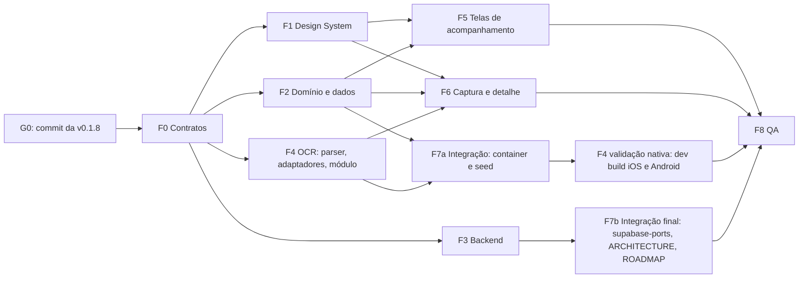

# v0.2 — Plano de implementação para agentes paralelos

> Escrito em 11/11/2026 na revisão de consistência da Fase A (crítico de consistência), depois de ler a spec da Head de Produto, o calendário PNI, `DESIGN.md`, `docs/DESIGN_SYSTEM.md`, o protótipo v3, `ocr-tecnico.md`, `dados-saude-backend.md`, o ADR 0001, `docs/ARCHITECTURE.md` e `eslint.config.js`.
> Comportamento, copy e aceite: `docs/features/v0.2-saude-da-familia.md` (prevalece em caso de conflito). Forma: `DESIGN.md` e `docs/DESIGN_SYSTEM.md`. Técnica: `ocr-tecnico.md`, `dados-saude-backend.md`.
> **Portão G0:** nenhuma fatia começa antes do commit da v0.1.8, que está em andamento no `src/`. Commit, push e PR só quando o Douglas pedir.

## 1. Regras para todos os agentes

1. **Posse de arquivos disjunta.** Cada fatia só cria ou edita os caminhos da sua linha na §2. Precisou mexer em arquivo de outra fatia? Peça ao dono, ou ao Tech Lead se o dono já terminou. Não edite "só uma linha".
2. **Contratos congelados** (§3). Os nomes exportados e as assinaturas são os da §3. Mudar um contrato exige aviso do Tech Lead a todas as fatias que o consomem e registro na §7.
3. **Sem dependência npm nova.** `react-native-svg` 15.16.0 já está instalado (gráficos). O ML Kit entra como dependência Gradle **dentro** de `modules/document-text/android/build.gradle`, não no `package.json`. Se alguma fatia achar que precisa de pacote, ela para e pede ao Tech Lead (com `npx expo install`, nunca `npm add`).
4. **FSD e Clean** (`eslint.config.js`): camada só importa camada abaixo; slice não importa slice da mesma camada; fora do slice, só pela API pública (`@/<camada>/<slice>`); `domain/` não importa React, RN, Expo, Supabase, `data/` nem `ui/` (isso inclui `@/shared/ui`); `data/` não importa `ui/`.
5. **Expo SDK 58.** Antes de tocar API do Expo/RN, leia a doc da versão: `https://docs.expo.dev/versions/v58.0.0/`. `ios/` e `android/` são gerados (CNG) e nunca editados.
6. **Copy clínica** só com os textos da spec (§3.2 e A1–A15). Copy nova vai para a Q8 da spec antes de virar texto final.
7. **Privacidade:** nenhum texto lido pelo OCR em log, `console.*`, AsyncStorage, chave de query ou arquivo. Nenhum dado de saúde em log de Edge Function.
8. **Pronto de qualquer fatia:** `npm run typecheck`, `npm run lint` (zero avisos) e `npm test` verdes, com a saída real colada no relatório. Fatias de banco também rodam `npm run db:test`. O relatório diz o que não foi verificado e por quê.

## 2. Fatias e posse de arquivos

| Fatia | Papel | Posse exclusiva (cria/edita) | Depende de | Entrega da spec |
|---|---|---|---|---|
| **F0 Contratos** | Tech Lead | Arquivos de contrato da §3 (listados em §3.0), `src/shared/lib/di/index.ts`, `src/shared/lib/local-db/types.ts`, `src/shared/lib/format.ts` (novo, L7), `src/shared/lib/index.ts`, `src/shared/lib/testing/**` | G0 | base de 0.2.2 |
| **F1 Design System** | Designer + Mobile | `src/shared/ui/**`, `src/entities/health-record/ui/recordTypeAppearance.ts` | F0 (só para começar junto) | 0.2.1 |
| **F2 Domínio e dados (app)** | Mobile | `src/entities/{measurement,vaccine,medication}/**` exceto `ui/**`; `src/features/{add-measurement,record-vaccine-dose,manage-medication,health-overview}/**` exceto `ui/**`; `src/features/add-record/**`; `src/features/delete-record/**`; `src/entities/health-record/data/local-health-record-repository*.ts`; `src/entities/member/data/local-member-repository*.ts`; `src/entities/session/data/local-data-export-gateway*.ts`; `src/entities/consent/domain/**` (termo v2) | F0 | 0.2.2 |
| **F3 Backend** | Backend | `supabase/migrations/20261111000004_health_data.sql`, `supabase/tests/04_health_data.test.sql`, `supabase/tests/01_schema.test.sql`, `supabase/functions/export-my-data/**`, `docs/BACKEND.md` | F0 (nomes de colunas da §3.5) | 0.2.3 (lado banco) |
| **F4 OCR** | Mobile + Tech Lead | `modules/document-text/**`, `src/features/read-document/**` (inclui `ui/ScanProgress.tsx`) | F0; F1 para o `ScanProgress` (só `ProgressSteps`) | 0.2.10 (parser e leitor demo), 0.2.11, 0.2.12 |
| **F5 Telas de acompanhamento** | Mobile | `src/app/**`; `src/screens/**` exceto `new-record` e `record-detail`; `src/widgets/**` exceto `document-review`; `src/entities/{measurement,vaccine,medication}/ui/**`; `src/entities/member/ui/**`; `src/features/{add-measurement,record-vaccine-dose,manage-medication}/ui/**` | F1, F2 | 0.2.4 a 0.2.9 e o reskin v3 das telas existentes |
| **F6 Captura e detalhe** | Mobile | `src/screens/new-record/**`, `src/screens/record-detail/**`, `src/widgets/document-review/**`, `src/widgets/attachment-picker/**` | F1, F2, F4 | 0.2.10 (revisão e gravação), A15 |
| **F7 Integração** | Tech Lead | `src/application/**` (container, `supabase-ports.ts`, seed demo e testes), `eslint.config.js`, `docs/ARCHITECTURE.md`, `docs/ROADMAP.md` (status) | F2, F4 (F7a); todas (F7b) | fecha 0.2.2, 0.2.3 e 0.2.11 |
| **F8 QA** | QA | `docs/qa/**` | todas | 0.2.13 |

Notas de posse:
- `index.ts` de cada slice novo é criado na F0 e passa ao dono do slice (F2 nas entities e features de domínio, F4 em `read-document`). A F0 também cria `ui/index.ts` vazio (`export {};`) nas entities e features novas, e o `index.ts` do slice já reexporta `./ui`. Assim a F5 preenche `ui/` sem tocar no `index.ts` da F2.
- `src/shared/lib/**` congela depois da F0. Mudança posterior passa pela F7.
- `package.json`, `app.json`, `tsconfig.json` e `eslint.config.js` só mudam pela F7 (ou F0, para `tsconfig`, se precisar). A expectativa é **não mexer** em `package.json` nem em `app.json`: o módulo local não tem config plugin.
- A F5 é grande. Depois que a F5.0 cria todas as rotas e telas vazias, ela pode ser dividida entre agentes por pasta de tela (§4.1), sem sobreposição.

## 3. Contratos congelados na F0

### 3.0 Arquivos que a F0 cria

```
src/entities/measurement/{index.ts, domain/types.ts, domain/ports.ts, domain/reference.ts, domain/reference.test.ts, domain/analyte-catalog.ts, domain/spoken-unit.ts, ui/index.ts}
src/entities/vaccine/{index.ts, domain/types.ts, domain/ports.ts, domain/vaccine-aliases.ts, domain/vaccine-aliases.test.ts, ui/index.ts}
src/entities/medication/{index.ts, domain/types.ts, domain/ports.ts, domain/duration.ts, domain/duration.test.ts, ui/index.ts}
src/features/read-document/{index.ts, domain/document-text.ts, domain/suggestions.ts}
src/features/{add-measurement,record-vaccine-dose,manage-medication,health-overview}/{index.ts, ui/index.ts}
src/shared/lib/di/index.ts             # + measurements, vaccineDoses, medications, documentText
src/shared/lib/local-db/types.ts       # + measurements, vaccineDoses, medications, vaccineRuleDismissals
src/shared/lib/format.ts (+ test)      # formatDecimal('7.4') → '7,4'; formatShortDate → '12 de out. de 2026'; formatMonthYear → 'outubro de 2026'; formatAxisDate → 'mar./25'
```

A F0 implementa só o que é dado puro ou regra de poucas linhas que duas fatias usam: `computeFlag` (R1), `medicationEndOn` (R6), `spokenUnit`, `ANALYTES`/`VITALS`/`UNIT_ALIASES`/`GROUP_TITLES` (Apêndice B.1 do `ocr-tecnico.md`) e `VACCINE_ALIASES` (Apêndice B.2, já com os códigos do PNI). Os testes de limite da R1 e da R6 entram junto. O resto da §3 entra como tipo e assinatura; a implementação é da fatia dona.

### 3.1 `@/entities/measurement`

```ts
export type MeasurementKind = 'lab' | 'vital';
export type MeasurementOrigin = 'ocr' | 'manual';
export type MeasurementContext = 'fasting' | 'post_meal' | 'other';
/** Mesmos literais de ReferenceState (@/shared/ui). O domínio não importa ui/. */
export type ReferenceFlag = 'in' | 'high' | 'low' | 'none';
export type VitalCode = 'bp' | 'glucose_capillary' | 'weight' | 'height';

export interface Measurement {
  id: string; familyId: string; memberId: string;
  kind: MeasurementKind;
  code: string;                 // ANALYTES[].code, VitalCode ou 'other'
  label: string;
  value: number;                // sistólica em 'bp'
  value2: number | null;        // diastólica; não nulo se e só se code = 'bp'
  unit: string;
  referenceLow: number | null; referenceHigh: number | null; referenceText: string | null;
  takenOn: string;              // YYYY-MM-DD
  takenAt: string | null;       // HH:mm
  context: MeasurementContext | null; // só em 'glucose_capillary'
  note: string | null;          // ≤ 140
  sourceRecordId: string | null;
  origin: MeasurementOrigin;
  createdAt: string; updatedAt: string;
}
export type NewMeasurement = Omit<Measurement, 'id' | 'createdAt' | 'updatedAt'>;
export type MeasurementChanges = Partial<Pick<Measurement,
  'label' | 'value' | 'value2' | 'unit' | 'referenceLow' | 'referenceHigh' | 'referenceText' | 'takenOn' | 'takenAt' | 'context' | 'note'>>;

export interface MeasurementRepository {
  listByMember(memberId: string): Promise<Measurement[]>;
  listByFamily(familyId: string): Promise<Measurement[]>;
  listBySourceRecord(recordId: string): Promise<Measurement[]>;
  createMany(items: NewMeasurement[]): Promise<Measurement[]>;
  update(id: string, changes: MeasurementChanges): Promise<Measurement>;
  remove(id: string): Promise<void>;
}

// Catálogo (F0, Apêndice B.1 do ocr-tecnico.md, com o código free_t4)
export type AnalyteGroup = /* B.1 */ string; export interface Analyte { /* B.1 */ }
export const ANALYTES: Analyte[]; export const VITALS: { code: VitalCode; label: string; unit: string }[];
export const UNIT_ALIASES: Record<string, string>; export const GROUP_TITLES: Record<AnalyteGroup, string>;
export function findAnalyte(code: string): Analyte | undefined;
export function computeFlag(value: number, low: number | null, high: number | null): ReferenceFlag; // R1 (F0)
export function spokenUnit(unit: string): string; // 'mg/dL' → 'miligramas por decilitro' (F0)

// Regras (F2)
export interface MeasurementSeries {
  key: string;                    // R2: code, ou label normalizado em 'other'
  code: string; label: string;
  unit: string;                   // unidade do resultado mais recente
  points: Measurement[];          // todos, por takenOn e takenAt crescentes
  latest: Measurement;
  chart: Measurement[];           // R3: mesma unidade do mais recente; gráfico só com ≥ 2
  offChart: Measurement[];        // "Unidade diferente, fora do gráfico"
  band: { low: number; high: number } | null; // R4
}
export function seriesKey(m: Pick<Measurement, 'code' | 'label'>): string;   // R2
export function buildSeries(measurements: Measurement[]): MeasurementSeries[]; // só kind 'lab'
export function latestOutOfRange(measurements: Measurement[], today: string): Measurement[]; // R15
export function vitalSeries(measurements: Measurement[], code: VitalCode): Measurement[];   // F5, sem faixa (S3)

// model (F2)
export const measurementKeys: { byMember(id: string): readonly unknown[]; byFamily(id: string): readonly unknown[]; bySource(id: string): readonly unknown[] };
export function useMeasurementRepository(): MeasurementRepository;
export function useMemberMeasurements(memberId: string): UseQueryResult<Measurement[]>;
export function useFamilyMeasurements(familyId: string): UseQueryResult<Measurement[]>;

// ui (F5)
export function MeasurementRow(props: { measurement: Measurement; origin: string; label?: string; onPress?: () => void }): JSX.Element;
```

### 3.2 `@/entities/vaccine`

```ts
export type DoseKey = 'D1' | 'D2' | 'D3' | 'R1' | 'R2' | 'R' | 'DU' | 'ANUAL' | 'PERIODICA' | 'OUTRA';
export interface VaccineDose {
  id: string; familyId: string; memberId: string;
  vaccineCode: string;            // calendario-vacinal-pni.md §2, ou 'other'
  vaccineName: string | null;     // obrigatório em 'other'
  doseKey: DoseKey; doseLabel: string;
  appliedOn: string | null;       // null = "Não sei a data"
  lot: string | null; location: string | null;
  sourceRecordId: string | null; origin: 'ocr' | 'manual';
  createdAt: string; updatedAt: string;
}
export type NewVaccineDose = Omit<VaccineDose, 'id' | 'createdAt' | 'updatedAt'>;
export type VaccineDoseChanges = Partial<Pick<VaccineDose, 'vaccineCode' | 'vaccineName' | 'doseKey' | 'doseLabel' | 'appliedOn' | 'lot' | 'location'>>;
export type DismissalReason = 'had_disease' | 'professional_advice' | 'other';
export interface VaccineRuleDismissal { id: string; familyId: string; memberId: string; ruleId: string; reason: DismissalReason; note: string | null; createdAt: string }
export type NewVaccineRuleDismissal = Omit<VaccineRuleDismissal, 'id' | 'createdAt'>;

export interface VaccineDoseRepository {
  listByMember(memberId: string): Promise<VaccineDose[]>;
  listByFamily(familyId: string): Promise<VaccineDose[]>;
  listBySourceRecord(recordId: string): Promise<VaccineDose[]>;
  createMany(items: NewVaccineDose[]): Promise<VaccineDose[]>;
  update(id: string, changes: VaccineDoseChanges): Promise<VaccineDose>;
  remove(id: string): Promise<void>;
  listDismissals(memberId: string): Promise<VaccineRuleDismissal[]>;
  listFamilyDismissals(familyId: string): Promise<VaccineRuleDismissal[]>;
  dismiss(input: NewVaccineRuleDismissal): Promise<VaccineRuleDismissal>;
  undismiss(id: string): Promise<void>;
}

// Catálogo (F0: aliases; F2: calendário)
export const VACCINE_ALIASES: { code: string; label: string; aliases: string[] }[]; // B.2 com códigos PNI
export const SCHEDULE_VERSION: 'PNI-2026-ed4';
export interface VaccineScheduleRule { /* calendario-vacinal-pni.md §9, doseKey: DoseKey */ }
export const VACCINE_SCHEDULE: VaccineScheduleRule[];
export function vaccineLabel(code: string, vaccineName?: string | null): string;
export function doseLabelOf(key: DoseKey): string; // 'D1' → '1ª dose', 'DU' → 'Dose única'…

// Regras R7–R14 (F2)
export type VaccineStatus = 'late' | 'due' | 'confirm' | 'next' | 'planned' | 'noRecord' | 'applied' | 'notApplicable';
export interface RuleEvaluation { rule: VaccineScheduleRule; status: VaccineStatus; dueFrom: string | null; dismissal: VaccineRuleDismissal | null }
export interface VaccineEvaluation {
  missingBirthDate: boolean;      // R13
  pending: RuleEvaluation[];      // late → due → confirm → next (F3.1)
  applied: VaccineDose[];         // mais recente primeiro; sem data por último
  calendar: RuleEvaluation[];     // regras automáticas da faixa
  other: VaccineScheduleRule[];   // automatic = false (F3.8)
  notApplicable: RuleEvaluation[];
}
export function evaluateVaccines(input: { birthDate: string | null; doses: VaccineDose[]; dismissals: VaccineRuleDismissal[]; today: string }): VaccineEvaluation;
export function isUpToDate(e: VaccineEvaluation): boolean; // R14

// model (F2)
export const vaccineKeys: { byMember(id: string): readonly unknown[]; byFamily(id: string): readonly unknown[]; dismissals(id: string): readonly unknown[] };
export function useVaccineDoseRepository(): VaccineDoseRepository;
export function useMemberVaccines(memberId: string): UseQueryResult<{ doses: VaccineDose[]; dismissals: VaccineRuleDismissal[] }>;

// ui (F5)
export function VaccineStatusRow(props: { vaccineName: string; status: VaccineStatus; detail: string; doses?: string; onPress?: () => void }): JSX.Element;
```

### 3.3 `@/entities/medication`

```ts
export interface Medication {
  id: string; familyId: string; memberId: string;
  name: string; dosage: string | null; instructions: string | null;
  startOn: string; endOn: string | null;  // null = uso contínuo (escolha explícita)
  sourceRecordId: string | null; origin: 'ocr' | 'manual';
  createdAt: string; updatedAt: string;
}
export type NewMedication = Omit<Medication, 'id' | 'createdAt' | 'updatedAt'>;
export type MedicationChanges = Partial<Pick<Medication, 'name' | 'dosage' | 'instructions' | 'startOn' | 'endOn'>>;
export interface MedicationRepository {
  listByMember(memberId: string): Promise<Medication[]>;
  listByFamily(familyId: string): Promise<Medication[]>;
  listBySourceRecord(recordId: string): Promise<Medication[]>;
  createMany(items: NewMedication[]): Promise<Medication[]>;
  update(id: string, changes: MedicationChanges): Promise<Medication>;
  remove(id: string): Promise<void>;
}
export type MedicationDuration = { kind: 'days'; days: number } | { kind: 'continuous' } | { kind: 'unknown' };
export function medicationEndOn(startOn: string, duration: MedicationDuration): string | null | undefined; // R6 (F0); undefined = escolher
export type MedicationStatus = 'active' | 'scheduled' | 'ended';
export function medicationStatus(m: Pick<Medication, 'startOn' | 'endOn'>, today: string): MedicationStatus; // R5 (F2)
export const medicationKeys: { byMember(id: string): readonly unknown[]; byFamily(id: string): readonly unknown[] };
export function useMedicationRepository(): MedicationRepository;
export function useMemberMedications(memberId: string): UseQueryResult<Medication[]>;
export function MedicationRow(props: { name: string; dosage?: string | null; instructions?: string | null; startOn: string; endOn: string | null; status: MedicationStatus; origin: string; onPress?: () => void }): JSX.Element; // F5
```

### 3.4 Features

```ts
// @/features/read-document (F4) — porta e tipos: ocr-tecnico.md §b.2 e §c.1, com o "Alinhamento com a spec"
export type { DocumentTextExtractor, DocumentTextAvailability, ExtractedText, HealthDocumentSuggestions,
  LabResultSuggestion, VaccineSuggestion, MedicationSuggestion, ParseWarning, Confidence, ReadDocumentResult };
export const READ_DOCUMENT_MAX_FILES: 5, READ_DOCUMENT_MAX_PAGES: 5, READ_DOCUMENT_TIMEOUT_MS: 20_000;
export function readDocument(deps: { extractor: DocumentTextExtractor }, files: LocalFile[], options: ReadDocumentOptions): Promise<ReadDocumentResult | null>;
export function useReadDocument(onProgress?: (p: { current: number; total: number }) => void): { mutateAsync; reset; isPending; availability: DocumentTextAvailability; cancel(): void };
export function createDeviceDocumentTextExtractor(native?: DocumentTextNativeModule | null): DocumentTextExtractor | null;
export function createDemoDocumentTextExtractor(delayMs?: number): DocumentTextExtractor;
export const unavailableDocumentTextExtractor: DocumentTextExtractor;
export function ScanProgress(props: { current: number; total: number; thumbnailUri?: string; onSkip(): void }): JSX.Element;

// @/features/add-record (F2) — extensão aditiva; sem healthData o comportamento atual não muda
export interface HealthDataInput {
  measurements: Omit<NewMeasurement, 'familyId' | 'memberId' | 'sourceRecordId' | 'origin'>[];
  vaccineDoses: Omit<NewVaccineDose, 'familyId' | 'memberId' | 'sourceRecordId' | 'origin'>[];
  medications: Omit<NewMedication, 'familyId' | 'memberId' | 'sourceRecordId' | 'origin'>[];
}
// AddRecordInput ganha healthData?: HealthDataInput; deps ganham measurements, vaccineDoses, medications.
// Falha em qualquer createMany → compensação (remove anexos e registro) e DomainError('record/health-data-failed').
// useAddRecord().mutateAsync aceita o mesmo input.

// @/features/delete-record (F2) — sem mudança de assinatura; a contagem da A15 vem de useRecordLinkedItems.

// @/features/health-overview (F2)
export interface MemberHealthSummary {
  vaccines: { missingBirthDate: boolean; upToDate: boolean; pendingCount: number; first: RuleEvaluation | null };
  recentLabs: MeasurementSeries[];          // ≤ 5, últimos 12 meses, fora da faixa primeiro (F6.2)
  activeMedications: Medication[];          // ≤ 5 (R5)
  vitals: Partial<Record<VitalCode, Measurement>>;
}
export function buildMemberSummary(input: { member: Member; measurements: Measurement[]; doses: VaccineDose[]; dismissals: VaccineRuleDismissal[]; medications: Medication[]; today: string }): MemberHealthSummary;
export type AttentionKind = 'vaccine-late' | 'lab-out-of-range' | 'vaccine-due' | 'vaccine-next';
export interface AttentionItem {
  id: string; kind: AttentionKind; memberId: string; date: string;
  title: string;      // "{Primeiro nome} · {o quê}" (F7.3)
  detail: string;     // estado em texto
  target: { screen: 'vaccines'; memberId: string } | { screen: 'exam-series'; memberId: string; seriesKey: string };
}
export interface FamilyAttention {
  hasHealthData: boolean;                   // false → cartão oculto (F7.6)
  items: AttentionItem[];                   // todos, ordenados (F7.2); a tela mostra 5
  vaccines: { upToDate: number; total: number; withoutBirthDate: number }; // F7.4
}
export function buildFamilyAttention(input: { members: Member[]; measurements: Measurement[]; doses: VaccineDose[]; dismissals: VaccineRuleDismissal[]; today: string }): FamilyAttention;
export function useMemberHealthSummary(memberId: string): { summary?: MemberHealthSummary; sections: Record<'vaccines' | 'labs' | 'medications' | 'vitals', { isLoading: boolean; error: unknown; retry(): void }> };
export function useFamilyAttention(familyId: string): UseQueryResult<FamilyAttention>;
export function useRecordLinkedItems(recordId: string): UseQueryResult<{ measurements: Measurement[]; vaccineDoses: VaccineDose[]; medications: Medication[]; count: number }>;

// @/features/add-measurement (F2 domínio e model; F5 ui)
export function validateLabInput(input: unknown): NewMeasurement;           // F2.5, F2.6 ("Digite um número, por exemplo 13,2.")
export function validateVitalInput(input: unknown): { value: NewMeasurement; needsConfirmation: boolean }; // F5.2 bloqueia; F5.3 → A14
export function useAddMeasurement(), useUpdateMeasurement(), useDeleteMeasurement();
export function LabResultForm(props: { memberId: string; onSaved(): void }): JSX.Element;      // F5
export function VitalEntryForm(props: { memberId: string; kind?: VitalCode; onSaved(): void }): JSX.Element; // F5

// @/features/record-vaccine-dose (F2 domínio e model; F5 ui)
export function validateDoseInput(input: unknown): NewVaccineDose;          // F3.5
export function useRecordVaccineDose(), useDismissVaccineRule(), useUndoDismissal();
export function VaccineDoseForm(props: { memberId: string; onSaved(): void }): JSX.Element;
export function DismissRuleSheet(props: { memberId: string; ruleId: string; onDone(): void }): JSX.Element;

// @/features/manage-medication (F2 domínio e model; F5 ui)
export type MedicationPlan = { kind: 'continuous' } | { kind: 'until'; endOn: string } | { kind: 'days'; days: number };
export function buildMedicationInput(input: { memberId: string; familyId: string; name: string; dosage?: string; instructions?: string; startOn: string; plan: MedicationPlan }): NewMedication; // F4.3, F4.5
export function useAddMedication(), useEndMedication(), useDeleteMedication();
export function MedicationForm(props: { memberId: string; onSaved(): void }): JSX.Element;
```

### 3.5 Banco, DI e modo demo

- Colunas e restrições: `dados-saude-backend.md` §2 (versão 0.2). Mapeadores snake ↔ camel nos adaptadores `supabase-*` da F2 usam exatamente essas colunas.
- `DEPENDENCY_KEYS`: `measurements`, `vaccineDoses`, `medications`, `documentText`.
- `LOCAL_COLLECTIONS`: `measurements`, `vaccineDoses`, `medications`, `vaccineRuleDismissals`.
- `AppPorts` (F7): `measurements: MeasurementRepository`, `vaccineDoses: VaccineDoseRepository`, `medications: MedicationRepository`, `documentText: DocumentTextExtractor`.
- Termo: `CURRENT_TERMS_VERSION = '2026-11-v2'` (F2); parágrafo novo na tela de consentimento (F5), texto da spec P1.

### 3.6 `@/shared/ui` (F1)

Novos exports com as props do `DESIGN.md` › Components (revisado em 11/11/2026): `SectionHeader`, `MetricValue` (com `unitSpoken`), `StateChip`, `RangeBar`, `SummaryCard`, `StatTile`, `Sparkline`, `TrendChart`, `AttentionList`, `SuggestedField`, `ProgressSteps`; tipos `ReferenceState`, `ReferenceRange`, `Confidence`; `Screen` com `heading`; `headerOptions(theme, { contentTitle })`; `Avatar` com `ring`; ícones semânticos novos. Tudo aditivo: nenhuma API existente sai, então as telas atuais compilam durante a migração.

## 4. Ordem e paralelismo



- **Onda 1 (paralela, depois da F0):** F1, F2, F3 e F4 (parser, adaptadores, Swift e Kotlin). Nenhuma toca arquivo de outra.
- **Onda 2:** F5 e F6, assim que F1 exportar os componentes novos e F2 exportar os hooks da §3. Elas podem começar antes, contra os contratos e com fakes no `renderWithDependencies`, mas só fecham depois do merge de F1 e F2.
- **F7a** liga as portas e o leitor no container (`createContainer` escolhe nativo, demo ou indisponível como no `ocr-tecnico.md` §b.4) assim que F2 e F4 estiverem no tronco. Só então a F4 faz o development build.
- **F7b** depois da F3: `supabase-ports.ts`, `docs/ARCHITECTURE.md` (pasta `modules/`, entities novas, `AppContainer`), regra `no-console: error` em `src/features/read-document/**` e `modules/document-text/src/**`, e os status do ROADMAP.

### 4.1 Divisão interna da F5 (por pasta, depois da F5.0)

| Sub-fatia | Posse | Spec |
|---|---|---|
| F5.0 Rotas | `src/app/**`: rotas da spec §9 (revisada) com telas vazias; `formSheet` + `Screen presentation="sheet"` | — |
| F5.1 Sinais vitais | `screens/member-vitals/**`, `screens/new-vital/**`, `features/add-measurement/ui/VitalEntryForm*` | 0.2.4 |
| F5.2 Exames | `screens/member-exams/**`, `screens/exam-series/**`, `screens/new-measurement/**`, `features/add-measurement/ui/LabResultForm*`, `entities/measurement/ui/**` | 0.2.5 |
| F5.3 Medicamentos | `screens/member-medications/**`, `screens/new-medication/**`, `features/manage-medication/ui/**`, `entities/medication/ui/**` | 0.2.6 |
| F5.4 Vacinas | `screens/member-vaccines/**`, `screens/new-vaccine-dose/**`, `features/record-vaccine-dose/ui/**`, `entities/vaccine/ui/**` | 0.2.7 |
| F5.5 Resumo da pessoa | `screens/member-timeline/**` (vira "Resumo \| Documentos"), `widgets/member-health-summary/**` (novo), `entities/member/ui/**` | 0.2.8 |
| F5.6 Painel e reskin | `screens/family-home/**` (cartão "Para acompanhar"), `widgets/family-attention/**` (novo), e o reskin v3 das demais telas existentes (`welcome`, `consent` com o parágrafo do termo v2, `sign-in`, `verify-code`, `create-family`, `first-members`, `manage-member`, `search`, `settings` com "Carregar família de exemplo" no demo) e `widgets/{member-form,floating-actions,attachment-viewer}/**` | 0.2.9 + v3 |

`features/add-measurement/ui/index.ts` é editado por F5.1 e F5.2: a F5.0 já escreve as duas linhas de reexportação para que nenhuma das duas precise tocá-lo.

## 5. Critérios de pronto por fatia

| Fatia | Pronto quando |
|---|---|
| F0 | `npm run check` verde; testes de limite de `computeFlag` (igual ao limite = `in`; só piso; só teto; sem limite = `none`) e `medicationEndOn` (7 dias a partir de 05/11/2026 → 11/11/2026; contínuo → `null`; desconhecido → `undefined`); teste de que todo `VACCINE_ALIASES[].code` existe na tabela de códigos do PNI; `grep` sem `'normal'` como valor de faixa |
| F1 | `tokens.test.ts` com todos os pares da tabela de contraste do `DESIGN.md` (0 falhas); testes de `RangeBar`, `MetricValue` (rótulo de acessibilidade com `unitSpoken`) e `TrendChart` (resumo obrigatório); `Catalog` com os 4 estados clínicos nos dois temas; capturas claro, escuro e AX5 no iOS 26.5 (binário e checkout informados); testes existentes de telas continuam verdes |
| F2 | Testes de domínio com **todos** os exemplos das F2.4, F3.3, F4.2 e F5.2/F5.3 da spec (datas fixas, hoje = 11/11/2026); R7 por calendário (aniversário + meses, véspera e dia exato); R9 com 30 dias exatos (Pendente) e 31 (Atrasada); R10 sem "atrasada"; R11 dT + 10 anos; R12 ano civil, 2 doses na primeira vez e dose sem data fora do ano; R14; R15 com 12 meses; F7.2 ordem por tipo e data sem ordenar pessoas; adaptadores locais com cascatas (registro e membro), únicos e exportação das 4 coleções; `addRecord` com `healthData` (sucesso, compensação, sem `healthData` igual a hoje); termo `2026-11-v2` pedindo novo aceite no fluxo de sessão |
| F3 | `npm run db:test` verde com `04_health_data.test.sql` (34) e `01_schema` atualizado; `02` continua 68/68; exportação com `format_version: 2` e as 4 coleções; nenhum valor de saúde em log da Edge Function |
| F4 | Fixtures do `ocr-tecnico.md` §e atualizados ao "Alinhamento com a spec" e verdes; casos de borda; adaptadores nativo (módulo falso), demo e indisponível; `readDocument` com 5 páginas, 20 s, nascimento e A11; teste de privacidade (zero `console.*`); corpus de 20 documentos fictícios com as metas da §2 da spec (≥ 90% analitos, ≥ 85% data e tipo). Nativo: `swiftc -typecheck` e o roteiro do §h.3 no simulador iOS 26.5 com development build (0.2.11); no Android, emulador próprio (não os AVDs de outros projetos) com JDK 17 e `ANDROID_HOME` exportado, ou "não verificado" registrado (0.2.12) |
| F5 | Cada critério EARS da F2–F7 vira teste de tela (Testing Library) com os textos exatos; estados vazio, carregando, erro e parcial; A1/A3/A4/A5/A13 nos rodapés; teste de snapshot de textos sem palavras vetadas nem "!" nas telas de saúde (métrica "Calma" da spec); toques Família → gráfico de HbA1c ≤ 3; roteiro no simulador em claro, escuro e AX5 |
| F6 | Critérios F1.4 a F1.15 em teste de tela com extrator falso; A15 com o `{n}` certo; "Documentos" do MVP sem regressão; teste que procura um trecho do texto simulado no AsyncStorage depois da revisão e não acha (F1.15) |
| F7 | `createContainer`: demo sem módulo → demo; Supabase sem módulo → indisponível; módulo presente → nativo (também em demo); `expo-doctor` sem erro novo; `docs/ARCHITECTURE.md` atualizado no mesmo conjunto de mudanças; lint com `no-console` nas pastas do OCR |
| F8 | Relatório em `docs/qa/` com plataforma, binário e checkout; proxy durante a leitura (0 bytes do app; métricas do ML Kit anotadas, Q7); VoiceOver e TalkBack; regressão do MVP |

## 6. Conflitos resolvidos nesta revisão (resumo)

Detalhe em cada documento; decisões registradas na spec §13.

1. Entity `vaccination` (OCR, backend) → **`vaccine`** (spec, design).
2. Códigos de vacina do parser (`vip`, `pneumococcal_conjugate`, `meningococcal_c`, `meningococcal_acwy`, `hpv`) → códigos do PNI (`ipv`, `pcv10`/`pcv20`, `menc`, `menacwy`, `hpv4`), + `rsv`.
3. `t4_free` (spec) → `free_t4`; catálogo canônico no Apêndice B.1 do `ocr-tecnico.md`.
4. Vocabulário da faixa `normal`/`unknown` → `in`/`none`, igual ao `ReferenceState` do design; `referenceStateOf` → `computeFlag`.
5. Itens do OCR marcados por confiança → todos desmarcados (S4).
6. 10 páginas e 60 s por arquivo → 5 páginas e 20 s no total (F1.1, F1.2).
7. Botão "Preencher com o documento" → leitura automática com "Pular leitura".
8. Rota `record/review` (spec, design) → passo dentro de `record/new` (OCR); spec §9 revisada.
9. Modo demo no dev build: spec ajustada para usar o leitor real (senão 0.2.11 e 0.2.12 seriam inverificáveis).
10. Copy do OCR alinhada a A1, A6–A11 e aos estados da F1.
11. Linha sem unidade ou valor → "Confira" sem valor (F1.8).
12. A11 e data antes do nascimento: contrato do parser e de `readDocument` ganharam `patientName`, `member` e `patientNameMismatch`.
13. "Ver texto lido" removido.
14. Consentimento: OCR e ADR propunham manter o aceite; vale o termo v2 (P1).
15. Telemetria do ML Kit × "nada sai do celular": métrica e F1.3 refinadas, Q7 para o Douglas.
16. Backend sem `taken_at`, `context`, `note`, `dose_key`, `vaccine_name`, `applied_on` nulo e `vaccine_rule_dismissals`: SQL, pgTAP e exportação completados (a reexecutar).
17. Índice único de medição quebrava vários `other` no mesmo laudo; índice de dose usava `dose_label`.
18. Copy de exclusão do backend → A15 (a anterior era falsa para itens manuais com documento de origem).
19. Casas dos componentes: `features/scan-document` e `features/add-vital` (design) → `features/read-document`, `widgets/document-review`, `features/add-measurement`.
20. `ScanProgress` por página e destaque do trecho na imagem: o leitor não dá progresso por página nem posição → progresso por arquivo e trecho em texto.
21. Escopo do design acima da spec (Últimos resultados, mini-resumo por pessoa, linha extra na linha do tempo, séries na Busca, Compartilhar com médico, editar registro, Face ID, Quem vê a família) → fora da v0.2 (P2).
22. Exemplo da F7.3 ("Ana · Gripe de 2026 sem registro") contradizia a R12 e a R9 → "Dirce · Influenza de 2026, pendente".
23. `doseKey` `RN` do calendário fora da lista da spec → `DU` ("Dose ao nascer").
24. `MetricValue` lia unidade "via mapa do domínio" de dentro do `shared/ui` → prop `unitSpoken`; `MeasurementRow` recebe a origem pronta.

## 7. Lacunas que ninguém cobriu

| # | Lacuna | Proposta | Dono |
|---|---|---|---|
| L1 | Seed demo da 0.2.2 sem gatilho (o demo começa vazio) | `application/demo-seed.ts` (F7) + ação "Carregar família de exemplo" nos Ajustes só no demo (F5.6) | Head de Produto (aprovar), Tech Lead |
| L2 | Corpus de 20 documentos fictícios da §2: há 9 textos no `ocr-tecnico.md` | F4 escreve os 11 restantes (5 layouts de laboratório, Q2) | F4 + QA |
| L3 | Teste moderado com 5 + 5 pessoas: sem roteiro, recrutamento nem termo de participação | Roteiro em `docs/qa/` antes do beta | Head de Produto + QA |
| L4 | Rótulos dos 36 analitos, exclusão do leucograma diferencial e "mês = 30 dias" na duração da receita (pedido do `ocr-tecnico.md` §d) sem validação | Validar antes da 0.2.10 | Head de Produto |
| L5 | VPC13/VPC15 da rede privada não contam para a série `pcv` | Decidir se entram em `countsAs` | Head de Produto |
| L6 | Copy nova sem aprovação (Q8): "Lemos as primeiras 5 páginas.", "Descartar a leitura?", erros técnicos | Aprovar ou trocar | Head de Produto |
| L7 | Formatação pt-BR de número e data ("7,4", "12 de out. de 2026", "mar./25") sem dono | Funções puras em `src/shared/lib` criadas na F0 (`formatDecimal`, `formatShortDate`, `formatMonthYear`) | F0 |
| L8 | Edição e exclusão de dose e de medicamento (F2.9 cobre só exames) | Assumido: mesmo padrão da F2.9 (detalhe + `ConfirmSheet`), dentro de F5.3 e F5.4 | Head de Produto confirma |
| L9 | Telemetria do ML Kit no *Data safety* e na política de privacidade (Q7) | Texto antes da v0.3 (lojas) | Douglas + jurídico |
| L10 | Revisão jurídica do termo v2 e DPO (Q1) | Antes do beta real | Douglas |
| L11 | Busca não acha analitos nem medicamentos | Mantido fora (P2); registrar como melhoria | Head de Produto |
| L12 | `docs/BACKEND.md` e `docs/ARCHITECTURE.md` ainda descrevem só o MVP | F3 e F7b atualizam | F3, F7 |
| L13 | Tema escuro e AX5 do protótipo não cobrem as telas de medicamentos, sinais vitais e formulários | Capturas no simulador durante a F5 | F5 + Designer |
| L14 | Leitura com mais de um anexo: só o primeiro dispara a leitura (Q9) | Padrão provisório | Head de Produto |
